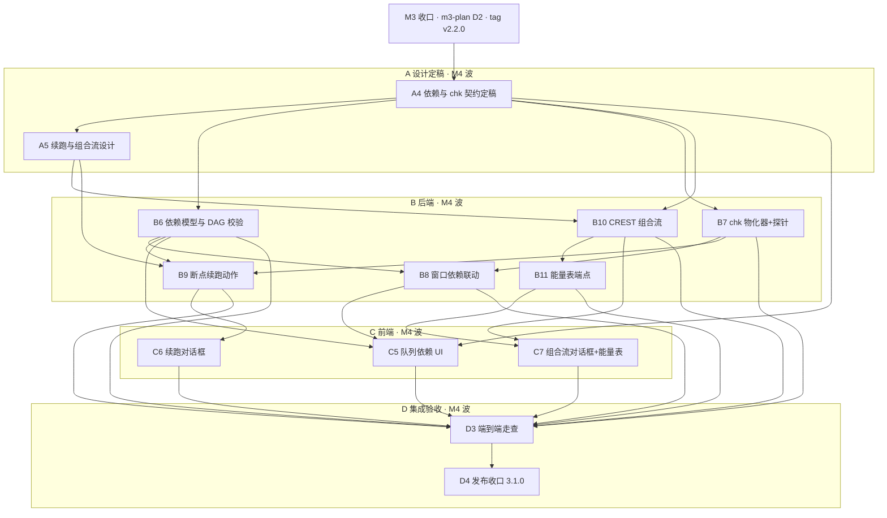
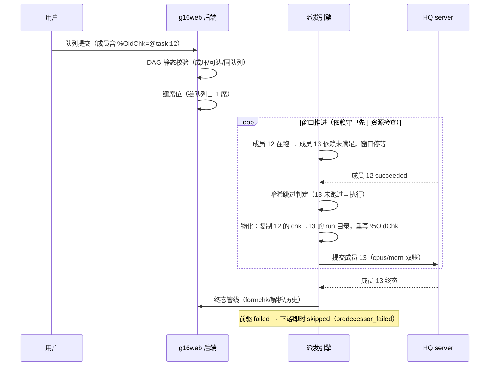
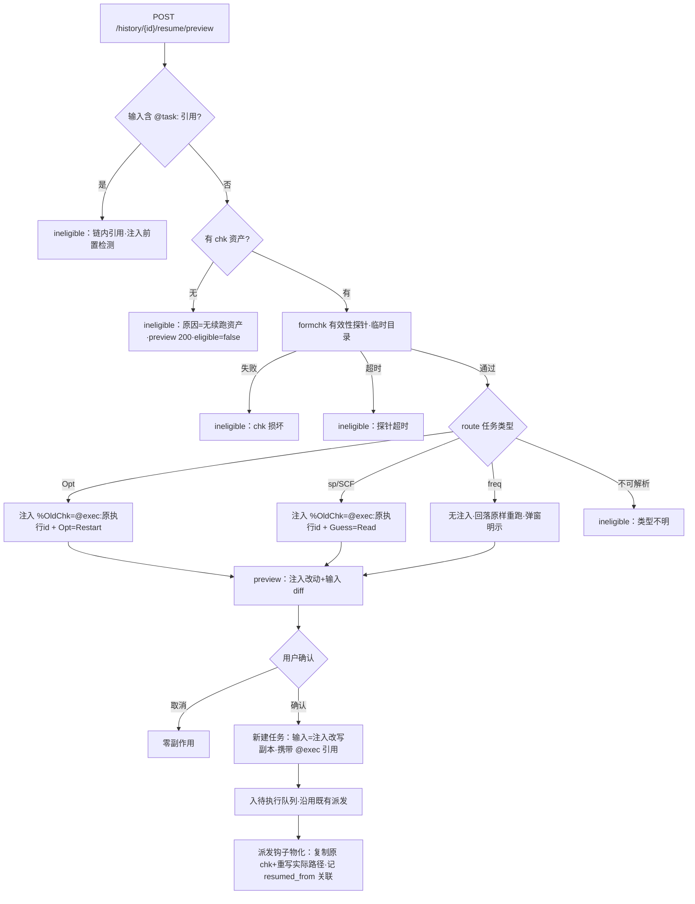
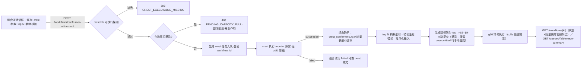

# M4 · 工作流 — 执行计划

> 状态：执行计划（依据 [roadmap.md](../specs/roadmap.md) §3 M4 制定）。
> 已经基线刷新与八轮独立审查修订定稿（2026-10-12）。
> 目标版本 3.1.0。
> **开工闸门 = M3 收口**（m3-plan D2：tag v2.2.0 已落位；unreleased
> 待冻结条目处置见 §0.4 条件 1）。
> §1–§9 结构同 m3-plan。本文与 roadmap 冲突时以 roadmap 为准；契约
> 基线 = 开工时 HEAD 的 docs/api/（M3 波新增端点/设置项已落库，其后
> v3.0.0 的契约演进——Queue 成员明细、cleanup scope、待执行成员重排
> PATCH——一并含入，v2.2.1 无契约变更），M4 新增一律走契约文档 diff
> （roadmap §4），不得漂移既有语义。

## 0. 目标、范围与依据

### 0.1 目标（= roadmap §3 M4 原文定义）

**M4 · 工作流**：任务链（opt→freq→sp 精修）、接入本机已有的 CREST/xtb
（`~/opt/xtb-6.7.1`、`~/opt/crest-3.0.2`）做构象搜索 → Gaussian 精修的组合
流。队列内任务间依赖与 chk 传递在此定稿（roadmap §7.1 建议方案：`%CHK` 符号
引用 + 提交时 DAG 校验 + 运行时物化路径，`%OldChk` 只读接续）。**自我续跑
同源**：failed/外部中断历史条目的「从断点续跑」动作复用同一物化机制——M1
已保全的 chk 先过 formchk 有效性探针，按任务类型注入 `Opt=Restart`（优化）
或 `%OldChk`+`Guess=Read`（SCF 初猜），弹窗展示注入改动与输入 diff，用户
确认后新建续跑任务入队、派发时经同一物化机制在新执行目录物化（freq 无中断
续跑语义，回落原样重跑）。

### 0.2 工作项编号（引 roadmap 原文段落顺序，WBS 表「对应项」列引用）

| 编号 | 工作项（roadmap 原文摘要） |
|---|---|
| M4.1 | 任务链（opt→freq→sp 精修），队列内任务间依赖与 chk 传递定稿（关闭 roadmap §7 开放事项 1） |
| M4.2 | 接入本机 CREST/xtb：构象搜索 → Gaussian 精修组合流 |
| M4.3 | `%CHK` 符号引用 + 提交时 DAG 校验 + 运行时物化路径；`%OldChk` 只读接续；依赖与并行窗口联动（依赖未满足者不得进入窗口） |
| M4.4 | 「从断点续跑」动作（复用同一物化机制；formchk 有效性探针；`Opt=Restart` / `%OldChk`+`Guess=Read` 注入矩阵；弹窗 diff 确认；freq 回落原样重跑） |
| M4.5 | 验收能力：一个按钮完成「构象搜索 + top N 构象精修」提交并汇总能量表；一条带 chk 依赖的任务链跑通 |

### 0.3 不做（非目标）

- 通用 crest 日志解析器（仅提取组合流所需的最小数据：构象坐标与能量，见 §2.3）。
- 独立 xtb 单点计算任务类型（xtb 仅作 crest 的引擎；独立 xtb 需求落地时按
  roadmap §2.3 重新评估）。
- 从零新建输入文件的通用编辑器（roadmap §6 backlog；M4 的程序化输入生成
  仅限「模板坐标替换」这一组合流内场景，见 §2.3）。
- 跨队列任务依赖、队列间 chk 引用（roadmap 限定「队列内任务间依赖」）。
- 正则堆领域解析（roadmap §4 禁止事项；crest 最小提取为既定豁免——
  roadmap §1 原则 2）。
- 前端页面单测（roadmap §7 开放事项 5② 决策延续：手动冒烟 + D 阶段走查
  清单，不引入 vitest；M3 同此）。
- 结果分析与可视化（M3 范围，见 [m3-plan.md](m3-plan.md)）。

### 0.4 前置条件（开工前必须检测并如实记录）

1. **M3 已收口**（m3-plan D2 完成，tag v2.2.0 已落位）：开工时无进行中
   的其他功能波（progress.json `in_progress` 为空或仅 M4）；`unreleased`
   无 **M4 波自身之外的未收口在途工作**——已提交入库、仅待版本冻结的
   插波条目不阻塞；当前 unreleased 存有 2026-10-04 更新域事故链的
   待冻结代码条目与本文档修订形成的 plans 条目——**条数不写死、
   以开工登记时 progress.json 实况为准**（硬计数在写入时点即过期），
   **建议开工登记前先冻结 v3.0.2 清空**——冻结为整行动作，plans 条目随行
   入库（计划修订记录属过程文档、非 M4 波交付物，不构成「M4 条目混入
   插波版本」；避免的只是其后 M4 实施条目与插波代码条目混入同一版本；
   发布属用户授权动作）；开工登记时按本条核对一次（「闸门实质已满足」
   须可证实，不作不可验证断言）。M4 开工前把「M4 工作流」登记入
   `in_progress`。A4 契约 diff 以开工时 HEAD 的 docs/api/ 为基线
   （避免 diff 基线漂移）。
2. `target/release/hq` 在位（**M4 硬依赖**——触及派发链路，B6–B10/e2e
   依赖——B7 物化器与派发器接线、B9 物化链复用与真机续跑走查、B10 的
   Task.kind 扩展与 crest 真机派发同需 hq 跑 e2e，与 §0.6/§9 风险 5
   口径对齐；缺失会静默跳过关键 e2e，违反 AGENTS.md §6.1 第 4 条）；
   **凡声称「全量 pytest 通过」时 hq 一律须在位**——既有 e2e 同受其
   制约，静默跳过即通过数虚高。
3. 真机资产在位（已实测确认）：`~/g16/g16`、`~/g16/formchk`（续跑探针）、
   `~/opt/xtb-6.7.1`、`~/opt/crest-3.0.2`（组合流）；D3 走查需真机 g16
   跑 chk 依赖链与断点续跑场景。
4. **批次闸门（B6 起后端实现启动前核对，非开工闸门）**：A4 契约 diff
   与 A5 设计定稿经用户评审通过（契约 diff 由 A4 一次携带、A5 交付设计
   定稿而非契约 diff；文档先行，roadmap §4）；roadmap §7 开放事项 1
   （任务间依赖与 chk 规范）随 A4 关闭（§6 进度同步含回填动作）。
   两项属 A4/A5 产出本身、开工时点不可能已满足，故由本清单拆出作为
   批次闸门——WBS 中 B6/B7/B9/B10 对 A4/A5 的依赖边即其执行载体。

### 0.5 依据

- roadmap：§2.1（领域模型/派发原则/成员数与只减不增）、§2.6（字段生命
  周期：跨里程碑扩展与历史冻结规则）、§2.7（输入空行规则——程序化输入
  生成沿用）、§3 M4、§5（风险表）、§7.1（任务间依赖与 chk 规范建议）、
  §8.6（journal 恢复语义——重入对账依据）、§8.8（HTTP/SSE 层——对账
  路径）。
- M0–M2 产出：`docs/api/` 契约四件套与 `web/src/`（store/engine/parse/
  services/routers）；M1 对账路径与重跑者识别（HQ job id 映射）。
- M1 遗产（M4 的直接依赖面）：非正常终止**仅保全 chk**至
  `run/<执行id>/protected/` 并落库 `chk_snapshot`（rwf 与 Gau-\* 自
  2026-10-04 清理边界修订起不再保全、异常终止即时收尸，roadmap M1 段
  已同步；`finalize.protect`，续跑探针的对象）；成功执行保留期内的
  `run/<eid>/input.chk`（链式物化溯源目标）。
- M3 产出（M4 的直接依赖面）：B1 解析服务与 `run/<id>/analysis.json`
  （能量表 g16 行取末次 SCF 双单位能量）；`HistoryEntry.result_ref` 链路。
- Gaussian 16 官方手册（gaussian-kb MCP 权威核查，2026-09-30）：
  - `%OldChk=file`（gaussian.com/link0）：指定 chk 的内容在本 job step 开始
    时复制为本 step 的 chk——从先前计算取数据而不破坏其 chk，即只读接续的
    原生机制。
  - `Opt=Restart`（gaussian.com/opt）：从 checkpoint 重启几何优化；整个
    route 只需 Opt 关键字 + 原选项 + Restart，无其他输入。
  - `Guess=Read`（gaussian.com/guess）：从 chk 读初猜（常配
    `Geom=Checkpoint`）；`Guess=(Only,Read)` 可仅做种群分析。
  - `formchk`（gaussian.com/utils）：二进制 chk → ASCII fchk；cclib 不解析
    fchk，二进制 chk 也不能直接作 `%Chk` 复用目标之外的格式（M4 探针与
    物化据此设计，见 §2.1/§2.2）。
- CREST 3.0.2 / xtb 6.7.1：本机发行目录与输出格式锚点随 A5 实测核验
  留痕（含 `XTB_PATH` 环境变量拼写与能量表输出单位）。

### 0.6 实施输入：现状核查结论（2026-09-30 实测、2026-10-11 复核，M4 视角）

| 事实 | 对计划的影响 |
|---|---|
| `engine/finalize.py`：非正常终止仅保全 chk 入 `protected/` 并落 `chk_snapshot`（rwf/Gau-\* 不再保全，2026-10-04 修订） | M4 续跑探针的对象即保全 chk（§2.2） |
| Task schema 无依赖字段、历史条目无 `resumed_from` | M4.3/M4.4 契约 diff 一次扩展（roadmap §2.6 规则 3）；存储迁移随 migrations 版本化（§2.2） |
| `~/opt/xtb-6.7.1`、`~/opt/crest-3.0.2` 在位；`~/g16/formchk` 在位 | B10 子进程调用 crest、B7/B9 探针调 formchk；可执行探测缺失时显式拒绝（不静默） |
| 契约基线 = 开工时 HEAD 的 docs/api/（M3 波新增 8 端点——analysis 六端点 + workspace-out + storage/usage，实测核对——与设置项已落库；其后 v3.0.0 契约演进——Queue 成员明细、cleanup scope、待执行成员重排 PATCH——一并含入；v2.2.1 无契约变更）；错误码全集载体在 openapi.yaml 文件头（`test_error_codes.py` 静态闸门） | 新增错误码随 A4 diff 登记，闸门自动覆盖 |
| openapi `info.version` 运行时从 `APP_VERSION` 动态覆盖（v2.1.0 SSOT 豁免口径） | 契约 diff 不手工追版本号；3.1.0 发布时随 VERSION/tag 自然演进 |
| `target/release/hq` 在位且 e2e 不回归（M1–M3 既有派发与解析链路，含 v2.2.x/v3.0.x 更新域与对账修复回归） | B6–B10 触及派发链路的回归防线（§9 风险 5） |

## 1. 任务分解与追踪（WBS）

单波：**A4–A5、B6–B11、C5–C7、D3–D4，目标版本 3.1.0**。阶段语义
与 m1/m2 计划一致：**A** 设计定稿（契约 diff，文档先行）→ **B** 后端 →
**C** 前端 → **D** 集成验收与发布。规模：S ≈ 半天内，M ≈ 1 天，L ≈ 2 天。
任务编号 A4/B6–B11/C5–C7/D3–D4 沿联合计划（M3 波见
[m3-plan.md](m3-plan.md)）。

| 编号 | 任务 | 产出物 | 验收标准（可验证） | 依赖 | 规模 | 对应项 |
|---|---|---|---|---|---|---|
| A4 | 任务链依赖与 chk 传递契约定稿（关闭 roadmap §7 开放事项 1） | §2.1 定稿 + 契约 diff（依赖语义、resume 端点、新错误码、mapping 增行） | 符号引用文法与推导规则定稿；DAG 校验规则含成环/可达/跨队列拒绝；与并行窗口、重排、哈希跳过、成员下限的交互逐条写明；用户评审通过 | D2 | L | M4.1/M4.3、roadmap §7.1 |
| A5 | 断点续跑与 CREST 组合流设计定稿 | §2.2/§2.3 定稿（注入矩阵、探针规格、组合流模板、能量表形状、crest 提取边界） | 注入矩阵覆盖 opt/scf/freq 三分支；组合流「一键提交」全链路时序定稿；crest/xtb 定位与配置项定稿；程序化输入生成仅限模板坐标替换 | A4 | L | M4.2/M4.4/M4.5 |
| B6 | 依赖模型与 DAG 校验（后端） | 符号引用解析器 + 提交/编辑时静态校验 + 新错误码落位 | 成环/不可达/跨队列引用/越成员边界引用逐一 422 且错误码正确；`test_error_codes.py` 通过；合法链提交通过 | A4 | M | M4.3 |
| B7 | chk 物化器（含 formchk 探针） | `engine/materialize.py`：派发前物化 %Chk/%OldChk 符号行（复制上游 chk 进本执行目录并重写）+ formchk 探针 | 物化后输入文件内无符号引用残留；上游原件零改动（哈希前后一致）；探针对「正常 chk/损坏 chk/缺 fchk 段」三分支判定正确 | A4 | L | M4.3/M4.4 |
| B8 | 派发窗口依赖联动 | 窗口守卫：依赖未满足成员不取入窗口；依赖失败 → 下游 skipped | FakeGateway 单测：依赖满足前窗口停等不越位（保序语义与资源停等叠加）；上游 failed → 下游 skipped（归因 predecessor_failed）；哈希跳过视为依赖满足且 chk 溯源其最近成功执行 | B6, B7 | M | M4.3 |
| B9 | 「从断点续跑」动作 | POST /history/{id}/resume/preview + POST /history/{id}/resume | 预览返回探针结果 + 注入改动 + 输入 diff；确认后在新执行目录物化并走既有派发；opt 注入 Opt=Restart、单点注入 %OldChk+Guess=Read、freq 回落原样重跑；无任何续跑资产（无保全 chk 且无可溯源的成功执行 chk——§2.2 两条取数路径）或探针失败时 ineligible 且原因明确 | A5, B6, B7 | L | M4.4 |
| B10 | CREST 任务类型与组合流生成 | task_kind 扩展（g16\|crest）+ crest 派发 + ensemble 提取 + top-N 精修队列程序化生成与自动入队 | crest 任务经 HQ 真机跑通（小分子）；ensemble 坐标/能量提取对 crest 3.0.2 输出正确；生成队列成员数=min(top_n, 实际构象数)（<2 不成队、组合流记 failed——§2.3）、route 来自模板；crest 可执行缺失时提交即拒（显式错误码） | A4, A5 | L | M4.2 |
| B11 | 能量表汇总与 workflow 查询端点 | GET /queues/{id}/energy-summary + GET /workflows/{id} + GET /workflows 列表（3 端点） | g16 成员能量取自 B1 解析（末次 SCF，附 hartree/eV 双单位）；crest 行仅见于 workflow 聚合、给相对能量（队列端点成员恒 g16，crest 不入队——§2.1）；workflow 聚合混排/部分完成态语义明确 | B10 | M | M4.5 |
| C5 | 队列编辑依赖 UI | 成员行「接续前置 chk」勾选辅助生成符号行 + DAG 错误提示 + 执行中页停等原因标注 | 勾选生成的 Link0 行与契约文法一致；DAG 校验错误逐成员内联提示；重排不改 @task:id 引用；停等原因（依赖停等/资源停等）在执行中页可见 | A4, B6, B8 | M | M4.3 |
| C6 | 断点续跑对话框 | 探针结果/注入改动/输入 diff/确认弹窗 | diff 展示与后端 preview 一致；ineligible 展示原因；确认后新任务出现于待执行队列 | B9 | M | M4.4 |
| C7 | 组合流对话框与能量表 | 一键提交对话框（crest 参数/top N/精修模板）+ 队列能量表展示 | 一个按钮完成「构象搜索 + top N 精修」全链路；能量表随成员完成增量刷新 | B10, B11 | M | M4.5 |
| D3 | M4 端到端验收走查（真机） | 走查记录 `docs/plans/m4-acceptance.md`（§7.2 路径逐条留痕，截图存本地不入库） | roadmap M4 验收段对照核验 + §7.2 走查路径逐条通过（含 chk 链、断点续跑、组合流） | B6–B11, C5–C7 | M | M4 验收 |
| D4 | M4 发布收口（3.1.0） | CHANGELOG.jsonl 冻结 + tag v3.1.0 + progress.json 同步 | AGENTS.md §5.2 五步顺序执行；双闸门通过 | D3 | S | AGENTS.md §5.2 |

**依赖关系总览**：`D2→A4→(A5, B6, B7)`（D2 = m3-plan 的 M3 发布收口，
开工闸门见 §0.4）；`A4→(C5, B10)`；`A5→(B9, B10)`；`B6→(B8, B9)`；
`B7→(B8, B9)`；`B10→(B11, C7)`；`B11→C7`；`B9→C6`；`B8→C5`
（停等原因字段渲染）；`B6→C5`；`B6–B11/C5–C7→D3→D4`。A4 是本波
契约总闸（B6/B7/C5 的文法与校验规则唯一来源，B10 的 Task.kind 契约亦随
A4 扩展、B9 的 @exec 静态校验随 B6 校验链落位）；B8/B9 同源于 B7 物化器
（「自我续跑同源」的工程投影）。

**总工量与关键路径**（2026-09-30 制定，沿 m1/m2 口径；拆分后仅计
本文任务）：总工量 ≈ **17.5 人天**（A4/A5 4 + B6–B11 9 + C5–C7 3 +
D3/D4 1.5）。逻辑关键路径 `A4→A5→B10→B11→C7→D3→D4`（9.5 人天，
组合流链最长）；次链 `A4→A5→B9→C6→D3→D4`（8.5，全路径实算），
A4 契约评审为两链共同前置，B9 另受 B7（物化器，与 A5 并行）约束。
单人串行执行时总工期即总工量；B7/B9/B10（L 估算）建议各预留
~20% 缓冲；估算不含 D 阶段走查缺陷 fix 的返工，亦不含决策点 7 分支 b
（改 `crates/` 的 HQ per-job 重试上限）+1~2 人天的 contingency；估算亦
不含 A 批次评审返工（§9 风险 12）。里程碑以版本号为锚、无日历承诺
（roadmap §3 按需排期口径）——人天估算仅作规模参照。

## 2. 关键设计定稿（A 阶段规格输入）

> 以下为 A4/A5 的定稿基线。标注「建议」的条目为开放决策点
> （§8）的建议值，评审时定案；未标注者为本计划的直接约束。

### 2.1 任务链依赖与 chk 传递（A4 定稿基线，关闭 roadmap §7 开放事项 1）

- **符号引用文法**：Link0 的 `%Chk=` / `%OldChk=` 取值支持 `@task:<id>`
  （id=同队列成员的任务 id）。`@prev` 建议不纳入（提交顺序不构成承诺、
  重排会破坏其语义；如评审坚持保留，则定义为「提交时展开为队首前驱的
  @task:id 糖衣」，重排后不重展开）。
- **依赖推导（单一真相）**：成员的依赖关系**由其 Link0 符号引用自动推导**
  （引用即依赖），不引入独立 depends_on 字段——避免「显式依赖」与「引用
  依赖」两套真相漂移；契约 diff 仅在 Task/输入预览层标注「Link0 含符号引用
  ⇒ 依赖其余成员」的派生语义与校验规则。`%Chk=@task:X`（续用语义）与
  `%OldChk=@task:X`（只读接续）均产生对 X 的依赖边。
- **提交时静态校验（DAG）**：① 引用可达——@task:id 必须是同队列现存成员
  （跨队列、引用已移除成员、自引用一律 422，码 `DEPENDENCY_UNREACHABLE`）；
  ② 依赖图无环（含续用自环），码 `DEPENDENCY_CYCLE`；③ 队列编辑（PATCH）
  同步校验——移除被依赖成员时拒绝（提示先解除下游引用，码沿用
  `DEPENDENCY_UNREACHABLE`，details 注明被谁依赖）；重排不影响 id 引用。
- **运行时物化**：派发某成员前，物化器将其 Link0 符号引用重写为实际路径——
  `%Chk=@task:X`：复制 X 最近一次成功执行的 chk 至本执行目录
  `dep-<taskid>.chk` 并改写 `%Chk=dep-<taskid>.chk`（G16 会重写该文件，复制
  语义保护上游原件——遵循 roadmap §8.6「g16 启动会重写 %CHK」教训）；
  `%OldChk=@task:X`：复制至 `dep-<taskid>.chk`、改写 `%OldChk=`，本任务自身
  `%Chk` 保持默认 `input.chk`。物化完成后输入文件内**零符号残留**；输入哈希
  按物化前的符号形式计算（哈希语义不受物化影响，重跑判定稳定）。
- **chk 溯源**：@task:X 的 chk 来源 = X 最近一次成功（succeeded）执行的
  `run/<eid>/input.chk`（M1 清理边界内的保留期 chk）；X 被哈希跳过时溯源至
  其被沿用的那次历史执行。溯源目标存在性在**提交时静态校验**：X 尚无成功
  执行（待执行/在跑）属正常（依赖满足时必然有产出），放行；X 已有成功记录
  但其 chk 已被清理 → 提交拒绝（码 `CHK_SOURCE_MISSING`，details 注明缺失
  的执行 id，提示「重跑上游恢复 chk 来源」——重跑沿用原任务 id、下游
  @task:X 引用不受影响；不引导「从断点续跑」：上游 succeeded 条目无
  续跑入口（§2.2）、resume 亦新建任务不恢复原链引用）——避免明知
  物化必败的提交。运行时物化失败（如期间被并发清理）→ 该成员 failed，归因沿用
  `program_error`（归因枚举为 M0 定稿不扩），details 注明
  `chk_materialization`（§8 决策点 3）。
- **重入语义（HQ 隐式重跑 × 物化副作用，§8 决策点 7）**：`%Chk=@task:X`
  （续用形态）的物化产物 `dep-<taskid>.chk` 是本任务的 %Chk 目标、会被
  G16 运行中重写；而 HQ 的隐式重跑（worker 失联按 crash_limit 自动重排、
  journal 恢复重提交，roadmap §8.6）**不经派发器物化钩子**——二次尝试
  将以被污染的 chk 为起点。定稿：① 凡输入含物化依赖（`@task:`/`@exec:`
  任一形态）的执行，提交 HQ 时**禁用内部重试**（worker 失联即终态
  failed、按既有归因落历史；重跑由用户显式发起、经派发器重新物化）；
  ② g16web 对账识别到 journal 恢复重跑者中含物化依赖的执行时，取消该
  HQ job、以新执行 id 重新物化派发（复用 M1 对账路径与重跑者识别；
  **特判先于 S3 的 chk 分流判定**（有 chk → 保全重定向重提交 /
  无 chk → 接管跟踪）——对账分流前先判执行输入含 `@task:`/`@exec:`，
  命中者即便无 chk 也不接管；
  roadmap §8.6「采纳重跑」通则对此子集不适用，回填动作见 §6）。
  crash_limit 旋钮粒度（per-job 可设否；无则按 ADR 0001 于提交路径加
  覆盖）与 `%OldChk` 只读形态是否一并适用，为 A4 实测核验与评审项。
  **重入②触发判据与 S3 盲区**：重跑者识别不得单依赖 `detect_rerun`
  时序判据——已知盲区（重跑发生在首次 started_at 后 120s 容差内时判据
  不成立、对账按 S1 静默接管：不落历史、不重提交——progress.json
  next_steps 在案）对物化依赖执行**不可接受**：静默接管即污染 dep chk
  直接成为二次尝试起点（本条要防的场景）且零可观测。A4 实测核验定案：
  物化依赖执行的重跑识别引入独立信号（如 HQ job 提交时间戳与 g16web
  派发记账交叉验证），或对盲区窗口内含 `@task:`/`@exec:` 的非终态执行
  保守按重跑处置（取消 + 新执行 id 重派——宁可重派、不可静默）；
  必要时收紧该子集容差豁免。B8 补「120s 容差内重跑」边界用例（§5）。
- **与并行窗口联动**：依赖未满足（任一前驱未到 succeeded 终态）的成员**不
  取入窗口**——窗口守卫在资源检查之前（roadmap §7.1「依赖未满足者不得进入
  窗口」）；前驱 failed → 下游即时记 skipped（归因 `predecessor_failed`，
  既有语义复用）；**前驱 skipped → 下游同样即时记 skipped**（传递闭包
  ——不补此条则勾选「跳过失败任务」时三段链中段失败 → 次段 skipped 后、
  末段的直接前驱永不到 succeeded，窗口无限停等、队列无法收束——死锁；
  归因沿用 `predecessor_failed`——归因枚举 M0 冻结不扩，details 注明
  传递链与直接前驱终态，如「freq=skipped←opt=failed」）。窗口停等属显式
  接受语义，与资源停等叠加时先判依赖。
- **与其他边界交互**：成员数 2–10 仅创建时校验、只减不增、至少保留 1 个
  （roadmap §2.1 不变）；待执行席位语义不变（链队列仍占 1 席）；
  **crest 任务不入队**（kind=crest 的任务禁止经「+队列」或队列 PATCH
  加入成员——422 `INVALID_MEMBERS`（既有码复用，不新设码），details
  注明 crest 任务不可组队；组合流的 crest 恒单任务席位，`@task:` 引用
  目标因此恒为 g16 成员、无 chk 溯源歧义，B11 的 crest+g16 混排场景由
  workflow 跨容器聚合承载，见 §2.3）；历史「重新排队」
  为单任务席位重跑、不建立下游依赖语义，但原输入若含 `@task:<id>` 引用则
  须按原任务 id 重新解析——单任务席位**禁止** `@task:<id>` 文法（限定
  队列内成员间；非队列载体提交时校验拒绝），原输入含引用者经「重新排队」
  将被此校验拒绝，引导先重建队列（回退编辑重新提交，哈希跳过免重跑上游）；
  「从断点续跑」对含 `@task:` 引用的输入同样 ineligible（§2.2 链内引用
  态——续跑新建的单任务输入仍含符号引用、被同一校验拒绝，注入还会
  与既有 %OldChk=@task: 行叠加）。
  **`@exec:<执行id>` 为 resume 专用文法变体**（§2.2）：仅由断点续跑生成的
  新任务携带，指向单条终态执行的历史 chk 资产、不受「同队列」限制；静态
  校验要求该执行存在、已终态、chk 溯源存在（探针已保证）——随 A4 契约
  diff 一并定稿。
- **契约 diff**：openapi（Queue/Task 描述与校验规则、待执行/执行条目
  停等原因字段（依赖停等/资源停等——§4.5 技术要求与 C5 渲染的契约承载）、
  符号引用文法含 `@task:<id>`/`@exec:<执行id>` 两形态及其载体约束、
  resume 端点与历史条目 `resumed_from`（落库）+ `resumed_by`（派生只读、
  不入存储）关联字段见 §2.2、能量表与 workflow 端点（查询端点含
  `GET /workflows` 列表，及组合流提交端点
  `POST /workflows/conformer-refinement`）见 §2.3、workflow 状态枚举与
  `refine_queue_pending` 布尔字段（§2.3 草案随评审定案）、
  新错误码 `DEPENDENCY_CYCLE`/`DEPENDENCY_UNREACHABLE`/`RESUME_NOT_ELIGIBLE`/
  `CHK_SOURCE_MISSING`/`WORKFLOW_STATE_INVALID`/`CREST_EXECUTABLE_MISSING`
  ——每码均须在正文有触发场景承载）+ mapping.md + sse.md（**无新增
  事件**；execution.progress 与 execution.stalled 事件行各补注 crest
  任务不适用——停滞告警为独立事件行，见 §2.3；注释性补注、非事件结构
  变更）。M0 契约的「多步任务（--Link1--）导入拒绝」语义不变（任务链以队列表达，
  不引入单文件多步）。M4 新增端点按 DSH 可消费形态定稿（workflows
  列表/单点与 energy-summary 只读、稳定 id、副作用仅 combo 提交与
  resume 确认两处显式动作——roadmap §1 原则 3，供 M5 工具面复用）。

### 2.2 「从断点续跑」动作（A5 定稿基线，M4.4）

- **入口**：历史页 failed 条目（归因=程序报错/外部中断，手动停止亦可）
  增「从断点续跑」动作（skipped 条目无执行目录、必无续跑资产，
  **不展示**该动作，C6 按此实现，与 failed 条目的 ineligible「无续跑
  资产」态区分；**归档条目同样不提供该动作**——归档即封存，如需续跑属
  「取消归档」专项、不入 M4，如需另立），两段式：
  `POST /history/{id}/resume/preview`（无副作用）
  → 前端弹窗 → `POST /history/{id}/resume`（**新建任务**并入待执行队列，
  沿用既有派发/核验链路；任务身份见下）。
- **探针**：优先取 `chk_snapshot.location=protected` 的保全 chk；无保全但
  该任务存在成功执行记录者取最近成功执行的 `input.chk`；两者皆无 ⇒
  ineligible。探针 = 对该 chk 跑 `<g16_root>/formchk`（临时目录），formchk
  成功且 fchk 可读 ⇒ 有效；超时沿用 finalize 同款 120s，超时按探针失败
  处理（formchk 典型耗时秒级、120s 为兜底上限，preview 同步执行探针、
  等待期前端弹窗显示「探针进行中」——C6）。探针失败/无 chk/route 不可
  解析 ⇒ `ineligible`（preview **恒 200**、以 `eligible=false` + reason
  表达；`POST resume` 对 ineligible 条目 422 `RESUME_NOT_ELIGIBLE`）。
  原因**五态**：无续跑资产/chk 损坏/探针超时/类型不明/**链内引用**
  （输入含 `@task:` 符号引用、不可脱离队列独立续跑，引导队列回退重提，
  随 A5 定稿）。
- **route 判定规则**（复用 M0 契约输入分块解析器取 route 节文本，大小写
  不敏感，不另写解析——roadmap §4 禁正则领域解析）：
  ① route 含 `Opt`（含 QST2/QST3/TS/Restart 等一切变体）→ 优化行——
  **Opt 与 Freq 并存（`opt freq` 组合）同样归优化行**（此类任务中断几乎
  必然发生在优化段、chk 内即优化轨迹状态，Restart 恢复最上游未完成段、
  优化收敛后 freq 段自然执行）；② 不含 Opt 但含 `Freq` → freq 行；
  ③ 其余（sp/能量类）→ 单点行；④ route 缺失或不可解析 → ineligible
  （类型不明）。「组合任务中断点已过优化段」的边缘（Opt=Restart 遇已
  完成优化）列为 A5 真机核验项。
- **注入矩阵**（与 §0.2 M4.4（引 roadmap 原文）的注入口径对齐；优化
  分支追加 `%OldChk=@exec` 为本文工程细化——`Opt=Restart` 须从原执行
  chk 取状态，roadmap 原文仅述 `Opt=Restart`；chk 来源以
  `@exec:<原执行id>` 符号引用表达，物化随派发钩子执行——文法与校验见
  §2.1；注入前置：preview 先检测输入是否含 `@task:` 引用，命中者
  eligible=false（原因=链内引用）、不做注入）：

| 任务类型（route 判定） | 注入 | 说明 |
|---|---|---|
| 优化（route 含 Opt） | Link0 追加 `%OldChk=@exec:<原执行id>` + route 改写为 `Opt=Restart` + 原选项 | 本任务 chk 自原 chk 复制（%OldChk 只读接续），Restart 读取并继续优化；整个 route 仅 Opt 关键字与其原选项 + Restart（G16 手册 Opt=Restart 语义） |
| 非优化 SCF（sp 等） | Link0 追加 `%OldChk=@exec:<原执行id>` + route 追加 `Guess=Read` | 只读接续做初猜；本任务 chk 为新 input.chk |
| freq | 无注入 | freq 无中断续跑语义，**回落原样重跑**（弹窗明示；不建立 @exec 引用；实现经 resume 链路新建任务以保留 resumed_from 关联——与历史页既有「重新排队」语义等价、并存）；链内成员 ineligible——原样重跑同样被单任务席位校验拒绝 |

- **任务身份与关联**：resume **新建任务**
  （新 task id + 新输入副本，副本内容 = 注入改写后的文本），并以两层关联
  指向原执行：① 输入层——`%OldChk=@exec:<原执行id>` 符号引用（物化链的
  技术关联）；② 记录层——新执行的历史条目记 `resumed_from: {task_id,
  execution_id}`，前端在新建任务详情与原历史详情双向展示「续跑自 #NNN」/
  「已续跑 → #MMM」（可读关联）。物化链路：confirm → 新建任务（改写输入
  副本）入队 → 派发时经 B7 物化钩子在 `run/<新eid>/` 复制原 chk、重写
  `%OldChk` 为实际路径 → 正常派发（与链式 `@task:` 引用共用同一物化器
  ——「自我续跑同源」的工程落点）。原历史条目**数据零变更**
  （`resumed_from` 仅新条目写入；表级加列随 A4 契约 diff 一次扩展）——
  「已续跑 → #MMM」由响应时按 `resumed_from` 反查的
  `resumed_by: [execution_id]` **派生只读字段**承载（不落库、不违反
  roadmap §2.6 规则 2 的冻结语义；与 `resumed_from` 随 A4 契约 diff
  一次定义）。存储落位：新条目侧为历史表加列 `resumed_from`（可空 TEXT
  JSON，与契约对象形状一一对应），随 `web/src/store/migrations.py`
  版本化迁移幂等落库。
- **弹窗与确认**：preview 载荷 = `{eligible, probe:{formchk_ok, reason},
  injections:[{type, link0_lines?, route_lines?}], input_diff}`（diff 为统一
  diff 文本，展示注入改动前后全文）；用户确认后按上述链路创建并派发；
  **零副作用前置**（取消即终止，不落任何记录）；confirm 端点幂等重探——
  preview 与确认之间 chk 可能被保留期/手动清理，确认时复跑探针（秒级、
  成本可忽略），资产缺失或探针失败按 422 `RESUME_NOT_ELIGIBLE` 拒绝。
  续跑执行不受哈希跳过约束（新任务首次执行无哈希记录、天然不触发；
  显式动作即强制重跑，§8 决策点 4）。confirm 满员语义：确认入队时在途
  席位满员 → 409 `PENDING_CAPACITY_FULL`（与历史「重新排队」/普通提交
  同待遇、不设占位或特权通道；幂等重探通过而入队满员时仍拒绝，前端 C6
  提示满员、用户稍后重试）——B9 测试矩阵补用例（§5）。

### 2.3 CREST/xtb 组合流与能量表（A5 定稿基线，M4.2/M4.5）

- **任务类型**：Task 增 `kind: g16 | crest`（契约 diff，随 A4 一次性扩展）。
  crest 任务：HQ 提交 program=crest 可执行、cwd=`run/<执行id>/`、命令行经
  `-T <nproc>` 控制线程（**A5 实测定稿（2026-10-12，乙醇/甲醇实测留痕
  fixtures `web/tests/fixtures/crest/`）：crest 3.0.2 二进制静态内嵌 tblite
  库（运行输出锚点行「xTB calculation via tblite lib」），xtb 引擎不经外部
  可执行、`XTB_PATH` 环境变量全路径不消费（含 `--xnam xtb` 外部引擎模式
  亦走内置库，仅回显参数）——派发环境**无需注入 `XTB_PATH`**，与 GAUSS_*
  环境天然零冲突（风险 7 应对相应落定）；`xtb_root` 设置项保留（未来独立
  xtb 需求的定位锚，不参与 crest 派发；可执行探测对象恒为
  `<crest_root>/crest`）；资源声明取组合流参数
  （核数默认 `link0_default_nproc`、HQ 请求仅 cpus、mem 不声明——窗口
  mem 账对 crest 成员按未声明不计，实测越界再议）；**不进 cclib 管道、
  无增量进度解析**（execution.monitor 照常，execution.progress 不适用
  且停滞告警同以增量解析为源、对 crest 任务同样不适用——在 sse.md
  该两事件行（execution.progress 与 execution.stalled，停滞告警为独立
  事件行）各补注 crest 不适用，非事件结构变更）。
- **组合流（一键提交）**：`POST /workflows/conformer-refinement`，载荷
  `{candidate_id, crest: {nproc, top_n}, template: {route, link0?}}`：
  - 载荷语义：`candidate_id` 提供电荷/多重度与分子说明节框架（候选输入
    副本）；`template.route/link0` 为精修 route 与可选 Link0（坐标由
    top-N 构象替换注入）；crest 引导模板为本仓库内置模板（非通用编辑器）。
  - 提交前置检查（顺序：可执行探测 → 在途席位满员 → 候选形态与 top_n）：
    席位满员 → 409 `PENDING_CAPACITY_FULL`，组合流**整体拒绝、零副作用**
    （不建 workflow 记录、不生成 crest 任务），前端提示与行内提交满员同
    文案——与普通提交同待遇、不设特权绕过；来源候选须仍在候选形态，否则
    422 `WORKFLOW_STATE_INVALID`（details 注明当前形态）；`top_n ∈ [2, 10]`
    （对齐队列成员数下限与上限，越界 422 `VALIDATION_FAILED`）。
  - 流程：① 生成 crest 任务（输入=候选输入副本的分子坐标引导文件，程序化
    生成）→ 入待执行队列；② 执行记录登记 `workflow_id`（SQLite 组合流
    记录：来源候选、crest 执行、状态、精修队列 id）；③ crest succeeded
    终态钩子提取 `crest_conformers.xyz` 与 `crest.energies`（**A5 实测定稿
    （2026-10-12）：crest 3.0.2 无旧版 `crest_ensemble.xyz`，构象与能量
    锚点为 `crest_conformers.xyz`——多构象 XYZ 堆叠，每构象=原子数行+
    注释行（该构象绝对能量，Hartree、10 位小数）+ 坐标行，按能量升序；
    `crest.energies` 每行「序号 相对能量」，相对列单位 kcal/mol（实测
    ΔHartree×627.509 吻合）；实际构象数=注释行条目数（crest.energies 行数
    交叉核对）。**能量取数单一来源=crest_conformers.xyz 注释行 Hartree**，
    相对 kJ/mol 由后端按 (E_i − E_min) × 2625.4996 计算、不经 kcal/mol
    中转；crest.energies 相对列仅作提取器交叉验证）——最小提取器：
    文件级锚点解析，锁 crest 3.0.2 实测格式，不做通用 crest 日志解析；
    ④ 取 top N 构象坐标（实际构象数不足 top_n 时取 min(top_n, 实际数)
    并在前端提示实际成队数；不足 2 无法成队 → 组合流记 failed，见下），
    对模板输入做「分子说明节坐标替换」程序化生成 N 个 g16 成员输入 →
    生成精修队列（成员数 N=min(top_n, 实际构象数)）→ **自动提交**
    （验收「一个按钮」语义）。时序定稿：crest 终态钩子链（ensemble
    提取 → 建精修队列 → 自动提交）在席位释放之前执行、crest 离席为
    钩子链尾——正常终态与重启恢复共用此时序基线；据此自动提交的满员
    判定发生在 crest 仍占席期间，在途席位计数含 crest 自身席位。
  - 自动提交的失败路径：在途席位满员时**队列保留为已保存（unsubmitted）**
    并在 workflow 记录中置 `refine_queue_pending` 布尔标志（非状态枚举值），
    前端提示「精修队列已生成、席位满员未自动提交，可在队列页手动提交」；
    crest 阶段失败不生成精修队列（§3.4），workflow 记 failed、crest 原文
    可查；**crest 成功但 ensemble 构象数 <2**（强收敛体系单构象等）无法
    满足队列成员下限，同样记 failed（原因注明 ensemble 构象数不足）、
    不生成精修队列。成功后的失败回退仍走既有队列回退机制（§8 决策点 2）。
  - **workflow 推进的恢复语义**：组合流多阶段推进（crest 终态钩子 →
    ensemble 提取 → 建精修队列 → 自动提交）属进程内钩子链，其重启/崩溃
    处置与执行级对账（§2.1 重入）分域定稿：① 终态钩子**幂等化**——提取
    产物（ensemble 坐标与能量表）落盘为锚文件于 crest 执行目录，钩子重入
    先查锚、有则跳过提取直接续建队；② g16web 启动对账增 workflow 扫描
    ——非终态 workflow 行与既有证据（crest 执行终态、精修队列存在性）
    比对，不一致者按幂等钩子重推未完成的一步、不重建已存在实体；③ 建队/
    提交各步以 workflow 记录状态判重，重复执行不产生重复队列或重复任务。
    随 A5 定稿（§4.2 ②）与 B10 落实现，风险登记见 §9 风险 11。
- **定位与配置**：运行级设置新增 `crest_root`（默认 `~/opt/crest-3.0.2`）、
  `xtb_root`（默认 `~/opt/xtb-6.7.1`）（生效边界=new_submissions 通则；
  A4 契约 diff 随 SettingItem 目录登记）。可执行探测失败 → 提交即拒
  （`CREST_EXECUTABLE_MISSING`，显式不静默）。
- **能量表与 workflow 查询**：
  - `GET /queues/{id}/energy-summary`（队列维度）→
    `{rows: [{task_id, kind, state, method?, energy_hartree?, energy_eV?,
    relative_kJ_mol?, source}]}`——队列端点成员**恒 g16**（crest 不入队，
    §2.1；kind 字段为与 workflow 聚合同形而设），每行取 B1 解析的末次
    SCF 能量；crest 行仅出现于 workflow 聚合（`GET /workflows/{id}`，
    取 ensemble 相对能量）；`relative_kJ_mol` 以**该查询范围内最低
    能量**为零点（crest 侧换算系数随 A5 实测定档）；部分完成态照常返回
    已完成行（前端增量刷新）。零点漂移处置：部分完成态新增更低能量行时，
    已展示行 `relative_kJ_mol` 随零点整体改写——**接受该漂移**（零点恒为
    当前查询范围最低，语义自洽），前端增量刷新时对相对值列标注「随完成
    进度重算」；不引入「全完成态才展示相对列」的降级（B11 断言部分完成
    态零点=当前行集最低值）。
  - `GET /workflows/{id}`（**新增端点**，组合流单点数据源）→
    `{workflow_id, source_candidate_id, state, crest_execution_id,
    refine_queue_id, refine_queue_pending, created_at, updated_at,
    energy_summary: <上述 rows，跨容器聚合>}`——状态供 C7 进度展示
    （crest 执行与精修队列经既有 SSE 事件驱动前端刷新后再拉此端点）；
    `energy_summary` 由**后端聚合** crest 行 + 精修队列行（零点是聚合范围
    内最低能量）；无 combo 需求的队列能量表直接走 `/queues/{id}/energy-summary`。
    端点随 A4 契约 diff 登记（mapping 增行）。
  - `POST /workflows/conformer-refinement` 响应（与既有提交端点同形，
    200）：`{workflow_id, state, crest_execution_id?}`——前端由此取得
    id 打开进度面板；端点随 A4 契约 diff 登记（mapping 增行），与两 GET
    workflow 端点对齐。
  - `GET /workflows?limit=20`（**新增列表端点**，只读）→
    `{workflows: [<GET /workflows/{id} 同形响应>…]}`，按 `updated_at`
    倒序——页面刷新后找回组合流、`refine_queue_pending` 满员提示回看的
    恢复路径（单机同时进行的组合流几乎恒 0~1 个，一个只读列表端点为
    最短路径）；随 A4 契约 diff 登记（mapping 增行）。
  - **workflow 状态机（草案，随 A5 评审定案、A4 契约 diff 登记）**：
    `state ∈ {crest_running, refining, completed, failed}`；迁移单向
    `crest_running → refining → completed`，任一阶段失败（crest 执行失败、
    构象数 <2 等）→ failed（终态）；精修队列失败回退期间 workflow 停留
    refining（回退重提属队列既有语义，终态判据=精修队列成功记 completed）；
    精修队列最终被放弃/删除（回退后不再重提、或用户删除精修队列）时
    同样停留 refining——不设放弃终态、workflow 记录不级联删除，单点
    端点聚合中精修队列行按缺失成员处理、crest 结果（ensemble 能量）
    仍可查——此路径登记为 A5 评审确认项。
    `refine_queue_pending` 为**独立布尔字段**、非 state 枚举值——满员未
    自动提交时 state=refining、叠加 pending=true。
  - **workflow 记录生命周期**：随执行产物保留、不设独立清理（组合流量级
    恒小）；来源候选被删除时列表与单点端点照常返回（`source_candidate_id`
    展示 id 原值、不解析文件名），不级联删除 workflow 记录。

## 3. 任务流程图

### 3.1 阶段与任务依赖（WBS 全景）

要点：以 M3 收口（m3-plan D2，tag v2.2.0）为闸门整体启动；A4 是本波的
契约总闸（B6/B7/C5 的文法与校验规则唯一来源，含 @exec 文法与 resume
关联字段）；B8/B9 同源于 B7 物化器（「自我续跑同源」的工程投影）；B9
的注入矩阵规格来自 A5（图边 A5→B9）；A4→B10 扩展 Task.kind 契约、
B6→B9 使 @exec 静态校验随校验链落位；B10→B11→C7 为组合流纵向链
（B11 含 `GET /workflows/{id}` 与列表查询端点）。

### 3.2 M4 任务链派发与 chk 物化时序（依赖联动）

### 3.3 断点续跑决策流（M4.4，与 §3.2 同源物化）

注：ineligible 原因五态全集见 §2.2（无续跑资产/chk 损坏/探针超时/
类型不明/链内引用）；链内引用为注入前置检测、先于 chk 资产判定；
探针失败与超时分列；422 `RESUME_NOT_ELIGIBLE` 属 POST resume 动作
（preview 恒 200、eligible=false 表达）、图上不标。

### 3.4 CREST 组合流时序（M4.2/M4.5）

前置检查顺序=可执行探测→席位满员→候选形态/top_n，与 §2.3/§4.7 正文
一致。

## 4. 逐任务执行方案

> 每任务四要素（B 批次逐任务齐备；A 批次以定稿基线代技术要求、C/D 批次
> 按需合并）：**步骤**（动手顺序）、**技术要求**（硬约束）、**质量标准**
> （可验证判据）、**交付物**（落库物）。公共纪律不重复写：文档先行、
> 全量 `uv run pytest` + 四校验脚本过闸、hq 产物在位（M4 派发相关）、
> 契约生成物随 diff 再生（gen:types 零 diff）、契约 diff 涉及新存储
> 字段者对应 SQLite 迁移随该批次落库（幂等、版本化，migrations 机制）。

### 4.1 A4 · 依赖与 chk 契约定稿

- 步骤：① 按 §2.1 起草契约 diff（符号引用文法含 `@task:<id>`/`@exec:<执行id>`
  两形态与载体约束、派生依赖、DAG 校验、窗口联动、停等原因字段
  （依赖停等/资源停等）、错误码六枚——每码须有正文触发场景承载、
  SettingItem 增 crest_root/xtb_root、resume 端点与历史条目
  `resumed_from`/`resumed_by` 关联字段、energy-summary、
  `GET /workflows/{id}`、
  `GET /workflows` 列表与组合流提交 `POST /workflows/conformer-refinement`
  端点、workflow 状态枚举与 `refine_queue_pending` 布尔字段、Task.kind、
  crest 任务不入队校验（`INVALID_MEMBERS` 复用））；②
  与 roadmap §2.1 及本计划 §2.1/§2.3 交互项走查（重排/哈希跳过/重新排队/成员下限/清理边界/
  单任务席位引用禁止/crest 不入队逐条）；③ 评审（此项即 roadmap §7 开放事项 1 的关闭
  动作，关闭后回填 roadmap）。
- 质量标准：交互矩阵（依赖 × 重排 × 跳过 × 回退 × 删除，含「前驱
  skipped → 下游传递 skipped」行——勾选跳过开关防死锁，§2.1）逐格有
  结论——含「上游重跑后下游哈希跳过是否传导」专项决策（建议：哈希跳过
  判定纳入直接前驱的溯源执行 id，前驱新执行即视依赖已变、下游重跑；
  随评审定案）；用户评审通过。
- 交付物：契约 diff + roadmap §7.1 状态更新。

### 4.2 A5 · 续跑与组合流设计定稿

- 步骤：① 注入矩阵定稿（§2.2，逐任务类型 diff 形状 + 任务身份与
  `@exec`/`resumed_from` 两层关联链路）；② 组合流时序与 workflow
  记录/查询模型定稿（§2.3，含 crest 终态钩子链先于席位释放的时序
  基线（流程④）、`GET /workflows/{id}` 响应形状与能量表聚合主体、
  状态机草案定案（含精修队列放弃/删除路径）与重启恢复语义（幂等
  钩子/对账重推））；
  ③ crest 提取器锚点清单 + `XTB_PATH` 环境变量拼写与生效方式 +
  crest 3.0.2 能量表**输出单位实测**（其输出惯不以 kJ/mol 计，换算系数
  随锚点一并核验留痕）——均对 crest 3.0.2 实测输出核验；④ 能量表数据
  形状定稿；⑤ 程序化输入生成的模板与坐标替换规则定稿（沿用
  roadmap §2.7 空行规约——模板重组经既有 verify_and_normalize）。
  **A5 定稿记录（2026-10-12 实测关闭）**：①②④⑤ 按 §2.2/§2.3 定稿基线
  与 A4 契约落定（决策点 2 定案=自动提交+满员保留 unsubmitted+`refine_queue_pending`
  布尔；决策点 4 定案=resume 新建任务首次执行无哈希记录、天然不触发跳过）；
  ③ 实测三结论（甲醇单构象 + 乙醇 4 构象双样例，`--xnam xtb` 外部模式
  同测）：crest 3.0.2 内嵌 tblite 引擎、`XTB_PATH` 全路径不消费（派发
  无需注入，风险 7 落定）；锚点文件=crest_conformers.xyz（非旧版
  crest_ensemble.xyz，§2.3 已随测修订）+ crest.energies；能量单位=注释行
  Hartree 绝对 + 相对列 kcal/mol，相对 kJ/mol 后端按 2625.4996 系数自
  Hartree 直算。用户授权按本计划执行 A/B 批次，§2 定稿基线即评审基线、
  开放决策点按建议值定案（A4 同此口径，契约 diff 已落）。
- 质量标准：crest 真机输出实测锚点与 XTB_PATH 核验留痕；评审通过。
- 交付物：本节定稿回填（已完成——§2.3 锚点与 XTB_PATH 结论随测修订）+
  crest 样例输出留存 fixtures（小文件，落 `web/tests/fixtures/crest/`——
  已入库：str.xyz 输入 / crest_conformers.xyz 4 构象 / crest.energies /
  cre_members / crest_stdout_head.log 头部锚点 / crest_stdout_summary.log
  终态统计段，沿 M3 体例）。

### 4.3 B6 · 依赖模型与 DAG 校验

- 步骤：① Link0 符号引用解析器（%Chk/%OldChk 值文法）；② 提交核验链
  （verify_and_normalize 后）追加依赖校验段；③ 队列 PATCH 校验（移除被
  依赖成员拒绝）；④ 错误码落位与契约测试。
- 技术要求：校验在提交事务内、先于席位创建；details 携带环/不可达明细。
- 质量标准：场景矩阵单测（合法链、环、自环、跨队、悬引用、移除被依赖者、
  crest 成员组队拒绝 `INVALID_MEMBERS`、单任务席位载体 `@task:` 引用
  拒绝）全绿；`test_error_codes.py` 通过。
- 交付物：校验模块 + 测试。

### 4.4 B7 · chk 物化器与探针

- 步骤：① 物化器（§2.1：复制上游 chk → 重写符号行 → 校验零残留）；②
  溯源（最近成功执行 → 哈希跳过沿用执行）；③ formchk 探针（临时目录、
  复用 finalize 的 formchk 调用模式）；④ 与派发器接线（派发前物化钩子）。
- 技术要求：上游原件哈希前后零改动；物化失败 = failed(program_error,
  details.chk_materialization)；哈希按符号形式预计算。
- 质量标准：FakeGateway 单测（物化后输入内容断言、上游零改动、缺源失败
  分支）；真机小链路（opt→sp）冒烟；重入①断言——含物化依赖执行的 HQ
  提交禁用内部重试（提交参数断言，§2.1 重入语义）。
- 交付物：engine/materialize.py + 测试。

### 4.5 B8 · 窗口依赖联动

- 步骤：① 窗口守卫（依赖检查先于资源检查，保序不越位不变）；② skipped
  联动（前驱 failed → 下游即时 skipped；**前驱 skipped → 下游传递
  skipped**——勾选跳过开关时沿链传递至尾段、队列收束不悬挂，§2.1）；
  ③ 事件时序对照 sse.md §3（task.status 语义复用，无新事件）。
- 技术要求：依赖满足判定含哈希跳过成员（视为已满足）；「依赖未满足停等」
  与「资源不足停等」并存时的优先序与可观测性（后端先落停等原因字段，
  执行中页最小标注——依赖停等/资源停等图注——随 C5 交付、与 §7.2
  走查 1 断言一致）。
- 质量标准：FakeGateway 场景单测（依赖停等不越位、失败联动 skipped、
  勾选跳过开关的传递 skipped——三段链中段失败、下游逐级 skipped、
  队列收束不悬挂、跳过溯源物化）全绿；重入②断言——对账识别 journal
  重跑者中含物化依赖的执行时取消 HQ job 并以新执行 id 重新物化派发
  （§2.1 重入语义）；重入②盲区边界——120s 容差内重跑的识别与保守处置
  （独立信号或按重跑取消重派，§2.1「重入②触发判据与 S3 盲区」/
  决策点 7）；hq 产物在位跑 e2e。
- 交付物：派发器守卫 + 测试。

### 4.6 B9 · 断点续跑动作

- 步骤：① preview 端点（探针+注入矩阵+diff 生成，无副作用）；② confirm
  端点（**新建任务**：输入副本=注入改写文本、Link0 携带
  `%OldChk=@exec:<原执行id>`、历史条目记 `resumed_from` 关联（派发
  创建执行记录时写入）【历史表加列 `resumed_from`（可空 TEXT JSON），
  随 migrations 版本化迁移幂等落库】、入队——物化随派发钩子即 B7
  物化器，不提前复制）；③ M1 保全
  chk（protected/）与最近成功执行 input.chk 两条取数路径；④ freq 回落
  分支（无注入、原样重跑、保留 resumed_from 关联）。
- 技术要求：注入矩阵与 §2.2 逐字一致（route 判定按 §2.2 规则：含 Opt
  即优化行、Opt+Freq 并存归优化）；resume 不改动原历史条目（新任务
  新执行 id，历史不可变；原条目「已续跑」走 `resumed_by` 派生只读，
  §2.2）；`@exec` 文法静态校验随 B6 校验链落位；ineligible 五态
  （无资产/chk 损坏/探针超时/类型不明/链内引用）原因明确，preview
  恒 200、resume 422。
- 质量标准：真机强停 opt → 探针 → Opt=Restart 续跑成功走查（D3 留痕，
  含新任务与「续跑自」双向展示）；单测覆盖注入矩阵三分支、ineligible
  五态与 HTTP 语义（preview 200 / resume 422）、confirm 幂等重探
  （preview 后清理 chk → 确认 422）、`resumed_from` 落库与物化链复用
  （与 B7 共用物化器的断言）。
- 交付物：resume 端点对 + 测试。

### 4.7 B10 · CREST 组合流

- 步骤：① Task.kind 扩展与派发适配（crest 程序 `<crest_root>/crest`、
  cwd、`-T <nproc>` 线程参数、资源声明——`XTB_PATH` 经 A5 实测无需注入，
  见 §2.3）；② workflow 记录表（随 migrations 版本化新建——已随 A4 批次
  迁移 v3 落库）；③ 组合流
  端点（提交前置检查按 §2.3 顺序：可执行探测 → 在途席位满员 409
  `PENDING_CAPACITY_FULL` 整体拒绝零副作用 → 来源候选形态校验
  `WORKFLOW_STATE_INVALID`；`top_n ∈ [2,10]` 校验）；④ ensemble 最小
  提取器（锚点解析 crest_conformers.xyz + 能量表，crest 3.0.2 实测核验）；
  ⑤ top-N 程序化输入生成与精修队列自动提交（满员时保留 unsubmitted +
  workflow 记 `refine_queue_pending`）。
- 技术要求：crest 可执行探测缺失提交即拒（503 `CREST_EXECUTABLE_MISSING`）；
  程序化生成输入必过既有提交核验（空行规约复用，不绕行）；crest 成员
  不进 cclib 管道；finalize 对 crest 终态按「无 chk」走既有跳过路径
  （不 formchk、不保全、无停滞告警输入——§2.3 不进解析管道的延伸）。
- 质量标准：真机小分子（如甲醇）crest 任务跑通、top-2 精修队列自动生成
  并执行（D3 留痕）；满员失败路径单测（保留 unsubmitted + 前端提示）；
  构象数边界单测（<2 记 failed 不生成队列、2≤n<top_n 取 min 并提示
  ——§2.3）；提取器单测以留存样例喂入。
- 交付物：workflow 模块 + 提取器 + 端点 + 测试。

### 4.8 B11 · 能量表汇总与 workflow 查询端点

- 步骤：① 队列汇总查询（队列成员 × kind × 解析结果/ensemble 能量）；②
  `GET /workflows/{id}`（状态 + `energy_summary` 跨容器后端聚合——crest
  执行行 + 精修队列行）与 `GET /workflows?limit=20` 列表端点（按
  `updated_at` 倒序、复用单点同形响应——刷新恢复路径）；③
  `relative_kJ_mol` 零点计算（查询范围内最低能量）；④ 部分完成态语义；
  ⑤ 契约测试。
- 技术要求：单位换算单点（hartree↔eV↔kJ/mol）与 B1 双单位一致；crest 行
  source 标注 ensemble；聚合在后端完成（前端不拼两段数据）。
- 质量标准：workflow 聚合混排（crest 行 + g16 行，跨容器——队列端点
  成员恒 g16、crest 不入队 §2.1）单测；workflow 单点与列表端点状态
  与聚合单测；缺失成员行为明确；部分完成态零点随行集重算断言
  （§2.3 零点漂移处置）。
- 交付物：energy-summary 与 workflows 查询端点（3 端点：
  `/queues/{id}/energy-summary`、`/workflows/{id}`、`GET /workflows`
  列表）+ 测试。

### 4.9 C5/C6/C7 · M4 前端

- C5（依赖 UI）：成员行「接续前置 chk」勾选 → 生成/移除 `%OldChk=@task:id`
  行（勾选仅承载 %OldChk 只读形态；续用形态 `%Chk=@task:id` 无前端
  生成入口，经 M2 候选分块编辑（或失败回退队列编辑框）手写 Link0 后
  组队——文法/校验/物化照常适用 §2.1）；
  DAG 错误内联提示；重排不改 id 引用；执行中页停等原因最小标注
  （依赖停等/资源停等，后端字段渲染）。质量：生成行与文法一致单测
  （前端无单测框架，走 D3 手动走查清单）。
- C6（续跑对话框）：preview 载荷渲染（探针结果/注入列表/diff 文本）、
  ineligible 原因展示、确认/取消两态；确认后提示「已创建续跑任务 #NNN
  （源自 #MMM）」，历史详情展示「续跑自 / 已续跑」双向关联
  （resumed_from）。质量：diff 展示与后端逐字一致、关联展示可辨
  （D3 走查）。
- C7（组合流对话框+能量表）：**入口挂载点**——组合流对话框从候选列表页
  发起（候选行「组合流」入口、载荷预选该候选 id），能量表随 workflow
  进度面板展示、纯 g16 队列经队列详情「能量表」入口；参数表单
  （crest nproc / top N∈[2,10] / 精修模板路由）、提交后经
  `GET /workflows/{id}` 展示进度（crest 执行与精修队列经既有 SSE 事件
  驱动刷新后再拉端点）、能量表增量刷新；页面刷新后经 `GET /workflows`
  列表恢复进度面板；自动提交失败（满员）提示「精修队列已生成、未自动
  提交，可手动提交」。crest 任务行展示（执行中页/历史页通用任务行）：
  kind 徽标区分 crest/g16、execution.monitor 数据照常展示、进度位显示
  「无增量解析」类占位提示（§2.3 crest 无增量解析语义的前端承载——
  非空白非报错，与停滞告警不适用口径一致）。质量：一个按钮全链路
  D3 留痕。

### 4.10 D3/D4 · M4 走查与发布

- D3：按 §7.2 走查路径清单真机走查（含 chk 链、断点续跑、组合流与能量表；
  GUI 经 Playwright 黑盒驱动），走查记录落 `docs/plans/m4-acceptance.md`
  （体例同 m3-plan D1；截图存本地不入库）；对照 roadmap M4 验收段核验。
- D4：AGENTS.md §5.2 五步执行（3.1.0；不推送远端，授权另请；冻结时以
  届时最新已发布版本按 changelog-spec §1.7 复核 minor 顺延）。

## 5. 测试矩阵（先测试后实现）

| 测试文件（拟） | 覆盖 | 关键用例 | 类型 |
|---|---|---|---|
| test_dependencies.py | B6 | 合法链/环/自环/跨队/悬引用/PATCH 移除被依赖成员/crest 成员组队拒绝/单任务席位载体 @task: 引用拒绝（行内提交与历史重新排队 422，DoD 3/走查 2 场景的测试承载） | 单元+契约 |
| test_materialize.py | B7 | 物化重写内容断言；上游零改动；缺源失败归因；探针三分支；重入①提交参数（禁用 HQ 重试） | 单元 |
| test_dispatch_deps.py | B8 | 依赖停等不越位；前驱失败→skipped；前驱 skipped→下游传递 skipped（勾选跳过开关三段链中段失败、防死锁）；哈希跳过溯源物化；依赖+资源双停等叠加；重入②journal 重跑者取消+重新物化派发；重入②「120s 容差内重跑」盲区边界（独立信号/保守处置） | 单元（FakeGateway） |
| test_resume.py | B9 | 注入矩阵三分支（`@exec` 引用与 Opt=Restart/%OldChk 形态）；无保全 chk 回落最近成功执行 input.chk 的探针与物化（§4.6 ③ 第二取数路径）；ineligible 五态与 HTTP 语义（preview 200 / resume 422；链内引用用例：输入含 @task: 引用 preview 返回 eligible=false）；confirm 幂等重探（preview 后清理 chk → 确认 422）；confirm 满员 409（入队满员拒绝、零副作用）；新建任务身份与 `resumed_from` 落库；物化链复用（与 B7 同器断言）；原历史条目不可变（`resumed_by` 派生只读） | 单元+集成 |
| test_workflow_crest.py | B10/B11 | 可执行缺失 503；提交席位满员 409 零副作用（无 workflow 行）；来源候选形态校验（WORKFLOW_STATE_INVALID）；`top_n∈[2,10]`；构象数边界（<2 记 failed、2≤n<top_n 取 min）；提取器样例回归；top-N 队列生成与自动提交（含满员保留 unsubmitted）；workflow 单点与列表端点状态与聚合；能量表 workflow 聚合混排（crest+g16 行）与换算；部分完成态零点随行集重算（§2.3 零点漂移处置）；精修队列删除后的单点聚合（workflow 停留 refining、crest 结果仍可查）；启动对账 workflow 重推幂等（钩子链中断恢复） | 单元+契约 |
| test_e2e_m4.py | D3 | chk 链、断点续跑、组合流（真机段走查留痕） | e2e |
| 既有回归 | 全程 | `test_error_codes.py`、`test_openapi_ssot.py`、`gen:types` 零 diff、`test_e2e_fake_g16.py` 不回归 | 闸门 |

说明：真机依赖（crest/真 g16/真机 hq）缺失时 skip 必须显式带
reason（`-rs` 可见）；hq 产物缺失静默跳过的既有教训（AGENTS.md §6.1
第 4 条）不得在新增测试重演——M4 派发类用例开工前先核
`target/release/hq`。

## 6. 提交序列与进度同步

遵守 conventional_commits（单类变更/提交，文档→测试→实现→进度同步；
测试与实现同提交——m1/m2 口径）。**定稿提交表**（13 项，含 3.1.0 发布；
每项随行一笔 chore(progress) 登记提交、不另占编号——m2 实践口径；
D3 的随查随修 fix 一缺陷一提交、另计。M3 波的 15 项提交见 m3-plan §6）：

| # | 提交（type: 摘要） | 内容 |
|---|---|---|
| 1 | docs(api): A4 依赖与 chk 契约 diff | 文法（@task/@exec）/resumed_from/resumed_by/workflow 端点/错误码/SettingItem |
| 2 | docs(plans): A5 续跑与组合流设计定稿回填 | §2.2/§2.3 评审修订（如有） |
| 3 | feat(web): B6 依赖模型与 DAG 校验 | + 测试 |
| 4 | feat(web): B7 chk 物化器与探针 | + 测试 |
| 5 | feat(web): B8 窗口依赖联动 | + FakeGateway 单测 |
| 6 | feat(web): B9 断点续跑动作 | 新任务 + @exec + resumed_from + 测试 |
| 7 | feat(web): B10 CREST 组合流 | workflow 模块 + 提取器 + 测试 |
| 8 | feat(web): B11 能量表汇总与 workflow 查询 | + 测试 |
| 9 | feat(frontend): C5 队列依赖 UI | |
| 10 | feat(frontend): C6 续跑对话框 | |
| 11 | feat(frontend): C7 组合流对话框与能量表 | |
| 12 | docs(plans): D3 走查记录 | `docs/plans/m4-acceptance.md`（+ 随查随修 fix 另计） |
| 13 | chore(release): 3.1.0 冻结五步 | CHANGELOG/progress/tag |

说明：A5 定稿若无评审修订，第 2 项可并入相邻文档提交；A5 评审若触及
契约形状（端点/字段/错误码），随第 2 项一并追加增量 `docs(api)` diff
提交（此时点契约仍处 unreleased、零漂移成本）——A4 携带的 workflow/
resume 部分即以 A5 评审结论为最终态；D4 发布五步按 AGENTS.md §5.2
独立提交（上表 13）。若决策点 7 定案走分支 b（HQ per-job 重试上限需改
`crates/`），于 #4（B7）前插入独立批次 `feat(hq): 提交参数支持
per-job 重试上限`（闸门含 `cargo test` 与重建 hq）。

**进度同步**：每完成一项上表提交即向 CHANGELOG.jsonl unreleased 行与
progress.json unreleased 追加摘要（AGENTS.md §九 约定，不 deferred）；
每个 A 批次关闭时回填 roadmap（§7 开放事项 1 状态、§8.6 重入语义
注记——含物化依赖的执行取消重派、不适用「采纳重跑/接管跟踪」通则
（§2.1 重入语义②）、§8.8 备忘如涉及）；M4 开工时把 in_progress
置为 M4。随 A4 关闭回填 roadmap 的动作共三项：① A4 关闭 §7 开放
事项 1 回填 roadmap 时，M4 段顺带注明「新增端点供 M5 DSH 工具面复用」
（§2.1 契约 diff 条目已按 DSH 可消费形态定稿）；② roadmap §6 backlog
「从零新建输入文件（……程序化输入生成随 M4 任务链引入）」条目
加注——M4 仅引入组合流内模板坐标替换（本文 §0.3），通用程序化
输入生成仍属 backlog（防误读为通用能力）；③ §2.2 续跑入口含
「手动停止」条目、为 roadmap M4 段「failed/外部中断历史条目」措辞的
有意超集（手动停止同属非正常终止、chk 已保全），随 A4 关闭回填
roadmap M4 段时补注「含手动停止条目」、消除两文口径差。

**闸门清单**（提交前逐项）：`uv run pytest`（全量）、
`scripts/validate_progress.py`、`scripts/check_tokens.py`、
`scripts/check_contrast.py`、`scripts/gen_changelog_md.py --check`、
`npm run build`（vue-tsc 零错误，前端改动批次）、
`scripts/audit_frontend_offline.sh`（前端批次与 D3 收口）、
`npm run gen:types` 零 diff（契约批次）、`target/release/hq` 在位
（**M4 硬依赖**——触及派发链路；凡声称「全量 pytest 通过」时一律
适用，静默跳过即通过数虚高）、`cargo test` 全绿 + 重建 hq（仅当
批次触及 `crates/`）。

## 7. 验收标准（DoD）

### 7.1 M4 DoD

1. 一个按钮完成「构象搜索 + top N 构象精修」：crest 任务执行 → top N
   精修队列自动生成并提交（满员时保留未提交并提示）→ 能量表（crest 相对
   能量 + 精修能量，相对 kJ/mol，经 `GET /workflows/{id}` **后端跨容器
   聚合**）可查、增量刷新。
2. 一条三段带 chk 依赖的任务链（opt→freq→sp，对齐 §0.2 M4.1（引
   roadmap 原文）的任务链；freq 与 sp 各以 %OldChk=@task: 引用直接
   前驱）跑通：依赖未满足期间
   窗口停等可见；逐级物化执行成功；上游 chk 原件零改动；续用形态
   （%Chk=@task:）另走一条两段链验证（dep chk 被 G16 重写、上游原件
   零改动、下游重跑重取上游）。
3. 依赖校验：成环/悬引用/跨队列引用/单任务席位引用提交被拒且错误码
   正确；移除被依赖成员被拒绝；溯源 chk 已清理时提交拒绝
   （`CHK_SOURCE_MISSING`）。
4. 断点续跑：真机强停一个 opt → 历史条目「从断点续跑」→ 弹窗展示探针
   结果/注入改动/输入 diff → 确认后**新建续跑任务**以 Opt=Restart 跑通，
   新任务可查「续跑自 #MMM」、原条目显示「已续跑」（resumed_from 双向
   关联）；sp 场景走 %OldChk+Guess=Read；freq 场景回落原样重跑且弹窗
   明示；ineligible 场景（无任何续跑资产——无保全 chk 且无可溯源的
   成功执行 chk）原因明确；链内成员（输入含 @task: 引用）发起续跑
   preview 返回 eligible=false 且原因=链内引用。
5. 派发联动：前驱失败 → 下游 skipped（predecessor_failed）；前驱
   skipped → 下游传递 skipped（predecessor_failed、details 注明传递链，
   勾选跳过开关时队列收束不死锁）；哈希跳过成员的 chk 可被下游溯源
   物化；上游重跑后下游按 A4 定案语义（溯源执行 id 变化即视依赖已变
   ——决策点 6 建议值，随 A4 定案后按定案语义复核本条）重跑。
6. crest/xtb 可执行缺失时组合流提交显式 503。
7. 全量测试与全部闸门脚本通过（含 hq 产物在位、offline 审计与
   `npm run build`）。
8. 工作项销号：§0.2 的 M4.1–M4.5 逐项打勾（对应任务验收物留痕）。
9. 3.1.0 冻结五步完成、tag v3.1.0 本地落位；roadmap §7 开放事项 1 关闭
   回填。

### 7.2 M4 D3 走查路径清单（同体例；记录落 `docs/plans/m4-acceptance.md`）

1. **依赖链（三段，对齐 §0.2 M4.1（引 roadmap 原文）的任务链）**：队列
   [opt, freq（%OldChk=@task:opt）, sp（%OldChk=@task:freq）] 提交 → 断言
   opt 在跑时后继窗口停等可见（执行中页原因标注）；逐级 succeeded →
   逐级物化执行成功；上游 chk 原件哈希前后一致。续用形态增测（构造
   说明：续用行无前端生成入口，opt2 的 `%Chk=@task:opt` 经 M2 候选
   分块编辑（或失败回退队列编辑框）手写 Link0 后组队生成，不经 C5
   勾选）：另跑两段链 [opt, opt2（%Chk=@task:opt）]
   ——断言 opt2 的 dep chk 被 G16 运行重写（内容/mtime 变化）后上游
   run/<opt执行id>/input.chk 原件哈希前后一致；opt2 标记 failed 后重跑，
   物化器重新复制上游 chk（重取语义）。
2. **依赖校验**：环/自环/悬引用/跨队列/单任务席位引用逐例 422 + 错误码；
   PATCH 移除被依赖成员拒绝；溯源 chk 清理后重提交 `CHK_SOURCE_MISSING`。
3. **失败联动（两分支）**：未勾选「跳过失败任务」——opt 失败（fake 注入）
   → freq/sp 均即时 skipped（predecessor_failed）+ 队列失败中止回退、
   归因可见；勾选跳过——opt 失败 → freq 即时 skipped（前序失败）→
   sp 因直接前驱 freq 为 skipped 传递 skipped（predecessor_failed、
   details 注明传递链「freq=skipped←opt=failed」）→ 队列跑完记失败
   （跳过跑完仍有失败）回退、无成员悬挂。
4. **哈希跳过溯源**：上游成功未变 + 下游依赖 → 重提交后下游物化使用上游
   被沿用的历史 chk；上游重跑（新执行 id）→ 下游重跑（A4 定案语义——
   决策点 6 建议值，随 A4 定案后按定案语义复核本条）。
5. **断点续跑 opt**：真机强停 opt → resume preview（探针/注入 diff）→
   确认 → 新任务「续跑自」双向关联可见 → Opt=Restart 跑通。
6. **续跑 sp 与 freq**：sp 场景 %OldChk+Guess=Read 跑通；freq 场景弹窗
   明示回落原样重跑；ineligible（无资产/chk 损坏或探针超时）原因明确
   （类型不明态由 test_resume 单测承载）；链内引用场景（历史条目输入含
   @task: 引用）发起续跑，preview 返回 eligible=false 且原因=链内引用；
   skipped 条目与归档条目不展示「从断点续跑」入口（§2.2 入口排除）。
7. **组合流**：crest 真机小分子（甲醇）一键提交 → crest 执行 →
   执行中页 crest 任务行断言（kind 徽标可见、monitor 照常展示、
   进度位显示「无增量解析」占位而非空白/报错；历史页 crest 条目同
   规格）→ top-2 精修队列自动生成并提交 → `GET /workflows/{id}` 进度
   与能量表（相对 kJ/mol）可查、增量刷新、页面刷新后经
   `GET /workflows` 列表恢复进度面板；精修自动提交满员受控场景断言
   保留未提交提示，crest 任务入队席位满员受控场景断言 409 整体拒绝
   零副作用（§2.3）。双满员场景构造：临时将在途席位上限调至 1
   （roadmap §2.5 调小即时生效、在跑席位不追溯），以 1 个在途席位
   占满即触发、走查后复原。
8. **可执行缺失**：crest/xtb 受控不可用 → 提交 503 显式。
9. **闸门**：全量测试与全部闸门脚本通过（含 hq 产物在位、offline
   审计与 `npm run build`、M3/M4 e2e 不回归；闸门脚本部分口径同
   m3-plan §7.2 第 7 条）。

## 8. 开放决策点（实施中关闭，建议值先行）

1. **crest/xtb 配置项形态**（A4 关闭）：建议运行级 `crest_root`/
   `xtb_root` 两键（§2.3），生效边界=new_submissions 通则。
2. **精修队列自动提交**（A5 关闭）：建议自动提交（「一个按钮」验收语义）；
   满员时保留 unsubmitted 并在 workflow 记录中置 `refine_queue_pending`
   布尔标志、前端提示手动提交（§2.3）；提交成功后的失败回退走既有队列
   回退机制，用户可编辑后重提。
3. **物化失败归因**（A4 关闭）：建议归因沿用 `program_error`（M0 归因
   枚举冻结不扩），details 注明 chk_materialization 细节。
4. **resume 与哈希跳过**（A5 关闭）：resume **新建任务**、首次执行无哈希
   记录天然不触发跳过——显式动作即强制重跑（无需额外豁免逻辑）。
5. **符号引用文法形态**（A4 关闭）：仅支持 `@task:<id>`（队列内）与
   `@exec:<执行id>`（resume 专用）两形态；`@prev` 不纳入（提交顺序不构成
   承诺、重排破坏语义）。如评审坚持保留 @prev，定义为「提交时展开为队首
   前驱的 @task:id 糖衣」，重排后不重展开。
6. **上游重跑对下游哈希跳过的传导**（A4 关闭；源自 §4.1 交互矩阵
   专项决策）：建议「依赖满足与跳过溯源纳入直接前驱的
   **溯源执行 id**——前驱产生新执行（重跑）即视依赖已变，下游不再沿用
   旧结果、随之重跑」；随 A4 评审定案。
7. **物化执行的重入语义**（A4 关闭）：建议「含 `@task:`/`@exec:` 物化
   依赖的执行禁用 HQ 内部重试（crash_limit 单执行关闭，失联即 failed、
   显式重跑经派发器重新物化）+ journal 重跑者对账取消后以新执行 id
   重新物化派发」（§2.1 重入语义）；A4 实测核验 crash_limit 旋钮粒度
   与 `%OldChk` 形态适用性后定案。**定案输出三分支及落位**：
   (a) HQ 提交参数已支持 per-job 重试上限 → 零 Rust 改动，B7 提交参数
   携带即可；(b) 不支持但改动限于提交结构体加字段 + server 应用 +
   HTTP 层透传（不触调度核心）→ B7 内扩展（L 估算预留可容纳），提交
   序列 #4（B7）前插 `feat(hq)` 批次（闸门 cargo test + 重建 hq，总工量
   +1~2 人天未计入 17.5）；(c) 需触调度核心 → 放弃提交侧禁用，退守
   对账拦截（重入② journal 对账 + M1 对账路径识别重跑者取消），风险 8
   应对预案相应改写。另随 A4 一并核验：重入②触发判据对 S3 已知盲区
   （120s 容差内 `detect_rerun` 不成立、S1 静默接管）的覆盖——独立信号
   或保守处置（§2.1「重入②触发判据与 S3 盲区」），不足则收紧该子集
   容差豁免。

## 9. 风险评估与应对预案

| # | 风险 | 影响 | 应对预案 |
|---|---|---|---|
| 1 | 上游 chk 被保留期清理后，下游链重跑物化失败 | 链队列重跑中断 | 物化=复制语义（下游自持副本，§2.1）；提交时静态校验溯源 chk 存在性（`CHK_SOURCE_MISSING` 拒绝，§2.1）；运行时物化失败显式归因（决策点 3），用户可重跑上游恢复 chk 来源（或编辑上游输入触发哈希重跑）——不引导「从断点续跑」，该场景上游为 succeeded 条目无续跑入口（§2.1）；续跑侧同源风险（preview 与确认间 chk 被清理）由 confirm 幂等重探消解（§2.2） |
| 2 | crest 输出格式随版本变化破坏提取器 | 组合流断链 | 锁定本机 3.0.2 实测锚点（A5 核验留痕）；提取器样例回归；失败时组合流记 failed 且 crest 原文可查，不产生半成品队列；能量换算系数（hartree↔eV↔kJ/mol 及 crest 相对能量定档——§0.5/A5 实测）单点常量定义（B11「单位换算单点」）+ 单测断言物理基准值（如 1 Eh = 2625.4996 kJ/mol），换算错误直接影响能量表结论 |
| 3 | 依赖模型与重排/哈希跳过/回退/重新排队的交互回归 | 派发语义回归 | 依赖单一真相=符号引用（无第二字段可漂移，§2.1）；场景矩阵单测（§5 test_dispatch_deps）；窗口守卫先于资源检查的优先序固化并留观测 |
| 4 | 组合流自动提交产生用户未预期的队列 | 误提交成本 | 满员时保留 unsubmitted 并提示手动提交（§2.3，不静默）；crest 阶段失败不生成精修队列（§3.4）；ensemble 构象数不足按 §2.3 边界处置（<2 记 failed、2≤n<top_n 取 min）；`top_n∈[2,10]` 前后端校验兜底 |
| 5 | M4 触及派发链路引入 M1/M2 回归 | 既有闭环受损 | B8 全部 FakeGateway 单测 + 既有 test_dispatch_engine/test_e2e_* 回归；hq 产物在位硬检查；A4 交互矩阵评审前置 |
| 6 | 契约 diff 与 3.1.0 发布交叠（版本号/SSOT） | ssot 闸门误报 | 沿用 v2.1.0 动态覆盖与豁免口径（§0.6）；契约批次跑 openapi ssot 测试；发布五步独立提交 |
| 7 | crest/xtb 与 g16 环境变量共存冲突（XTB_PATH 传递、worker env 构建） | 组合流 crest 任务启动失败或引错 xtb | **已实测落定（A5，2026-10-12）**：crest 3.0.2 内嵌 tblite 引擎、XTB_PATH 不消费——无需注入、与 GAUSS_* 天然零冲突（§2.3）；crest 任务 env 与 GAUSS_* 分域构建保留为实现纪律；可执行探测缺失提交即拒（503） |
| 8 | HQ 隐式重跑（worker 失联 crash_limit 自动重排 / journal 恢复重提交）绕过物化钩子，二次尝试以被 G16 重写的 dep chk 为起点（%Chk 续用形态） | 链式/resume 执行从污染状态静默重启，结果错误或连环失败 | 重入语义定稿（§2.1/§8 决策点 7）：含依赖执行禁用 HQ 内部重试（失联即 failed、显式重跑重新物化）；journal 重跑者对账取消+新执行 id 重派发；B7/B8 用例与 test_materialize/test_dispatch_deps 覆盖；crash_limit 不支持 per-job 时按决策点 7 三分支落位（b 改 `crates/` 或 c 退守对账拦截）。**失效模式登记**：若重跑者识别落入 120s 容差盲区（S1 静默接管），取消+重派不触发、污染 dep chk 直接成为二次起点且零可观测——触发判据独立信号/保守处置随 A4 定案（§2.1、决策点 7），B8 含盲区边界用例；盲区消除前该残差风险在案 |
| 9 | crest 长跑任务无进度/停滞信号（无增量解析、停滞告警不适用——§2.3），hung 不可观测 | 组合流体验受损、席位占用无感知 | 组合流对话框与文档提示 crest 任务可配墙钟上限（Task.time_limit 既有机制，roadmap §2.6，默认 0 不限制、按需设置）；execution.monitor（CPU/内存）照常可作人工判据；crest 最小进度提取列为后续按需观察项 |
| 10 | 链式物化复制语义放大磁盘占用（多下游各持 dep chk 副本 + 上游保留期 chk 并存） | 工作区占用随链深与队列数上升 | dep 副本属本执行目录产物、随执行目录清理规则同生命周期；空间占用统计与阈值告警（M3 B12）提供可见性（超阈仅警告）；上游 chk 到期清理不影响下游已物化副本（自持）；手动清理沿用 M1 历史页入口 |
| 11 | 组合流钩子链（crest 终态 → 提取 → 建队 → 自动提交）被 g16web 重启/崩溃打断 | workflow 卡中间态不可恢复、或恢复时重复建队/重复提交 | 终态钩子幂等化（提取产物落盘为锚、重入查锚跳过）；启动对账增 workflow 扫描、按幂等钩子重推未完成一步；建队/提交各步以 workflow 记录状态判重不重建（§2.3 恢复语义） |
| 12 | A4/A5 用户评审不通过或延迟 → 契约下游返工（B6/B7/C5 文法与校验、B9/B10 设计） | 波内返工、关键路径延长 | A 批次评审为批次闸门（§0.4 条件 4），未过不开 B；契约 diff 集中一次携带、评审修订在 unreleased 期增量 diff 零漂移成本（§6 说明）；工量估算不含 A 批次评审返工与 D 阶段走查 fix（§1） |
| 13 | crest 成员 HQ 请求仅 cpus、mem 不声明（§2.3 记账口径），窗口 mem 账对 crest 成员按未声明不计 | 窗口 mem 账与实况偏差（crest 实际内存占用不入账、可能超阈无告警） | 沿用 §2.3 既有口径：按未声明不计、实测越界再议；execution.monitor 内存读数可作人工判据（与风险 9 同源观测） |
