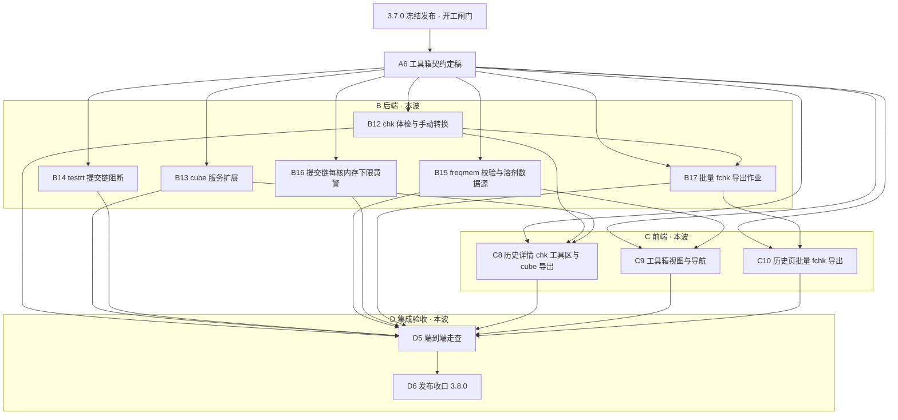
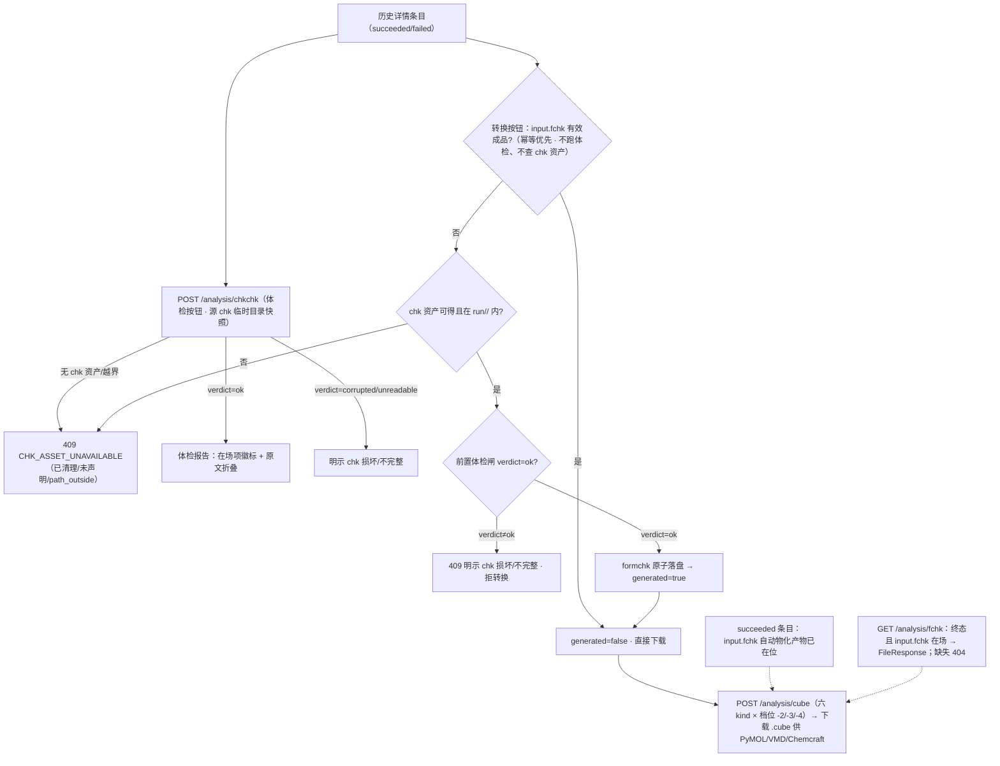
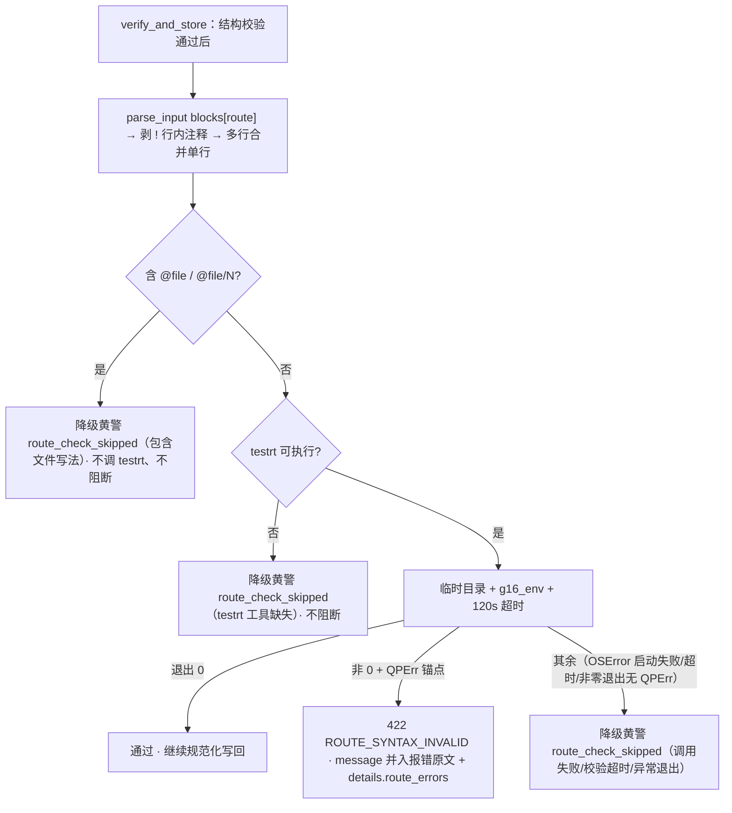
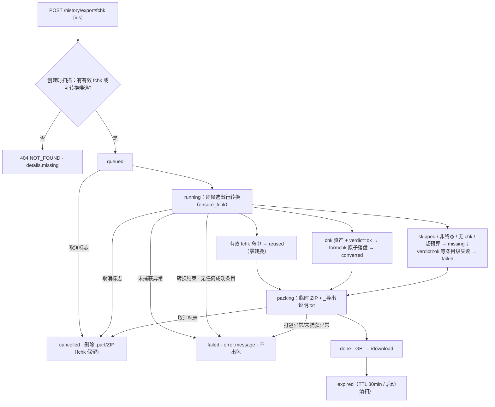

# G16 原生工具箱 · 执行计划

> 状态：**待实施**（需求输入 = [g16-native-tools-assessment.md](../specs/g16-native-tools-assessment.md)
> （2026-11-14 评估定稿）；经 grill 拷问逐项定案，全部决策已关闭（§8 决策记录），
> 本计划无开放决策点）。
> 目标版本 **3.8.0**；**开工闸门 = 3.7.0 冻结发布**（unreleased 现存 oldchk
> 单槽覆写修复批与历史 chk 导出批，已实施完毕待冻结；chk 资产 realpath
> containment 与越界用例须随该批收口，§0.4——按 AGENTS.md §5.2 五步冻结
> + tag v3.7.0 本地落位后本波开工）。
> §0–§9 结构同 [m4-plan.md](m4-plan.md) 范式。本文与评估文档冲突时以本文
> 为准（评估文档冲突处已在 §8 决策记录中逐条注明裁剪理由）；契约基线 =
> 开工时 HEAD 的 docs/api/（3.5.0–3.7.0 契约演进一并含入），本波新增一律走
> 契约文档 diff（roadmap §4），不得漂移既有语义。

## 0. 目标、范围与依据

### 0.1 目标（= 评估文档 §1/§2 原文定位）

把 G16 发行版自带命令行工具（utilities）做进 WebUI，使「chk / out 产物 →
各类数据转换导出」可在浏览器内完成，导出物供其他专业分析软件（PyMOL、
Chemcraft、VMD、自编程序等）进一步处理。采纳 5 项工具，形成 4 条工具链 +
1 个静态数据源；其中 **工具链 2（cubegen）后端直复用 M3 B4 既有实现**
（`web/src/services/cube.py`，本波仅做增量扩展），工具箱定位为
**导出供给外部软件**，与既有分析板块（预览渲染）分工不重叠。

### 0.2 工作项编号（引评估文档段落顺序，WBS 表「对应项」列引用）

| 编号 | 工作项（评估文档原文摘要） |
|---|---|
| T1 | 工具链 1：chk 体检（chkchk）与手动转换（formchk）——体检失败明示 chk 损坏；手动转换入口覆盖 fchk 缺失/丢失场景 |
| T2 | 工具链 2：cube 生成导出——fchk → cube 供外部软件下载（复用 M3 链路 + α/β kind + 档位枚举 + failed 执行覆盖） |
| T3 | 工具链 3：route 校验（testrt）融入输入文件格式校验——报错回显拦截在派发之前 |
| T4 | 工具链 4：内存估算（freqmem）——freq 任务 %mem 对照校验（交互式闭环） |
| T5 | 数据源：solname 溶剂名静态缓存——SCRF 溶剂速查表 |
| T6 | 工具链 1 扩展：批量 fchk 导出——选中历史条目按需 formchk 转换并打包下载，已有 fchk 直接复用，转换进度可轮询、可取消 |

T6 为 2026-11-17 用户定案的评估外增补，沿用工具链 1 的 formchk
能力；不改变评估文档 T1–T5 的原始范围。

### 0.3 不做（非目标）

- `fdensity` kind（评估文 §4.3「等」字举例非明确需求；与 Density=SCF 场景
  重叠，全电子密度对大体系开销显著）。
- fchk 并入 `scope=all`（「全部导出」维持 out+chk 语义；批量 fchk 走
  独立端点，避免既有包内容与测试漂移，§2.1/T6）。
- 批量 fchk 转换并发执行（同一时刻单作业、串行转换，避免与 G16 派发
  争抢 CPU；等待以进度呈现，§2.1/T6）。
- freqmem **精确需求**的提交链自动校验（首次提交 num-basis 不可得，
  半吊子覆盖行为不可预期——精确校验以工具箱交互式闭环承载，§2.4；
  提交链的内存校验以任务类型无关的每核下限黄警承载，§2.4/B16）。
- opt / 其他任务类型的内存估算公式（用户指示登记 backlog 待办，知识库
  查阅后再议——随本波发布回填 roadmap §6 backlog）。
- 编辑器内联溶剂智能提示（BlockEditor 自由文本富提示实现成本高，工具箱
  速查表承载，§2.5）。
- OrbitalsPanel 预览面板改造（保持现状：kind 下拉 MO/Potential、默认
  80³ 网格、无下载按钮——预览与导出分工，互不侵入）。
- 评估文档 §7 明确不纳入清单的全部工具（unfchk/copychk/freqchk/cubman/
  newzmat/rdmat/wrmat/mm/gauopt/gautraj 等——理由见评估 §7，本文不重复）。
- chkchk/formchk/freqmem/solname 输出的通用解析器（仅做锁实测格式的
  最小锚点提取，正则禁令豁免沿 crest 先例形态另行登记，§2.1）。
- 前端页面单测（沿 m3/m4 决策：手动冒烟 + D 走查清单，不引入 vitest）。

### 0.4 前置条件（开工前必须检测并如实记录）

1. **3.7.0 冻结发布**：unreleased 清空、tag v3.7.0 本地落位（AGENTS.md
   §5.2 五步；推送远端属用户授权动作另议）。冻结前完成 3.7.0 导出批的
   chk 资产 realpath containment 与越界用例（§2.1/§9 风险 15；与 B12
   共用 helper，避免 ZIP 导出绕过）。开工登记时把「G16 原生工具箱」
   写入 progress.json `in_progress`。A6 契约 diff 以开工时 HEAD 的
   docs/api/ 为基线（避免 diff 基线漂移）。
2. `target/release/hq` 在位（**全量 pytest 硬前提**——既有 e2e
   （test_e2e_fake_g16 等）受其制约，静默跳过即通过数虚高，AGENTS.md
   §6.1 第 4 条）。本波虽不触派发链路，凡声称「全量 pytest 通过」时
   hq 一律须在位。
3. 真机资产在位（评估 §3 已实测确认）：`~/g16/chkchk`、`~/g16/formchk`、
   `~/g16/cubegen`、`~/g16/testrt`、`~/g16/freqmem`、`~/g16/solname`、
   `~/g16/tests/` 金标准 fchk（`config.G16_SAMPLES_DIR` 既有取数通道）。
   A 批真机实测核验项（§2.7）依赖本条。
4. **批次闸门（B 批次后端实现启动前核对，非开工闸门）**：A6 契约 diff
   经用户评审通过（文档先行，roadmap §4）。

### 0.5 依据

- 评估文档：§4（五工具详述与实测记录）、§5（工具链使用方式）、§6（集成
  风险清单八条——本文 §2/§9 逐条承接）、§8（计划应覆盖面）。
- roadmap：§2.5（g16 执行环境与设置生效规则）、§4（契约先行/正则禁令及
  crest 提取豁免先例）、§143/§496（化学层 cubegen/fchk 定位——M3 B4 已
  落地预览链，本波扩展导出链）、§226（g16 环境等价说明——`g16_env` 已实现
  `web/src/engine/workspace.py:210`）。
- M3 产出（本波直接依赖面）：`services/cube.py`（POST/GET cube 端点、
  kind 白名单、幂等 cube_id、503/502 语义）与 `OrbitalsPanel.vue`
  （3Dmol 渲染）；`services/analysis.py`（`terminal_succeeded` 409 形态、
  analysis.json 概览）。
- M1/M4 产出：`engine/finalize.py` `make_fchk`（formchk 调用范式：run 目录
  内、120s 超时、`run/<id>/input.fchk` 命名）；`engine/materialize.py`
  `probe_chk`（临时目录 + 超时 + 产物头部校验探针范式）；`services/
  dependencies.py` `execution_chk_asset`（protected 保全优先、按执行副本
  `%chk=` 声明定位的 chk 资产取数单点）。
- 3.7.0 导出批产出：`services/history.py` `export_outputs`（out/chk/all
  三 scope、缺漏登记、临时 ZIP 顺序写）与 `routers/history.py`
  （`FileResponse` + `BackgroundTask` 删包）、`HistoryView.vue` split
  button；B17 复用打包、缺漏与下载形态，但批量 fchk 走独立异步作业，
  不改三 scope 语义。
- M2 产出：`services/verify.py` `verify_and_store`（所有提交动作统一闸口）、
  `parse/blocks.py`（`parse_input` blocks["route"]、warnings 通道）。
- `%mem → GB` 换算单点（G16 官方单位集 KB/MB/GB/…，`web/src/parse/
  link0_rules.py` 公开函数 `mem_to_gb`——workspace 侧 `_mem_to_gb`
  仅为私有包装，freqmem 对照取数直接复用公开单点，§2.4）。
- 本波实测（2026-11-15 本机 `ES64L-G16RevC.01` 复核）：
  - **testrt**：常见合法 route（无 `@file`、无行内 `!`）退出码 0；非法
    route 退出码 134（SIGABRT + core dump 落 cwd + QPErr 在 stdout）；
    带 `#` 前缀的 route 同样接受；但 `!` 行内注释与 `@file` 等 M2
    官方合法形态同样 134（见下条），不能以退出码直接判定输入非法。
  - **freqmem**：`NAtoms=… NBasis=… {closed-shell|open-shell} frequencies
    with up to X functions:` + `Minimum of N.NN megawords per thread.` 两
    锚点行；第三参 r/u/R/U 大小写不敏感；第四参为**单一角动量字母**
    （p/d/f/g 实测通过，`s` 恒被拒——"Unrecognized basis type "S""；
    h/i 补充实测（2026-11-16）同为接受——exit 0 且锚点输出合法，
    白名单终值 `p/d/f/g/h/i`，§2.4）；**非法
    参数退出码同为 0**、错误行走 stdout（`Unrecognized basis type …` /
    `Unrecognized SCF type …` / usage）——有效性判定必须锚点解析输出，
    退出码不可作判据。
  - **solname**：215 行输出（头行 1 + 条目行 214），头行
    `NSolv= 184 LNS=   5 LIS=  10 LRS=  25`；条目行 ` I=   N JN= k
    Name=X`，JN ∈ {1,2,3,4}——JN=1 为全名行（每溶剂恰一条，184 条，
    行数=NSolv）；JN=2/3/4 为别名/缩写行（合计 30 条、覆盖 23 个溶剂，
    Acetone/DMSO 各两条；JN=2 ×23、JN=3 ×6、JN=4 ×1）。
  - **chkchk**：健康 chk 体检输出沿用评估文档 §4.1 实测记录；本机补充
    实测（2026-11-16，真实 chk 截断至 8KB 反例）：退出 134（SIGABRT，
    core dump 落 cwd），stdout 仅 `Illegal range for read: …` / `Error
    termination in NtrErr:` / `NtrErr called from NtrIO.` 错误行——无
    `Version:` / `NAtoms=` / `present.` 任何锚点行；stderr 为
    `segmentation violation`。即截断类损坏落 verdict=unreadable（§2.1），
    损坏输入与 testrt 同样崩溃落核、cwd 临时目录隔离为硬约束（§9）。
    另复核记录补充 badroute 类损坏：退出 134 但 stdout 含 `NAtoms=` 锚点
    → corrupted（可提取结构、明示损坏），三态按锚点分流而非退出码
    单判（§2.1、§2.7 核验项 2）。
  - **cubegen**：评估文档 §4.3 实测记录沿用；2026-11-16 复核补充：
    - 闭壳层萘 `input.fchk` 的 `Alpha=SCF` 与 `Beta=SCF` 均退出 0，
      `ElSum from orbitals= 24.947` 恰为 `Density=SCF` 的 49.89 的一半；
      水分子同样成功。闭壳层 α/β 不失败，产出的是半密度 cube——预校验
      不能依赖 cubegen 报错兜底。
    - 开壳层 OH（`nbasis=17`）`MO=18..34` 均退出 0（beta 轨道），
      `MO=35` 才以 134 退出；MO 上界不能交给 cubegen 判定。
    - `-4` 档萘 cube 123MB、水 22.7MB；现有 GET 全量读入内存。
  - **testrt 合法形态**：`testrt "#p hf/sto-3g ! FAKE: exit=1"` 与
    `testrt "#p @mols.dat"` 均退出 134 + QPErr；而 `!` 行内注释、
    `@file`、`@file/N` 是 M2 认定并固化的官方合法形态
    （`test_block_save.py` 零警断言）。送 testrt 前必须先做注释截断与
    包含形态分流，否则合法输入会被 422 误拒。
  - **chkchk 损坏形态**：截断 chk 退出 134、stdout 无任何锚点 →
    unreadable；另存在退出 134 但 stdout 含 `NAtoms=` 锚点的损坏形态
    （badroute 类）→ corrupted。三态按「非零退出 + stdout 锚点」分流，
    不按退出码单判。
  - **chkchk 多步成功行**：多步 chk 输出
    `This checkpoint is from a step within a multi-step job which
    completed successfully.`，与单步成功行并存，`job_ok` 两形态均识别。
  - **fchk 头锚点**：闭壳层 `Multiplicity=1`、
    `Number of alpha electrons` 与 `Number of beta electrons` 相等、
    仅 `Alpha Orbital Energies` 段；开壳层 `Multiplicity=2`、α/β 电子数
    不等、`Alpha Orbital Energies` 与 `Beta Orbital Energies` 两段
    （OH 各 `N=17`）。α/β 开壳层判定与 MO 上界均按此锚点取数。

### 0.6 实施输入：现状核查结论（2026-11-15/17 实测与代码回读，本波视角）

| 事实 | 对计划的影响 |
|---|---|
| `services/cube.py` 已实现 cubegen 全链（kind 白名单 MO/Potential/Density/Spin、npts 40–120、幂等 cube_id、CUBE_EXECUTABLE_MISSING 503 / CUBE_GENERATION_FAILED 502、`run/<id>/input.fchk` 取数） | 工具链 2 不重复实现（§8 决策 1）；本波仅扩展 kind/npts/状态门槛（B13） |
| cube 服务门槛 = `terminal_succeeded`（409 码 `ANALYSIS_UNAVAILABLE`）；MO 上界取 analysis.json `summary.nmo`（`_nmo_upper` 经 `load_analysis` 惰性重建，缺失即补跑解析，不分状态） | 放宽为终态（B13；POST/GET 分列门槛，§2.2）；failed 条目 analysis.json **缺失或 degraded 在场**（`nmo=0`/`nbasis=0`/`homos=[]`/`blocks.orbitals=false`）均判源①不可得回落 fchk 头锚点（§2.2 硬规则：failed 直读绕过惰性重建，禁止向 failed 执行目录补写 analysis.json） |
| analysis.json `summary` 已含 `natom`/`nbasis`/`homos`（cclib 约定：闭壳层 homos 1 元素、开壳层 2 元素） | freqmem 历史带入预填零新解析（§2.4）；α/β 开壳层预校验同源（§2.2） |
| 保留期清理仅作用 `run/<id>/` 顶层 `.chk`（finalize 两档共用），`.fchk` 不在清理范围 | 手动转换落盘 `input.fchk` 持久（§2.1）；cube 链可长期消费 |
| 历史导出（3.7.0 批）对归档条目无限制（终态即可） | chk 体检/转换对归档条目同口径提供（§2.1） |
| `materialize` 写入 `run/<id>/input.gjf` 的是 `resolve_link0` 处理后的文本，缺 `%mem`/`%nproc` 时已注入缺省行；dispatcher 建执行记录时把 `resources.nproc` / `resources.mem_gb` 的 `{value, defaulted}` 落库 | freqmem 预填取执行记录 `resources` 判声明来源，不从执行副本反推（§2.4）；否则恒判 `declared` |
| `history.py` output 下载已用 `filename*=UTF-8''{quote(stem + '.out')}`；cube GET 经 `Response(content=read_bytes())` 全量入内存 | fchk 下载沿 RFC 5987 保留中文 stem 并恒附带白名单清洗的 ASCII fallback（output 下载仅 `filename*`，属新增强化）（§2.1）；cube GET 改 `FileResponse` 流式发送（B13、§9） |
| `POST /history/export` 为同步请求：`export_outputs` 只识别 out/chk/all，out 全内存、chk/all 临时文件 + `FileResponse`；`Scope` 枚举三值；全库无通用异步作业表（update 域为专用单例 + SSE） | 批量 fchk 不能塞进同步 scope：新增独立异步作业端点与进程内作业表（单后台线程串行转换），复用打包/缺漏/`FileResponse` 形态；不改 `Scope` 与 `all` 语义，不新增 SSE（前端轮询，§2.1/T6） |
| `CandidatesView.vue` 行内提交与 `QueueEditorModal.vue` 提交只渲染 `error.message`，不读 `details.route_errors`；`App.vue` 导航数组写死 page 01–06 | `ROUTE_SYNTAX_INVALID` 的报错原文并入 `message`（§2.3）；C9 文件清单含 `App.vue` 导航数组（page 06 工具箱、设置 07；mapping 工作流 08） |
| roadmap M3.2 与 m3-plan §2.2 规定「异常结束执行永不解析、详情仅原文查看/导出」，`AnalysisPanel.vue` 文案同口径；本波允许 failed 条目 chk→fchk→cube | 明确 chk/fchk/cube 属工具箱导出域、不进入 cclib 解析管道；§6 登记 roadmap/m3-plan 条目规则修订，C8 文件清单含 `AnalysisPanel.vue` 文案（§2.1/§2.2） |
| 当前计数：`Warning.kind` 12 词（`test_warning_messages.py`）、错误码全集 35 码（openapi 文件头/`ErrorBody.code`/`test_error_codes.py`）、mapping 自报 55 个操作（openapi 实际 57——`GET /candidates/{id}`、combo-templates 两枚、`POST /system/restart` 未入 mapping.md，孤儿清单过期） | A6 同步：kind 本波 +2、错误码 +5（35→40）、mapping 孤儿清单收口后按开工时实际计数增行 +10 并重排 06 工具箱/07 设置/08 工作流（§2.6） |
| `verify_and_store` 是所有提交动作唯一闸口；warnings 通道既有（B3 拼写警非阻断）；`parse/keywords.py` 注释已引 testrt 盲区 | testrt 接入点唯一（B14，§2.3） |
| 前端路由 page 编号 01–06（设置=06）；分析面板内嵌历史详情 | 工具箱视图插 page 06、设置顺延 07（C9）；mapping 工作流顺延 08；chk 工具区/cube 导出块挂历史详情（C8） |
| chkchk/testrt/freqmem/solname 全库零实现 | B12/B14/B15 从零落；均套用 materialize 探针范式（临时目录 + 列表参数 + 超时） |
| 组合流模板保存闸含每核内存下限校验（`PER_CORE_MEM_GB_FLOOR=1.0`，`services/combo_templates.py`，mem×核数失衡阻止保存）；单任务提交链无内存算术校验 | 提交链每核下限黄警沿同口径（B16）——常量单源上移 `parse/link0_rules.py`，组合流与提交链同源导入 |

## 1. 任务分解与追踪（WBS）

单波：**A6、B12–B17、C8–C10、D5–D6，目标版本 3.8.0**。阶段语义与
m1–m4 计划一致：**A** 契约定稿（契约 diff，文档先行）→ **B** 后端 →
**C** 前端 → **D** 集成验收与发布。规模：S ≈ 半天内，M ≈ 1 天，
L ≈ 2 天。任务编号沿联合计划序列顺延（M4 波最大编号 B11/C7/D4，
m4-plan §1）。**编号作用域 = 本计划文档**：link1-multistep-plan §4
自身编号同为 B 段（B1–B13），两计划并存期间 B12/B13 编号双义，跨计划
引用一律带文档名前缀（「toolbox-plan B14」「link1-multistep-plan B4」
式）；与该计划的互涉分工已在双方文档登记——其 B4 承接本计划 B14 的
testrt 逐段化义务与 route_check_skipped 按段透传，本计划 §6 回填清单
登记其 B1 词表基线数字同步。

| 编号 | 任务 | 产出物 | 验收标准（可验证） | 依赖 | 规模 | 对应项 |
|---|---|---|---|---|---|---|
| A6 | 工具箱契约定稿 | §2 契约 diff（新端点十枚——含批量 fchk 作业四枚、cube 端点扩展、错误码五枚、warnings kind 词表扩两词、mapping 孤儿清单收口（补 `GET /candidates/{id}`、combo-templates 两行、`POST /system/restart`）与增行计数（以开工时实际计数为基线，当前 openapi 57）/06 工具箱·07 设置·08 工作流重排、`TASK_STATE_CONFLICT` 描述扩至异步作业；openapi 两处 35 码与 `test_error_codes.py` 的 29/35 注释同批改 40；sse.md 零变更确认；contract.ts 与 models.py 生成物同批再生） | 每枚新错误码在正文有触发场景承载；kind/npts 契约扩展与既有 40–120 语义兼容说明；作业状态机与复用码的触发场景完整；生成物再生成零 diff；用户评审通过 | 3.7.0 冻结 | S | T1–T6、评估 §8 |
| B12 | chk 体检与手动转换（后端） | `services/chktools.py`：chkchk 体检端点 + 手动 formchk 转换端点 + fchk 下载端点 + 锚点提取器（含多步成功行与 Alpha/Beta 段） | 体检 verdict 三态正确（ok/截断 unreadable/badroute 类 corrupted fixture）；转换幂等命中且半成品 fchk 不误命中；前置体检闸拒绝损坏 chk；fchk 下载 RFC 5987 文件名与 404；工具缺失 503；源 chk 临时目录快照防读清竞态；`execution_chk_asset` realpath containment 越界 409 | A6 | M | T1、评估 §4.1/§4.2 |
| B13 | cube 服务扩展（后端） | kind 扩 Alpha/Beta、npts 契约扩 -2/-3/-4、POST 门槛放宽至终态且 fchk 在场、GET 门槛放宽至终态且 cube 在场、fchk 头锚点回落解析、GET 改 FileResponse | α/β 开壳层判定 fail-closed 422（闭壳层/不可判定均拒）；npts 档位幂等区分；failed 执行 fchk 在场出 cube / 缺失 502；skipped 409；MO 上界按自旋块总口径；既有 40–120/MO/Potential/Density/Spin 语义保留，`test_non_succeeded_409` 按 failed→502、skipped→409、GET 200/404 迁移 | A6 | M | T2、评估 §4.3 |
| B14 | testrt 提交链阻断（后端） | `verify.py` testrt 步 + route 注释截断/包含形态分流 + QPErr 提取 + 降级黄警（warnings kind 新词 route_check_skipped）+ 纯函数告警构造器 | QPErr → 422 ROUTE_SYNTAX_INVALID 且 message 携带报错原文；合法 route（含 `!` 注释、引号值、多行）通过；`@file`/`@file/N` 走包含文件写法降级；工具缺失/超时/异常退出降级不阻断；core dump 隔离（调用 cwd 断言为临时目录）；既有提交路径用例零回归（conftest 层受控 g16_root 注入隔离） | A6 | S | T3、评估 §4.4 |
| B15 | freqmem 校验与溶剂数据源（后端） | `services/toolbox.py` + `routers/toolbox.py`：freqmem 校验端点 + prefill 端点 + solvents 端点 + 进程内缓存 | freqmem 锚点解析（非法参数恒退出 0 → 锚点判定）；白名单外（含 `s`）422 自有中文提示，freqmem `Unrecognized` 防御路径 422 携带原文；对照 %mem 算术 verdict 正确（nproc 总量口径，缺省 1）；prefill 取执行记录 `resources` 的 value/defaulted 判声明来源（无声明/不可解析回落 default），非终态 404、终态非 succeeded 409；solvents 184 条解析（JN=1 行数=NSolv 且每 id 恰一条 JN=1）+ g16_root resolve 后失效重取 | A6 | M | T4/T5、评估 §4.5/§4.6 |
| B16 | 提交链每核内存下限黄警（后端） | verify.py 每核下限黄警 + `PER_CORE_MEM_GB_FLOOR` 单源上移 `parse/link0_rules.py`（combo 改导入零行为变更）+ 纯函数告警构造器 | 触发/不触发边界用例全绿（失衡声明触发、默认设置 8GB/4 核不触发、相等不触发、缺省回落核算）；黄警 `line`/`keyword` 形状完整（`%mem` 声明行；无声明取 Link0 首行，无 Link0 取 1）且不阻断提交；组合流模板保存闸既有用例零回归；`test_submit_verify` 的 CLEAN/SPELL_CLEAN 与 `test_warning_messages.py` 的 `_file` 模板调至默认 8GB 保持零警断言；test_warning_messages.py 词表随扩容 +1（沿 §6 提交序 B14 先落，13→14）与模板用例 | A6 | S | §8 决策 8 增补（2026-11-16 评审） |
| B17 | 批量 fchk 导出作业（后端） | `services/fchk_export.py`：进程内作业表 + 锁 + 单后台工作线程 + 四端点（创建/状态/下载/取消）+ 分类（有效 fchk 复用 / chk 转 formchk / 缺漏）+ 总预算与 TTL + 临时 ZIP 打包（复用 history 打包 helper，fchk 条目 DEFLATED） | 混合批次（succeeded 已有 fchk / failed protected chk / skipped / 非终态）分类与计数正确；已有 fchk 零转换；缺失项串行转换，单项沿用体检 120s + formchk 300s；总预算 900s 超出项登记缺漏、作业仍 done；取消在 queued/running/packing 生效且 `.part`/ZIP 清理干净；同刻第二作业 409；下载前 409、未知/过期 404；ZIP 命名/冲突前缀/`_导出说明.txt`/testzip 完整；重启后作业 404、`.part`/ZIP 清扫、已转 fchk 可复用；既有 out/chk/all 测试零回归 | A6, B12, 3.7.0 导出批 | M | T6、§8 决策 16 |
| C8 | 历史详情 chk 工具区与 cube 导出块 | chk 体检徽标报告（✓/✗ 在场项 + 可折叠原文）+ 体检/转换/下载按钮 + 独立「导出 cube」区块（六 kind + 三档位 + 生成并下载）+ `AnalysisPanel.vue` 异常态文案 | 体检损坏态明示且转换入口拒；failed 条目全链（体检→转换→下载→出 cube）可用；succeeded 无 chk 资产但 fchk 在场的下载/幂等转换可用；cube 下载文件名含 stem/kind/档位；错误态按契约区分（404 fchk/cube 缺失、409 无 chk 资产、422 参数/开壳层、502 生成失败、503 工具缺失）；MO 越界以提交后 422 details.max 回显；新增/改动样式仅引用既有令牌、无组件内硬编码（§2.8） | A6, B12, B13 | M | T1/T2、评估 §5 |
| C9 | 工具箱视图与导航 | `ToolboxView.vue`（freqmem 校验表单 + 历史带入预填选择器 + 溶剂速查表）+ 路由 page 06（设置顺延 07）+ `App.vue` 导航数组 | freqmem 手输与带入两路径出对比结论；溶剂速查搜索/复制可用；导航新页可达、设置页功能零回归；新增视图与导航样式仅引用既有令牌（§2.8） | A6, B15 | S | T4/T5、评估 §1 |
| C10 | 历史页批量 fchk 导出（前端） | `HistoryView.vue` 导出菜单增「导出 .fchk」+ 进度/取消注记 + `client.ts` 创建/轮询/下载/取消四方法 | 混合批次一键发起；轮询显示总数/已处理/复用/转换/失败/缺失与已用时；完成自动下载 `gauforge-fchk-<时刻>.zip`；取消在 queued/running/packing 生效，取消后无 `.part`/ZIP 残留；409 活动作业/404 全缺/失败态提示可见；导出 .out/.chk/全部零回归；导出菜单与进度注记样式仅引用既有令牌（§2.8） | B17 | S | T6 |
| D5 | 端到端验收走查（真机） | 走查记录 `docs/plans/toolbox-acceptance.md`（§7.2 路径逐条留痕，截图存本地不入库） | §7.2 走查路径逐条通过（含批量 fchk 混合批次、取消与复用）；roadmap 化学层定位对照核验 | B12–B17, C8–C10 | S | 评估 §8 |
| D6 | 发布收口（3.8.0） | CHANGELOG.jsonl 冻结 + tag v3.8.0 + progress.json 同步 | AGENTS.md §5.2 五步顺序执行；check_plan_status 定点校验通过；发布前回填本计划状态行与评估文档状态行 | D5 | S | AGENTS.md §5.2 |

**依赖关系总览**：`3.7.0 冻结 → A6 → (B12, B13, B14, B15, B16, B17)`；
`A6 → (C8, C9, C10)`；`B12 → C8`；`B12 → B17`；`B13 → C8`；`B15 → C9`；
`B17 → C10`；`B12–B17/C8–C10 → D5 → D6`。A6 是本波契约总闸。B13 与
B12 无接口依赖（cube 服务只认 `input.fchk` 文件存在性；B13 测试以
fixture fchk 自持造数，不依赖 B12 先落）——C8 同时消费两者产出
（failed 条目全链 UI）。B17 消费 B12 的 `ensure_fchk` 核心与 3.7.0
导出批的打包/缺漏/`FileResponse` 形态，不复制转换或打包逻辑。

**总工量与关键路径**（沿 m1–m4 口径）：总工量 ≈ **8.5 人天**（A6 0.5
+ B12–B17 5 + C8–C10 2 + D5/D6 1）。逻辑关键路径
`A6 → B12 → B17 → C10 → D5 → D6`（4 人天）；单人串行执行时总工期即
总工量；B12/B13/B15/B17（M 估算）建议各预留 ~20% 缓冲；估算不含 A 批
评审返工与 D 阶段走查缺陷 fix 的返工。里程碑以版本号为锚、无日历
承诺——人天估算仅作规模参照。

## 2. 关键设计定稿（A6 契约规格输入）

> 以下全部为定案（§8 决策记录），无「建议/待定」项。契约 diff 以本节
> 为唯一来源，评审仅核对与本文一致性。

### 2.1 工具链 1：chk 体检与手动转换（T1/T6，B12/B17/C8/C10）

- **对象口径（按端点分层，chk 资产闸只作用需要 chk 的端点）**：
  - 体检端点：终态执行（succeeded/failed）且 chk 资产可得。
  - 转换端点：终态执行；`input.fchk` 已是有效成品时直接幂等命中，不查
    chk 资产；需要现转时才要求 chk 资产可得且体检通过。
  - 下载端点：终态执行且 `input.fchk` 在场，不查 chk 资产（顶层 `.chk`
    被保留期清理后 fchk 仍可下载）。
  - 跳过态无执行目录，前端不展示入口；归档条目照常提供（与 3.7.0
    导出批同口径，均为只读消费）。
  - **资产 containment**：chk 资产 realpath 必须位于 `run/<id>/` 之内
    （含 `protected/`）；`%chk=/任意/secret.chk` 等绝对路径或 `..` 越界
    一律不读取，按 409 `CHK_ASSET_UNAVAILABLE`（details.reason=
    `path_outside`）拒绝。3.7.0 导出批复用同一 containment 单点，冻结前
    补齐越界用例。
- **体检端点** `POST /history/{id}/analysis/chkchk` → 200
  `{verdict, report, raw}`：
  - 调用范式：**先把源 chk 复制进独立临时目录再调 chkchk**（快照语义，
    防采集→调用间源文件被保留期清理/手动清理收走的读清竞态——3.7.0
    导出批同教训延伸）；临时目录 + `g16_env` + `subprocess.run` 列表参数 +
    120s 超时（沿 materialize 探针范式）。
  - **verdict 三态判定**（判定规则确定，ok↔corrupted↔unreadable 边界
    以本机实测锚定）：`ok`（退出 0——锚点行缺失形态含入，缺失字段以
    「—」呈现、raw 恒透传兜底）/ `corrupted`（非零退出且 stdout 有锚点
    行——细节可提取，明示「chk 损坏/不完整」；badroute 类实测为 134 +
    `NAtoms=` 锚点）/ `unreadable`（非零退出且无任何锚点行——完全
    不可读；截断类损坏实测落此态，134 + `Illegal range for read` 等错误
    行、无 `Version:`/`NAtoms=`/`present.` 锚点）——三支互斥完备覆盖
    全部退出形态。corrupted fixture 按 badroute 类形态补造，A 批核验项 2
    留痕锚点行。
  - **最小结构提取**（锚点锁实测格式，前向兼容——未识别行忽略不炸）：
    `version`（`Version:` 行）、`natom`/`icharg`/`multip`（`NAtoms=` 行）、
    `has_coords`（`Atomic coordinates present.`）、`has_basis`（
    `AO basis is present.`）、`has_mo`（`MO coefficients present.`）、
    `job_ok`（单步 `This checkpoint is from a job which completed
    successfully.` 与多步 `This checkpoint is from a step within a
    multi-step job which completed successfully.` 两形态）；`-p` 明细与
    力常数/OT 桶在场行暂不提取（锚点行文随 A 批实测补登记）。`raw` 恒
    透传 stdout 全文（版本差异原样透传、不做兼容性断言——评估 §6.6）。
    **豁免登记**：本波锚点提取属 roadmap §4 正则禁令的**新增豁免实例**
    （crest 提取器先例的豁免理由为「cclib 不覆盖的实时进度」，不含本波
    场景；形态沿其先例：文件级锚点、锁实测格式、样例回归——发布前随
    §6 回填清单在 roadmap 显式登记）。
  - 错误语义：state ∉ {succeeded, failed}（含 skipped，对象口径外，
    不沿用 analysis 域 terminal 判定——避免 skipped 落 409）404
    （`not_found`）；无 chk 资产或资产越界 409
    `CHK_ASSET_UNAVAILABLE`（details 注明已清理/未声明/`path_outside`）；
    chkchk 可执行缺失 503 `G16_TOOL_UNAVAILABLE`（details.tool=chkchk）；
    启动失败/超时 502 `G16_TOOL_FAILED`（details.tool=chkchk）。
- **转换端点** `POST /history/{id}/analysis/fchk` → 200
  `{generated: bool, fchk: "input.fchk"}`：
  - **幂等优先**：`run/<id>/input.fchk` 存在、非空且头部锚点有效
    （`Number of atoms` / `Number of basis functions` 等在位）→ 直接
    返回 `{generated: false}`，不跑体检、不查 chk 资产、不跑 formchk。
    半成品（formchk 超时/被杀留下的非空文件、头部锚点缺失）不判命中，
    按未转换处理。
  - **前置体检闸**（评估工具链 1 定位「体检失败不再转换」）：需要现转
    时服务端内部先跑体检（不依赖前端先调）；verdict≠ok → 409
    `CHK_ASSET_UNAVAILABLE`（details.verdict 区分 corrupted/unreadable，
    前端明示「chk 损坏/不完整，不执行转换」）。
  - **源 chk = `execution_chk_asset`**（protected 保全优先、回落执行副本
    `%chk=` 声明定位，再过 containment）；不复用 `make_fchk` 的
    `resolve_chk(run_dir)` 取数——failed 条目的保全 chk 在 `protected/`
    下，`resolve_chk` 看不到。仅复用其调用形态：独立临时目录快照 +
    `g16_env` + 列表参数 + 产物命名 `input.fchk`（默认格式 -3，与 M1
    自动物化同款）。
  - **原子落盘**：手动转换与 M1 自动物化共用原子落盘 helper——formchk
    写入同目录唯一临时文件（`tempfile.mkstemp` 形态，非固定名；如
    `.input.fchk.<pid>.tmp`），成功后 `os.replace` 到 `input.fchk`；
    `finalize.make_fchk` 同步改用该 helper（产物名与自动物化语义不变）；
    失败/超时删除临时文件，不留半成品。手动转换超时 300s（大 chk 较
    自动物化 120s 放宽），超时 502 明示。
  - **核心单点**：转换逻辑落 `ensure_fchk(execution_id) ->
    (fchk_path, generated)`，返回结果/领域异常、不直接映射 HTTP；
    `convert_fchk` 路由薄层映射 409/502/503，B17 批量作业直接消费
    并按条目捕获，不复制转换逻辑。
  - 错误语义：有效 fchk 在场时幂等命中优先（不受 chk 资产已清理影响）；
    需要现转而 chk 资产缺失/越界/verdict≠ok 409（同上）；formchk 可执行
    缺失 503 `G16_TOOL_UNAVAILABLE`（details.tool=formchk）；非零退出/
    超时/产物空 502 `FCHK_GENERATION_FAILED`（details 携带 stderr 尾部）。
- **下载端点** `GET /history/{id}/analysis/fchk` → 200 文件流
  （`application/octet-stream` + `Content-Disposition: attachment;
  filename=<ASCII 清洗名>; filename*=UTF-8''<quote(stem + '.fchk')>`）：
  在 `history.py` output 下载既有 `quote`/RFC 5987 形态上恒附带
  ASCII fallback 字段（服务端无法探测客户端能力，不做客户端分支）——
  fallback 取 stem 白名单清洗，清洗为空时回落 `execution-<id>.fchk`；
  主文件名以 `filename*` 为准，中文与 Unicode stem 原样保留。
  `input.fchk` 不存在 404（`not_found`）；不查 chk 资产。下载经
  `FileResponse` 流式发送（大 fchk 不整文件入内存）。
- **前端（C8）**：历史详情新增「chk 工具」区——「chk 体检」按钮（徽标
  报告：在场项 ✓/✗ 列表 + 版本/NAtoms 行 + 可折叠原文）、「转换为 fchk
  并下载」按钮（体检闸内嵌，失败态明示）、fchk 下载入口（常显；转换
  成功后直接可用，缺失以 404 提示）；`execution_chk_asset` 定位失败的
  条目不做前置置灰（库内无 chk 资产在场查询端点——历史条目
  `chk_snapshot` 仅为非正常终止保全标记，前端无从预判）——按钮可点，点击后 409
  `CHK_ASSET_UNAVAILABLE`（details 注明已清理/未声明/越界）以提示呈现。
- **批量 fchk 导出作业（T6，B17/C10）**：
  - **形态**：独立异步作业，不并入 `POST /history/export` 的
    `out|chk|all` 三 scope；「全部导出」维持 out+chk 语义。四端点：
    `POST /history/export/fchk`（载荷 `{ids}`，202
    `{job_id, state, total}`）、`GET /history/export/fchk/{job_id}`
    （200 作业快照）、`GET /history/export/fchk/{job_id}/download`
    （200 ZIP 文件流）、`POST /history/export/fchk/{job_id}/cancel`
    （202 `{job_id, state}`）。路由声明统一置于既有 `/history/{id}`
    二段路由之前（沿同文件 `/history/cleanup`、`/history/export`
    的前置声明先例）：FastAPI 首个全匹配生效，`/history/{id}` 系
    路由的 `{id}` 段正则接受任意值、整数校验失败返回 422 且不回落
    到后声明路由，静态段路由前置属确定性落位；二段路由匹配不了
    三段路径、既有三段动作路由（archive/requeue/resume/
    return-candidate）字面段与新路径不重合，当前无实际吞并，前置
    防后续同段数路径演进踩坑。
  - **作业状态机**：`queued → running → packing → done`；
    `queued/running/packing` 可转 `cancelled`；`running/packing`
    异常或无任何成功条目（不出包）转 `failed`；`done` 超过 TTL
    转 `expired`（作业表惰性清扫）。
    状态响应字段
    `{job_id, state, total, processed, reused, converted, failed,
    missing, current_eid, elapsed_s, error?}`；`processed =
    reused + converted + failed + missing`，`total` 为去重后的选中
    执行数；创建时判定的 `missing` 直接计入 `processed`。不设同步
    快速路径——同一端点统一 202 + 轮询，避免 blob/JSON 双响应形态；
    全命中批次通常在一个轮询周期内完成。
  - **取数与分类**（创建时一次扫描，后续逐条执行）：
    - 非终态/不存在 → `missing`（说明「条目不存在或非终态」）；
    - `run/<id>/input.fchk` 存在且头部锚点有效 → `reused`（不查
      chk 资产、不跑工具）；
    - 其余终态条目经 `execution_chk_asset` + containment 得 chk
      资产 → 转换候选；`skipped` 或无 chk 资产 → `missing`（说明
      「未运行无执行产物」/「无 chk 资产（已清理或从未产生）」）。
      归档条目同口径放行。创建时全部条目均无有效 fchk 且无转换
      候选 → 404 `NOT_FOUND`（details.missing，沿既有导出全缺
      语义）。
  - **转换执行**：单个后台工作线程串行处理候选；每条复用
    `ensure_fchk` 核心（§2.1 单条转换的幂等命中、前置体检闸、
    containment、formchk 原子落盘），单项超时沿用体检 120s +
    formchk 300s；执行时再次命中有效 fchk 计 `reused`，不重复转换。
    条目级失败（verdict≠ok / chk 越界 / 工具缺失 / 非零退出 /
    超时）只记入 `failed` 与缺漏说明，不使作业失败；作业仅在打包
    异常、未捕获异常或无任何成功条目（不出包）时转 `failed`。
  - **等待时间**：作业总预算 `FCHK_BATCH_BUDGET_S = 900`
    （`config.py` 常量；转换阶段墙钟）；每轮启动新候选前按单项最坏
    420s 预留，剩余预算不足即停止转换，未处理候选记 `missing`
    （说明「超出批量转换时间预算」）；已启动的条目允许跑完，不再
    中途杀进程。已有 fchk 的条目零转换，典型 succeeded 批次秒级
    完成；只有 failed/丢失批次才进入进度等待。大 failed 批次在 900s
    预算内至多串行完成约两项转换（最坏单项 420s），其余候选预期大量
    记 `missing`，此类批次以分批发起承载（与 ids 元素数上限 500 的
    分批说明同口径）。转换串行，避免与 G16
    派发争抢 CPU。取消在 `queued` 下即时生效、`running` 下于当前
    条目结束后生效，在 `packing` 下于当前条目写入间隙生效；取消后
    关闭打包句柄并
    删除 `fchk-export-<job_id>.zip.part` 与已生成的作业 ZIP，转
    `cancelled`，不留作业私有临时文件；已落盘 `input.fchk` 为持久
    分析产物，不随作业取消删除（可重新发起复用）。
  - **打包与下载**：转换完成后 `packing`——无任何成功条目
    （reused 与 converted 均为 0）不进入 `packing`、不写包文件，
    直接转 `failed`（`error.message` 说明）；否则复用 `history.py`
    打包 helper 的缺漏合并、同名冲突组 `<eid:03d>-` 前缀、包内
    平铺与读清竞态处理；条目 `<stem>.fchk`、缺漏写
    `_导出说明.txt`、fchk 条目 `ZIP_DEFLATED`（文本可压缩；chk
    既有 `ZIP_STORED` 语义不变）。缺漏文案与说明头按 fchk 维度
    （「无 fchk / 转换失败 / 超出预算」），不复用 chk 资产文案。
    临时包落 `config.HOME_DIR / EXPORT_TMP_SUBDIR`，先写
    `fchk-export-<job_id>.zip.part`，打包完成后 `os.replace` 为
    `fchk-export-<job_id>.zip`（下载只服务 `.zip`）；下载经
    `FileResponse` 流式发送，包名
    `Content-Disposition: attachment;
    filename=gauforge-fchk-<时刻>.zip`。ZIP 保留
    `FCHK_EXPORT_TTL_S = 1800`（`config.py` 常量；30 分钟），支持
    重复下载；TTL 采用惰性判定（status/download/新建作业时清扫过期
    作业），进程重启时
    由启动清扫删除（`purge_export_tmp` 扩认 `fchk-export-*.zip` 与
    `fchk-export-*.zip.part`），不新增常驻定时器。
  - **并发与重启**：同一时刻仅一个活动作业（queued/running/
    packing）；重复创建 409 `TASK_STATE_CONFLICT`
    （details.active_job_id）。作业表为进程内字典 + 锁，不落
    SQLite（零存储迁移）——**单进程部署前提**（`main.py` 经
    `uvicorn.run` 单进程运行、无 workers 参数；未来多 worker 部署
    该作业表即失效，届时需迁移跨进程载体）；服务重启后作业 id
    一律 404，`.part`/
    `.zip` 与作业记录由启动清扫删除，已转换的 `input.fchk` 持久
    保留、可直接重新导出。
  - **取消与清理**：`cancelled`/`failed` 终态在状态落定前统一调用
    `cleanup_job_artifacts(job)`：关闭打包句柄，删除
    `fchk-export-<job_id>.zip.part`、作业 ZIP 与打包临时文件；
    作业记录只保留 `state`/计数供前端轮询，不占磁盘：`done` 记录
    按 TTL 惰性转 `expired` 后移除，`cancelled`/`failed` 记录不设
    TTL、随进程重启消亡。已落盘 `input.fchk` 不属作业残留，保持持久
    （单条下载/cube/重复导出可复用）。
  - **错误语义**：ids 非空正整数数组否则 400 `INVALID_REQUEST`，
    元素数上限 500（超出同 400 `INVALID_REQUEST`，更大批次由分批
    发起承载）；作业 id 未知/过期 404 `NOT_FOUND`（`not_found("export_job", …)`，
    `_RESOURCE_LABELS` 补「导出作业」）；下载时 state≠done（含
    queued/running/packing/cancelled/failed）409 `TASK_STATE_CONFLICT`；
    取消 queued/running/packing 接受，done/failed/expired 409；
    `TASK_STATE_CONFLICT` 的 openapi 描述扩为「任务或异步作业状态机
    冲突」（无新错误码）。状态轮询用 1s 间隔的普通 GET，不新增 SSE
    事件（sse.md 零变更）。
  - **前端（C10）**：历史页导出 split button 增「导出 .fchk」；
    发起后按钮区转为进度注记（`processed/total` + 复用/转换/失败/
    缺失计数 + 已用时 + 取消按钮），轮询至 `done` 后自动下载并保留
    「下载」按钮供重复下载（`gauforge-fchk-<本地时刻>.zip`）；
    `failed`/`cancelled` 显示 `error.message` 或状态文案；活动作业
    409 提示「已有批量 fchk 导出在进行中」，若 details 带
    `active_job_id` 则直接附着到该作业继续轮询；取消按钮点击后
    显示「正在取消（当前条目/打包间隙结束后生效）」，`cancelled`
    后清空进度注记并提示作业私有临时文件已清理。轮询随组件卸载
    停止，作业继续；返回页面重新发起即可复用已落盘 fchk。

### 2.2 工具链 2：cube 导出扩展（T2，B13/C8，复用 M3 链路）

- **状态门槛（POST 与 GET 分列）**：
  - **POST** 用新单点 `terminal_with_fchk`（终态 succeeded/failed 且
    `run/<id>/input.fchk` 在场）：
    - succeeded：既有 `input.fchk`（M1 自动物化产物）。
    - failed：经 §2.1 手动转换落盘后出 cube（评估价值链 chk→fchk→cube）；
      未转换（fchk 缺失）→ 502 `CUBE_GENERATION_FAILED`（既有
      fchk_missing 语义复用，details 注明「fchk 缺失，请先执行 chk
      转换后再生成 cube」——文案中性，succeeded/failed 条目同形）。
    - skipped → 409 `ANALYSIS_UNAVAILABLE`（details.state=skipped，
      message「未运行条目无执行产物」）；非终态（running/staged）→ 404
      `not_found`。
  - **GET** `/history/{id}/analysis/cube/{cube_id}` 用新单点
    `terminal_for_download`（succeeded/failed；skipped 409；非终态 404），
    只校验 cube 文件存在性，**不要求 fchk 在场**：cube 已生成后 fchk 被
    清理不应阻断下载；cube 文件缺失 → 404 `not_found`。GET 改
    `FileResponse` 流式发送（大 cube 不整文件入内存）。
  - analysis 四端点沿用的共享单点 `terminal_succeeded` 零改动（全库
    六调用点：analysis 四处 + cube 两处；cube 两处按 POST/GET 分别改走
    上述新单点，其 message 无既有文案断言保护，不改 analysis 域语义）。
- **failed 条目三级源读取硬规则**（§8 决策 14 的边界补充）：
  ① failed 条目读 analysis.json 一律**绕过 `load_analysis` 惰性重建**
  直读文件，缺失即源①不可得降级下级源——禁止向 failed 执行目录补写
  analysis.json（终态管线对 failed 仅保全不落 analysis、result_ref 恒
  null，补写文件与其形成内部不一致）；② 在场 analysis.json 为
  degraded 形态（`summary.nmo=0` / `summary.nbasis=0` /
  `summary.homos=[]` / `blocks.orbitals=false`）一律判**源①不可得**
  降级 fchk 头锚点——否则 MO 上界取 0 轨道全拒、homos 元素数 0 被
  误判闭壳层 422。
  succeeded 条目 analysis 读取语义零变更（`blocks.orbitals=false` 的既有
  422「无 MO 表」保留）；闭壳层 MO 上界不变，开壳层按 `2×nbasis` 扩展。
- **kind 白名单扩至六种**：`("MO", "Potential", "Density", "Spin",
  "Alpha", "Beta")`；Alpha/Beta 实参 `Alpha=SCF` / `Beta=SCF`（与既有
  `Density=SCF` 首字母大写形态同构——cubegen what 大小写不敏感已由 M3
  真机测试段证实，A 批核验 α/β 两 kind 确认）。
  - **开壳层预校验（fail-closed）**：kind ∈ {Alpha, Beta} 时按三级源
    判定开壳层，**不可判定时拒绝，不把判断交给 cubegen**：
    - 源① analysis.json `summary.homos`：元素数 ≥2 判开壳层、1 判闭壳层；
      failed 条目直读，缺失/degraded（`homos=[]`/`nmo=0`/`nbasis=0`/
      `blocks.orbitals=false`）判源①不可得。
    - 源② fchk 头锚点：先要求 `Alpha Orbital Energies` 段在场（缺失即
      源②不可得，不得反推闭壳层）。开壳判据 = `Multiplicity ≥ 2` 或
      α/β 电子数不等；闭壳判据 = `Multiplicity=1`、α/β 电子数相等且
      无 Beta 段；`Beta Orbital Energies` 段在场仅作佐证，与
      `Multiplicity=1` 并存即矛盾。仅开壳判据成立 → 开壳层；仅闭壳
      判据成立 → 闭壳层；两者皆成立或皆不成立（含上述矛盾形态、
      电子数锚点缺失无法归类）→ 不可判定。权威格式
      `~/g16/doc/formchk.txt`，A 批核验项 6 留痕。
    - 源③（两源皆不可得/不可判定）→ 422 `VALIDATION_FAILED`
      （details.reason=`shell_unknown`，注明「无法判定开壳层，已拒绝
      生成 α/β 密度」）。闭壳层确认 → 422 `VALIDATION_FAILED`
      （details.reason=`closed_shell`，注明 α/β 密度要求开壳层体系）。
      闭壳层 α/β 在 cubegen 侧会成功产出半密度 cube（§0.5 实测），
      不能依赖其失败兜底。
- **npts 契约扩展**：接受 `-2/-3/-4`（G16 原生粗/中/细档位，直透
  cubegen 位置参数）或 40–120 自由整数（既有语义零变更）；其余值
  422。`cube_id` 摘要公式含 npts 原值（`-3` 与 `80` 天然不同 id，
  幂等区分档位）。A 批核验项 3：负数位置参数（`-2/-3/-4`）被 cubegen
  解析为档位而非选项（评估 §4.3 据 .hlp 断言，实测留痕）。`-4` 档
  体积显著（萘 123MB、水 22.7MB），C8 在档位旁标注「细档体积大」，
  不设硬上限；D5 用大体系核下载内存与耗时。
- **MO 上界三级源**（既有 `_nmo_upper` 扩展，按自旋块总口径）：
  `summary.nmo` 为每自旋块轨道数（cclib 约定，OH `nmo=17`，G16 中
  `nmo=nbasis`）；对外可寻址 MO 总数 = 闭壳层取 `summary.nmo`（G16
  中恒等于 `nbasis`）、开壳层取 `2 × nbasis`，`nmo` 与 `nbasis`
  两字段不等时一律以 `nbasis` 为准（cubegen OH 实测 `MO=18..34` 为
  beta 轨道，`MO=35` 才失败）。取数链：
  - 源① succeeded：闭壳层沿用 `summary.nmo`；开壳层取
    `2 × summary.nbasis`；
    `blocks.orbitals=false` 保留既有 422 `ANALYSIS_PARSE_FAILED`
    （succeeded 语义零变更）。failed 条目直读，缺失/degraded 判源①
    不可得。
  - 源② fchk 头锚点：`Alpha Orbital Energies` 的 `N` + `Beta Orbital
    Energies` 的 `N`（无 Beta 段取 Alpha 的 `N`）；Alpha 段缺失即源②
    不可得。
  - 源③（两源皆不可得）→ 422 `VALIDATION_FAILED`（details.reason=
    `mo_upper_unknown`），**不再降级为仅正整数校验**，不依赖 cubegen
    报错。降级链逐级显式，解析失败不静默（stderr 留痕）。
- **前端（C8）**：历史详情新增独立「导出 cube」区块（与 OrbitalsPanel
  预览并列、互不侵入）：kind 下拉六种、档位下拉三档（粗 -2 / 中 -3 /
  细 -4，**默认中档**，禁自由数值——评估 §6.4 治理意图；细档标注体积
  提示）、「生成并下载」按钮（POST 幂等 → GET 文件流 → 浏览器保存
  `<stem>-<kind>[-<n>]-<粗|中|细>.cube`——档位以中文单字入名，与
  MO 轨道号数值段区分）。MO 轨道号不在前端预显上界
  （无轻量查询端点）：提交后越界以 422 `VALIDATION_FAILED`
  `details.errors[].max` 回显；α/β 闭壳层与不可判定按 422 message 明示。
  OrbitalsPanel 零改动。
- **既有语义保留与测试迁移**：MO/Potential/Density/Spin 四 kind、40–120
  npts、幂等命中、`CUBE_EXECUTABLE_MISSING` 503、OrbitalsPanel 载荷
  形状保留；`test_cube_api` 的 `test_non_succeeded_409` 按新门槛迁移
  （failed 无 fchk POST 502、skipped POST/GET 409、failed 已有 cube
  GET 200、cube 缺失 GET 404），其余既有用例保留通过。

### 2.3 工具链 3：testrt 提交链阻断（T3，B14）

- **接入点**：`services/verify.py` `verify_and_store` 内、结构解析校验
  （parse_errors/multistep 检查）之后、规范化写回之前——testrt 只见
  单步输入（多步已被 422 `INPUT_MULTISTEP_UNSUPPORTED` 拒绝），校验
  顺序 = 结构 → route 语法 → 落盘。
- **route 提取与送检预处理**：取 `parse_input` 的 `blocks["route"]` 节
  文本（含 `#` 起始行，多行以空行终止）：
  - 逐行按引号/括号感知截断首个 `!` 行内注释（双引号内 `!` 保留；
    `#`、`/`、`@` 与引号值原样保留，`External="RunTink Amber"` 不拆词）；
  - 非空行 strip 后以单空格连接为单行（多行合并为单行的 testrt 接受度
    属 A 批真机核验项 1；若实测 testrt 不接受合并单行，则改为整段
    原样送检（保留换行），以核验项 1 留痕为切换依据）；
  - 截断注释后用 `tokenize_route` 检查包含形态：任一 `@file` 或
    `@file/N` 词 → 直接走 fail-open 降级（message 原因短语「包含文件写法」），
    不调 testrt——`@file`/`@file/N` 是 M2 认定并固化的官方合法形态
    （`test_block_save.py` 零警断言），testrt 实测 134 + QPErr，不能
    据此 422。
  - 其余合法形态（`!` 注释、引号值、多行）送 testrt 前已剥注释，
    route 语义不变。
- **调用范式**：独立临时目录（**testrt 报错即 SIGABRT + core dump 落
  cwd——临时目录隔离为硬约束**，评估 §6.1）+ `g16_env` + 列表参数 +
  120s 超时。
- **三支判定**（决策规则确定）：
  1. 退出 0 → 通过（不回显 link 展开序列——对用户无操作价值）；
  2. 退出非 0 且 stdout 含 `QPErr` 锚点 → 422 `ROUTE_SYNTAX_INVALID`
     （details：`route_errors` = stdout 原文截断 2000 字符、`exit_code`；
     **`message` 以「route 语法错误：」起始并并入报错原文首段
     （截 300 字符）**——
     `CandidatesView.vue` 与 `QueueEditorModal.vue` 只渲染
     `error.message`，不读 details，并入后拼错关键词与出错位置在既有
     提示位直接可见，两组件零改动）；
  3. 其余（可执行缺失 / OSError 启动失败 / 非零退出但无 QPErr / 超时 /
     含 `@file` 包含形态）→ **fail-open 降级**：不阻断提交，`warnings`
     通道追加一条非阻断黄警（显式不静默——降级可见）。形状遵循既有
     Warning schema（required `[line, keyword, kind, message]`，不新增
     字段）：`kind="route_check_skipped"`（kind 词表扩一词）、
     `keyword=""`、`line` = route 节起始行号（route 缺失已先走
     parse_errors 422，恒可得）、`message` 以「route 语法校验跳过
     （<原因>）：」起始接中文说明——<原因> 以中文短语内嵌并作
     断言锚点：「testrt 工具缺失」「调用失败」「校验超时」
     「异常退出」「包含文件写法」，分别对应可执行缺失、OSError
     启动失败、超时、非零退出无 QPErr、`@file` 包含形态五支降级，
     不透出内部枚举值。
- **前置探测**：`<g16_root>/testrt` 可执行检查（`os.access(X_OK)` 沿
  cube 先例）——缺失直接走降级支 3，不发子进程；`@file` 分流在探测前
  完成，不依赖 testrt 是否安装。
- **契约承载**：`ROUTE_SYNTAX_INVALID` 新码登记错误码全集（文件头 +
  触发场景正文）；warnings 通道 `route_check_skipped` 随契约 diff
  登记——Warning schema 形状零变更，仅 kind 词表描述扩一词（既有
  schema 为描述性词表非 enum，无枚举值可补）。
- **与 B3 拼写警关系**：并存互补——B3 离线黄警（编辑期实时反馈）先行，
  testrt 提交时权威阻断（派发前拦截，评估本意）；两者语义互不替代，
  契约描述注明分层。
- **性能**：testrt 子进程秒级（实测 <0.5s），提交链路可接受；组合流
  批量提交逐成员串行各跑一次 testrt（≤10 成员最坏 ~5s）同口径可接受，
  不属缺陷；每次调用独立临时目录，并发提交无互踩（评估 §6.7）。

### 2.4 工具链 4：freqmem 交互式校验（T4，B15/C9）

- **校验端点** `POST /toolbox/freqmem` 载荷
  `{num_atoms, num_basis, shell: "r"|"u", basis_type, compare_mem_gb?,
  nproc?}`：
  - 载荷类型与值域：`num_atoms`/`num_basis` 须为正整数且 ≤ 100000
    （防御上限——远超真实体系规模；越界 422 `VALIDATION_FAILED`）；
    `compare_mem_gb?` 可选、须为正数（非法类型/值域同码 422）；
    `nproc?` 可选、正整数且 ≤ 256（与 `link0_default_nproc` 设置值域
    同口径），缺省视为 1（单线程口径）。
  - `basis_type` 白名单终值：`p/d/f/g/h/i`（全数实测确认——p/d/f/g
    通过、`s` 恒拒、h/i 补充实测接受，§0.5；**决策规则确定**）。
    **两类 422 分列**：
    - 白名单外（含 `s`）→ 422 `VALIDATION_FAILED`，自有中文提示
      「角动量字母仅支持 p/d/f/g/h/i」，**不调 freqmem**，无原文可带；
    - 白名单内参数但 freqmem 仍输出 `Unrecognized` / usage 行 → 422
      `VALIDATION_FAILED`（details 携带 freqmem 原文错误行）——防御
      路径，与白名单拦截分开断言。
  - 后端调 `<g16_root>/freqmem <num_atoms> <num_basis> <shell>
    <basis_type>`（临时目录 + `g16_env` + 120s 超时）；**有效性判定 =
    锚点解析**（非法参数退出码恒 0，退出码不可作判据——§0.5 实测）：
    输出含 `Minimum of N.NN megawords per thread.` → 成功；含
    `Unrecognized` / usage 行 → 422 `VALIDATION_FAILED`（details 携带
    freqmem 原文错误行——参数错属用户输入问题，与进程层失败分列）。
  - 响应 `{minimum_mw, minimum_gb, per_thread: true, basis_type_echo,
    verdict?}`：`minimum_gb = minimum_mw × 8 / 1024`（**1 MW = 2²⁰ words
    × 8 B = 8 MiB**——G16 %mem 单位语义；GB 按 1024 基底，与
    `link0_default_mem_gb` 口径一致）；`verdict` 仅当载荷携带
    `compare_mem_gb` 时返回：`{nproc, declared_mem_gb, sufficient,
    delta_gb}`——minimum 为每线程需求、declared 为 %mem 声明总量，
    `sufficient = declared ≥ minimum_gb × nproc`、`delta_gb = declared
    − minimum_gb × nproc`（负值=缺口；nproc 为载荷值或缺省 1，随
    verdict 回显）——**对比算术在后端单点完成**，前端不做单位换算
    与判断。
  - 错误语义：freqmem 可执行缺失 503 `G16_TOOL_UNAVAILABLE`
    （details.tool=freqmem）；启动失败/超时 502 `G16_TOOL_FAILED`。
- **预填端点** `GET /toolbox/freqmem-prefill?execution_id=<id>` →
  `{num_atoms, num_basis, shell, suggested_compare_mem_gb,
  suggested_mem_source, suggested_nproc, suggested_nproc_source}`
  （仅 succeeded；非终态（running/staged）→ 404 `not_found`，终态
  非 succeeded（failed/skipped）→ 409 `ANALYSIS_UNAVAILABLE`，
  succeeded 条目 `analysis.json` 缺失且重建失败 → 409
  `ANALYSIS_UNAVAILABLE`（复用 `load_analysis` 既有语义，不另设
  错误码）——按 `terminal_succeeded` 语义分列）：
  - 取数三源：`analysis.json` `summary.natom` / `summary.nbasis` /
    `summary.homos` 元素数判 shell（1→"r"、≥2→"u"）。
  - **资源预填取执行记录，不取执行副本**：dispatcher 建执行记录时已把
    `resources.nproc` / `resources.mem_gb` 的 `{value, defaulted}` 落库。
    `suggested_compare_mem_gb = resources.mem_gb.value`、
    `suggested_nproc = resources.nproc.value`；来源
    `suggested_*_source` = `"declared"`（`defaulted=false`）或
    `"default"`（`defaulted=true`）。`materialize` 写入的
    `run/<id>/input.gjf` 是 `resolve_link0` 处理后的文本，缺
    `%mem`/`%nproc` 时已注入缺省行，从副本反推会恒判 `declared`，
    禁止作为预填数据源。
  - **不可解析声明回落**：`defaulted=false` 但原任务输入声明值不可解析
    （`mem_to_gb` 返回 None / `%nproc` 非正整数）时，dispatcher 记账
    已回落缺省值，来源按 `default` 标注；原任务输入不可读时以
    `defaulted` 字段为准。执行记录缺 `resources` 的存量条目按设置
    缺省值预填并标 `default`。
  - 零值/缺失守卫三参对称覆盖，一律 409 `ANALYSIS_UNAVAILABLE`
    （details 注明缺失维度）——不猜数：`natom` 缺失或 0（degraded
    解析无坐标数据）、`nbasis` 为 0（无基函数数据）、`homos` 缺失
    或元素数为 0（degraded 形态 `homos=[]`）。
- **前端（C9）**：freqmem 校验表单（四参数下拉/数字输入 + 可选 nproc
  输入缺省 1 + 可选「对照 %mem」GB 输入框）+ 「从历史带入」选择器
  （仅列 kind=g16 的 succeeded 条目——crest 等其他 kind 执行无
  对应分析数据，不入列；选中 → prefill 预填三参数、对照值与
  nproc）→ 结果卡
  （每线程需求 MW 与 GB 换算 + 按「对照总量 ≥ 每线程需求 × nproc」
  口径的充足/不足结论与差额，nproc>1 时标注总量口径说明）。
- **提交链不做 freqmem 精确校验**（§0.3）：首次提交 num-basis 不可得，
  不做猜数；评估文档「融入输入校验（freq 任务内存提示）」的精确估算
  分支据此裁剪，留痕 §8 决策 8。
- **提交链每核内存下限黄警（B16，§8 决策 8 增补定案）**：
  verify_and_store 内、testrt 步同区插入（结构解析校验之后、规范化写
  回之前），对输入副本做纯算术校验——`resolve_link0` 记账值
  `mem_gb.value < nproc.value × PER_CORE_MEM_GB_FLOOR` 即向 warnings
  通道追加非阻断黄警：`kind="mem_below_per_core_floor"`（与组合流
  模板保存闸错误 reason 同名——同一规则两域承载）、message 携带
  核算内存值/核数/下限并指引「freq 任务精确需求请用工具箱 freqmem
  校验」。**Warning schema 必填字段钉死**：`keyword="%mem"`、`line` =
  `%mem` 声明行绝对行号；无 `%mem` 声明时取 Link0 区首行（无 Link0
  时取 1）——避免 `line=0` 在前端渲染为 `L0`。fail-open 恒不阻断；
  记账值 = 声明优先、缺省回落（与 dispatcher 注入实况一致——缺
  `%mem`/`%nproc` 时按缺省值核算，默认设置 8GB/4 核不触发）；相等
  不触发（严格小于）。常量单源：`PER_CORE_MEM_GB_FLOOR`（1 GB/核）
  自 `services/combo_templates.py` 上移 `parse/link0_rules.py`，组合流
  与提交链同源导入（组合流行为零变更，既有测试全数保留）。零子进程、
  零 g16 依赖（hermetic）；组合流成员派发经同一闸口同口径生效
  （模板保存闸已拦存量失衡，成员覆写失衡仍可警）；前端零改动
  （warnings 通道既有渲染面，line/keyword 已在位）。
  **既有测试迁移**：`test_submit_verify.py` 的 `CLEAN` 与
  `SPELL_CLEAN` 由 `%mem=1GB` + `%nprocshared=4` 调至
  `%mem=8GB` + `%nprocshared=4`（与默认设置同口径），保持
  `w2 == []` 与 `w1` 纯 `keyword_spell` 断言；
  `test_warning_messages.py` 的 `_file` 模板同步由 `%mem=1GB` 调至
  `%mem=8GB`（1GB 低于每核下限，不迁移则 B16 落地后每条 `_file`
  用例额外产出 `mem_below_per_core_floor` 黄警，干扰后续全量
  warnings 断言）；`mem_below_per_core_floor`
  另由 B16 专测覆盖（含队列/组合流提交路径），warnings 非阻断语义
  不变。告警构造抽纯函数 `_mem_floor_warning(...)`，供
  `test_warning_messages.py` 的 `CASES` 直接调用，维持
  `KIND_VOCABULARY` 全覆盖断言。

### 2.5 数据源：solname 溶剂速查（T5，B15/C9）

- **端点** `GET /toolbox/solvents` → `{count, solvents: [{id, name,
  aliases}]}`：
  - 解析锚点：条目行 ` I=   N JN= k Name=X`，JN ∈ {1,2,3,4}（§0.5
    实测）——`name` 取 JN=1 全名行（每溶剂恒恰一条）；`aliases` 收
    JN=2/3/4 别名/缩写行 Name（0–3 条，实测合计 30 条覆盖 23 个
    溶剂：17 溶剂 1 条、5 溶剂 2 条、DiethylEther 3 条——同为 G16
    可接受的 scrf 溶剂写法，须进速查搜索覆盖）；
    其他未识别 JN 值的行按「未识别行忽略」前向兼容处理（不炸不收）。
    交叉核对判据钉死：**JN=1 条目行数 = 头行 NSolv**，且**每个 `I=`
    溶剂 id 恰有一条 JN=1 全名行**（逐 id 校验，防同一 id 重复 JN=1
    或缺失全名行被总数掩盖）；任一不满足 → 502 `G16_TOOL_FAILED`
    （防御解析缺陷，评估 NSolv=184 锚点）。豁免登记同 §2.1（锚点
    提取、锁实测格式）。
  - **懒加载 + 进程内缓存**：首次请求调 `<g16_root>/solname`（独立
    临时目录 + `g16_env` + 120s 超时）；缓存键 = `g16_root`
    `expanduser().resolve()` 后的 realpath——符号链接换目标但路径
    字符串不变时同样失效重取；设置变更即失效；调用失败不缓存（下次
    请求重试）；无 SQLite 表、无启动时调用（不拖启动、g16 缺失不炸
    启动）。
  - 错误语义：solname 可执行缺失 503 `G16_TOOL_UNAVAILABLE`
    （details.tool=solname）；启动失败/超时/解析核对失败 502
    `G16_TOOL_FAILED`。
- **前端（C9）**：工具箱视图溶剂速查表——搜索框（名称/别名子串过滤、
  大小写不敏感）+ 两列表格（名称、别名——多条以「、」连接展示，无
  别名呈现「—」）+ 点击复制名称；184 条一次全量返回不分页（载荷
  ~数十 KB）。用户经速查复制名称后在编辑器手填 `scrf=(solvent=…)`
  （内联智能提示不做，§0.3）。

### 2.6 错误码与契约 diff 全集（A6 交付物明细）

- **新码五枚**（openapi.yaml 文件头错误码全集登记，每码正文有触发
  场景承载，`test_error_codes.py` 静态闸门自动覆盖；
  `CONTRACT_CODES` 清单按开工时实际值 +5（本波先行 35→40；link1 先行
  37→42）须**同批更新**——该闸门为「实现 ⊆ 清单」单向比对，清单不
  更新则本批提交自红）。计数注释
  同批收口：`test_error_codes.py` docstring 的「29 码」与
  `CONTRACT_CODES` 注释、`openapi.yaml` 文件头及 `ErrorBody.code`
  描述两处「35 码」均改为本波落地后的实际计数（本波先行 40；link1
  先行 42）。与 link1 B1 的基线按落地顺序登记：本波先行 35→40，
  link1 随后 40→42；link1 先行 35→37，本波随后 37→42。所有数字以
  开工时实际计数为基线，逐次 +5/+2，不在文档中预设跨计划固定总数。

  | 码 | HTTP | 承载场景 |
  |---|---|---|
  | `ROUTE_SYNTAX_INVALID` | 422 | testrt QPErr 语法错阻断（B14） |
  | `CHK_ASSET_UNAVAILABLE` | 409 | chk 工具域对象态冲突：无 chk 资产（已清理/未声明）/ 资产越界（`path_outside`）/ 体检 verdict≠ok 拒转换（B12） |
  | `G16_TOOL_UNAVAILABLE` | 503 | chkchk/formchk/freqmem/solname 可执行缺失共码（details.tool 区分——四场景一码，较四专码经济；cube 既有专码 `CUBE_EXECUTABLE_MISSING` 不动） |
  | `G16_TOOL_FAILED` | 502 | chkchk/freqmem/solname 进程非零退出或超时共码（details.tool 区分）；solname NSolv/逐 id 交叉核对失败 |
  | `FCHK_GENERATION_FAILED` | 502 | 手动 formchk 转换非零退出/超时/产物空（§2.1，details 携带 stderr 尾部） |
- **复用既有码**：`VALIDATION_FAILED`（freqmem 参数错/cube kind·npts·
  orbital 越界/α/β 闭壳层或不可判定/`mo_upper_unknown`）、
  `ANALYSIS_UNAVAILABLE`（cube skipped 409 / prefill 终态非 succeeded
  409 / prefill 解析守卫 409；非终态 404 不在此码）、
  `CUBE_GENERATION_FAILED`（cube 502 / failed 执行 fchk 缺失）、
  `ANALYSIS_PARSE_FAILED`（succeeded 条目 `blocks.orbitals=false` 的
  既有 422「无 MO 表」语义保留，B13 不改变）、
  `TASK_STATE_CONFLICT`（批量 fchk 作业：已有活动作业 409 / 下载时
  state≠done 409 / 取消 queued/running/packing 接受；openapi 描述
  扩为「任务或异步作业状态机冲突」）、`NOT_FOUND`（批量 fchk 作业
  id 未知/过期；创建时全缺 404 沿既有导出语义）。
- **新端点十枚**：`POST /history/{id}/analysis/chkchk`（体检）、
  `POST /history/{id}/analysis/fchk`（手动转换）、
  `GET /history/{id}/analysis/fchk`（fchk 下载）、
  `POST /toolbox/freqmem`（内存校验）、`GET /toolbox/freqmem-prefill`
  （历史带入预填）、`GET /toolbox/solvents`（溶剂速查）、
  `POST /history/export/fchk`（批量 fchk 作业创建）、
  `GET /history/export/fchk/{job_id}`（作业状态）、
  `GET /history/export/fchk/{job_id}/download`（作业 ZIP 下载）、
  `POST /history/export/fchk/{job_id}/cancel`（作业取消）。
- **既有端点扩展**：`POST /history/{id}/analysis/cube`（kind 六种、
  npts 枚举 ∪ 40–120、终态且 fchk 在场）与 `GET .../cube/{cube_id}`
  （终态且 cube 在场，不要求 fchk）。
- **router 落位**：chk 工具/cube 端点按「对象=执行产物」挂
  `routers/analysis.py`（服务层新文件 `services/chktools.py`，与
  `services/cube.py` 并列）；freqmem/prefill/solvents 按「对象=独立
  工具」挂新 `routers/toolbox.py`（服务层 `services/toolbox.py`）；
  批量 fchk 四端点挂既有 `routers/history.py`（服务层新文件
  `services/fchk_export.py`），声明统一前置在 `/history/{id}` 二段
  路由之前（沿 `/history/cleanup`、`/history/export` 前置先例，
  落位约定见 §2.1）；`main.py` include_router 同既有模式。
- **mapping.md 孤儿清单收口、增行与计数**：先补齐既有未入表操作
  （`GET /candidates/{id}`、`GET/PUT /combo-templates`、
  `POST /system/restart`——openapi 实际 57 个操作，mapping.md 自报
  55 的孤儿清单已过期），再增本波新端点十枚；操作数一律以开工时
  实际计数为基线逐次累加，不在文档预设固定总数；分节重排为
  **06 工具箱 / 07 设置 / 08 工作流**（现 06 设置 / 07 工作流顺延），
  同步 C9 路由 page 06 与 `App.vue` 导航数组；**sse.md 零变更**
  （无新增事件——本波全部为请求-响应型操作，A6 确认一次留痕）。
- **warnings 通道**：`route_check_skipped` 与 `mem_below_per_core_floor`
  登记（Warning schema 形状零变更——仅 kind 词表扩两词，语义内嵌
  message 文本；两 kind 分别随 B14/B16 落地，词表同步义务见各任务；
  词表覆盖测试由纯函数构造器承载，词表总数按落地顺序累加：本波 +2、
  link1 B1 再 +3）。
- **details 词域核对**：B12 `CHK_ASSET_UNAVAILABLE` details（已清理/
  未声明/`path_outside`、verdict）与 B13 skipped details（state）、
  `VALIDATION_FAILED` 的 `shell_unknown`/`closed_shell`/
  `mo_upper_unknown` 等新结构化值域，A6 核对文件头三张 reason 词表
  （导入 per-file / 设置域 / 组合流模板）是否适用，触发扩容则随 diff
  登记；B17 作业快照的 state 词表
  `queued|running|packing|done|failed|cancelled|expired` 与
  `missing`/`failed` 条目说明为响应内文本，不进错误码 reason 词表。
- **存储迁移：零**（solname 进程内缓存、chkchk 报告不落库、cube_id
  幂等沿用既有、体检结果不落库、批量 fchk 作业表进程内）；
  **契约生成物随 diff 同批再生**：
  前端 contract.ts 经 `gen:types`、后端 `web/src/models/models.py`
  经 `web/scripts/gen_models.py`（两者零 diff 为契约批次闸门——
  `test_openapi_ssot.py` 每次全量 pytest 校验 models 零 diff，
  openapi.yaml 变更不同批再生则提交自红）。

### 2.7 A 批真机实测核验项（A6/B12–B17 执行前完成，留痕入各任务交付物）

1. testrt 送检预处理实测：多行 route 合并单行（含 `#` 前缀与长
   route）、`!` 行内注释截断、引号值 `External="RunTink Amber"` 原样
   保留；`@file`/`@file/N` 分流不调 testrt，合法提交零 422。若实测
   testrt 拒绝合并单行，送检形态切换为整段原样（保留换行）并以本项
   留痕为切换依据。
   —— **2026-11-17 A6 实测留痕（本机 ES64L-G16RevC.01）**：合并单行
   `#p b3lyp/6-31g(d) opt freq scrf=(solvent=water)` exit 0（正常展开）；
   截断后 `#p hf/sto-3g` exit 0；原文带 `!`（`#p hf/sto-3g ! FAKE:
   exit=1`）exit 134 QPErr——截断必要性证实；引号值
   `#p external="RunTink Amber" hf/sto-3g` exit 0（回显原文）。**合并
   单行送检策略成立，不切换整段模式**。
2. chkchk 损坏形态可达性收敛：截断反例已实测落 unreadable（退出
   134、stdout 仅错误行无任何锚点，§0.5）；badroute 类复核记录为
   134 + `NAtoms=` 锚点 → corrupted。补造该形态 fixture 并留痕锚点行
   （NAtoms、present. 行），核验项以「锚点分流」收敛，不再假设
   corrupted 不可达。
3. cubegen `-2/-3/-4` 负数位置参数的档位语义（评估 §4.3 据 .hlp
   断言的实测确认）；记录三档产物体积（萘/水基线 123MB/22.7MB）
   供 D5 大体系对照。
   —— **2026-11-17 A6 实测留痕**（水 `h2o_optfreq_popreg.fchk`，
   Density=SCF）：`-2` exit 0、393KB；`-3` exit 0、3.0MB；`-4` exit 0、
   22.75MB（与评估水基线 22.7MB 一致）；正整数 `80` exit 0、6.7MB。
   负数位置参数被 cubegen 解析为档位而非选项，产物合法。
4. cubegen 对闭壳层 fchk 出 `Alpha=SCF`/`Beta=SCF` 的实际行为：
   实测为退出 0、`ElSum from orbitals` 为 `Density=SCF` 的一半（萘
   24.947 vs 49.89，水同），即产出半密度 cube——确认预校验必须
   fail-closed 422，不依赖 cubegen 失败兜底；同时留痕开壳层 OH
   α/β 正常形态与 `MO=18..34` beta 轨道行为供 MO 上界核验。
   —— **2026-11-17 A6 复测留痕**：水 `Alpha=SCF` exit 0
   （ElSum=4.0027）、`Beta=SCF` exit 0、`Density=SCF` ElSum=8.0054
   ——α 恰为全密度之半，fail-closed 必要性再证。开壳层 OH：
   `Alpha=SCF`/`Beta=SCF` exit 0 正常形态；`MO=17`/`MO=34` exit 0
   （18–34 为 beta 轨道段）、`MO=35` exit 134（SIGABRT，无产物）
   ——MO 上界须服务端预校验。
5. freqmem `h`/`i` 角动量字母接受度留痕确认（§0.5 补充实测已定案
   接受——basis_type 白名单终值 `p/d/f/g/h/i`，A 批复测留痕即可）。
   —— **2026-11-17 A6 复测留痕**（`freqmem 3 25 r <字母>`）：
   p=3.30 / d=3.30 / f=7.40 / g=23.69 / h=66.30 / i=158.80 MW，
   全部 exit 0 且 `Minimum of N.NN megawords per thread.` 锚点在位；
   `s` 恒拒（`Unrecognized basis type "S"`，退出 0 但无锚点——
   锚点判定必要性再证）。
6. fchk 头锚点行名实测（`Number of atoms`、`Number of basis
   functions`、`Multiplicity`、`Number of alpha electrons`、
   `Number of beta electrons`、`Alpha Orbital Energies`、`Beta Orbital
   Energies` 数组段名与维度语义，据 `~/g16/doc/formchk.txt` 对照）；
   闭壳层（水）与开壳层（OH）各留一份头锚点样本。
   —— **2026-11-17 A6 实测留痕**：水
   `~/g16/tests/h2o_optfreq_popreg.fchk`（闭壳层）`Multiplicity=1`、
   α/β 电子数 5=5、仅 `Alpha Orbital Energies R N=19`（无 Beta 段）；
   OH `~/g16/tests/oh_doublet_popreg.fchk`（开壳层）`Multiplicity=2`、
   α=5≠β=4、`Alpha Orbital Energies R N=17` 与 `Beta Orbital Energies
   R N=17` 两段并存；`Number of atoms I` / `Number of basis functions
   I` 标量锚点在位。与 `~/g16/doc/formchk.txt`（'Multiplicity' /
   'Number of alpha electrons' / 'Number of beta electrons' /
   'Alpha Orbital Energies' / 'Beta Orbital Energies' 章节名）对照一致。
7. 批量 fchk 转换耗时基线：金标准 chk（水/萘/OH）开工时逐一
   核实在案（`~/g16/tests` 现存样本以 .out 为主，chk 在案性未
   确认），缺失者登记「真机样本另造」并留痕；各跑一次 formchk，
   记录耗时与 fchk 体积；混合批次 ZIP 打包耗时与体积各留一份，
   用于 900s 总预算与单项 420s 预留的实测校准。

### 2.8 前端视觉与令牌纪律（C8–C10 共用）

本节是 C8–C10 的实现与验收依据，不产生契约差异，A6 不登记。

- **继承既有风格**：不引入 UI 组件库、不新建视觉语言或页面骨架。
  布局、密度、控件形态、空态、加载态、错误提示与交互反馈一律沿用
  现有页面与 `base.css` 共享类（如 `.btn`/`.btn--secondary`）的既有
  形态；新控件优先复用既有先例（split button、卡片、抽屉、表格、
  Toast），不与相邻区块形成第二套视觉层级。
- **令牌集中管理不可违反**：凡由
  [`web/frontend/src/styles/tokens.css`](../../web/frontend/src/styles/tokens.css)
  管理的维度——颜色（含 rgb/rgba/hsl）、字体栈、字号、字距、间距、
  圆角、阴影、层级、页面度量、动效时长与缓动——只能以 `var(--…)`
  引用，禁止在组件 `<style>`、模板内联 `style`、TS 字符串或动态样式
  对象中以字面值替代既有令牌。禁止组件内私设 `--*` 私有令牌，禁止
  复制一份局部变量或写临时主题分支。
- **双主题**：组件不写 `html[data-theme=...]` 分支；新增面在暗色与
  明亮两主题下均由令牌覆盖，前景/背景配对沿用既有受检组合
  （`scripts/check_contrast.py` 全部组合 ≥ 4.5:1）；若引入脚本未覆盖
  的新配对，D5 走查逐对实测并留痕。
- **新增令牌的唯一路径**：既有令牌确实无法覆盖时，先在 `tokens.css`
  的暗色 `:root` 与 `html[data-theme="light"]` 成对登记，同步
  [`m0-ui-preview.html`](assets/m0-ui-preview.html) 样板变量块并跑
  `scripts/check_tokens.py` 至零 diff；新增颜色同批跑
  `scripts/check_contrast.py`。不得先在组件内写死再补登记。
- **动效与文案**：动效只改变 `transform` 与 `opacity`，时长与缓动
  引用既有 `--dur-*`/`--ease-*` 令牌，不自定义 `cubic-bezier()` 或
  毫秒值；新增 UI 文案用简体中文，分隔用「—」或「/」、禁「·」，
  不呈现后端枚举、字段名等内部语义。
- **闸门与人工复核**：C8–C10 每批提交前跑 `npm run build`
  （vue-tsc 零错误）、`scripts/check_tokens.py`、
  `scripts/check_contrast.py` 与 `scripts/audit_frontend_offline.sh`。
  `check_tokens.py` 只校验两处令牌定义一致、`check_contrast.py` 只从
  `tokens.css` 取色，均不拦截组件内硬编码，因此每批另做组件样式
  diff 复核（确认仅令牌变量引用、无字面值、无组件内私设令牌），并在
  D5 走查中切换明暗双主题目检新增面。

## 3. 任务流程图

### 3.1 阶段与任务依赖（WBS 全景）

### 3.2 工具链 1 体检-转换-导出链（T1/T2 协同）

### 3.3 testrt 提交链三支判定（T3）

### 3.4 批量 fchk 导出作业状态机（T6）

## 4. 逐任务执行方案

> 每任务四要素：**步骤**（动手顺序）、**技术要求**（硬约束）、
> **质量标准**（可验证判据）、**交付物**（落库物）。公共纪律不重复写：
> 文档先行、全量 `uv run pytest` + 闸门清单（§6）过闸、契约生成物随
> diff 再生（gen:types 与 gen_models.py 零 diff）。

### 4.1 A6 · 工具箱契约定稿

- 步骤：① 按 §2.6 起草契约 diff（十新端点——含批量 fchk 作业四枚 +
  cube 扩展 + 五新错误码 + warnings kind 词表扩两词 + mapping 孤儿
  清单收口（补 `GET /candidates/{id}`、combo-templates 两行、
  `POST /system/restart`）与增行计数（以开工时实际计数为基线，当前
  openapi 57）/06 工具箱·07 设置·08 工作流重排 + `TASK_STATE_CONFLICT`
  描述扩至异步作业 + sse.md 零变更确认 +
  `test_error_codes.py` `CONTRACT_CODES` 35→40、docstring 29→40、
  openapi 文件头与 `ErrorBody.code` 两处 35→40 同批更新）；②
  §2.7 核验项 1/3/4/5/6 真机实测留痕（核验项 4 为已复核实测的
  闭壳层半密度形态，核验项 5 为复测留痕确认，核验项 2 随 B12，
  核验项 7 随 B17）；③
  与 §2 各节逐条走查契约形状一致性（含文件头三张 reason 词表适用性
  核对，§2.6）；④ 生成物同批再生：`npm run gen:types`（contract.ts）
  与 `uv run python web/scripts/gen_models.py`（models.py）零 diff；⑤
  用户评审。
- 技术要求：契约基线 = 开工时 HEAD docs/api/；每枚新码正文有触发场景；
  npts 扩展与既有 40–120 语义兼容表述明确；Warning schema 形状零变更
  （kind 词表扩两词，不新增字段）；批量 fchk 作业状态词表与复用码
  （`TASK_STATE_CONFLICT`/`NOT_FOUND`）触发场景写清；错误码/kind 计数
  以开工时实际值为基线逐次 +5/+2，link1 先落时按 37→42 顺延（§2.6）。
- 质量标准：评审通过；`test_openapi_ssot.py` / `test_error_codes.py`
  通过；contract.ts 与 models.py 再生成零 diff。
- 交付物：契约 diff（openapi.yaml + mapping.md + sse.md 确认注记 +
  contract.ts / models.py 再生成产物 + `web/tests/test_error_codes.py`
  `CONTRACT_CODES` 与计数注释更新）+ 核验项实测留痕（写入本文档
  §2.7 对应处或验收文档）。

### 4.2 B12 · chk 体检与手动转换

- 步骤：① `services/chktools.py`：`run_chkchk`（快照复制 + 临时目录
  调用 + verdict 三态判定 + 最小锚点提取器，含多步成功行与
  Alpha/Beta 段）与 `ensure_fchk`（源取 `execution_chk_asset` +
  containment + 幂等命中 + 前置体检闸 + formchk 原子落盘）；
  `convert_fchk` 路由薄层映射领域异常；② 三端点
  挂 `routers/analysis.py`（fchk 下载 `FileResponse` + RFC 5987 文件名）；
  ③ 核验项 2 收敛留痕（截断反例 fixture 制造：金标准 chk 截断前几 KB
  ——实测落 unreadable；badroute 类 134 + `NAtoms=` 锚点 fixture 落
  corrupted）；④ 测试。
- 技术要求：源 chk 先复制进临时目录再调工具（读清竞态防护与 core
  dump 隔离，§2.1/§9）；对象门槛按端点分层（体检/现转需 chk 资产；
  有效 fchk 幂等命中不查资产；下载只查 fchk）；chk 资产 realpath
  containment 必须位于 `run/<id>/`（含 `protected/`），越界 409
  `CHK_ASSET_UNAVAILABLE`（`path_outside`）；体检动作 HTTP 恒 200
  （损坏是有效结论）、进程层失败才 502/503；`convert_fchk` 不复用
  `make_fchk` 的 `resolve_chk(run_dir)` 取数，只复用 cwd/g16_env/
  产物命名形态；`ensure_fchk` 返回 `(path, generated)` 与领域异常，
  不直接映射 HTTP——B17 按条目捕获并登记；formchk 写同目录唯一
  临时文件后 `os.replace`，失败时删除临时文件；抽共用 helper 供
  `finalize.make_fchk` 同步使用；手动转换超时 300s；产物落
  `run/<id>/input.fchk`（默认格式 -3）。
- 质量标准：`ensure_fchk` 结果形态与领域异常单测（幂等命中/需现转/
  资产缺失/越界/verdict 非 ok）；verdict 判定用例全绿（ok 正常
  fixture / unreadable 截断反例 fixture / corrupted badroute 类
  fixture）；failed 条目
  protected/ 保全 chk 体检与转换用例；幂等命中断言（含 chk 已清理、
  fchk 在场直接 `generated=false`）；半成品 fchk 不误命中并可重转；
  前置闸 409 断言；fchk 下载流（中文 stem 原样、ASCII fallback 清洗）
  与 404；skipped 404；越界 `%chk` 409；503/502 工具缺失/失败分支；
  归档条目同口径用例；`make_fchk` 原子性回归（自动物化失败无半成品
  残留）。
- 交付物：services/chktools.py + 三端点 + fixtures + 测试。

### 4.3 B13 · cube 服务扩展

- 步骤：① `services/cube.py` KINDS 扩 Alpha/Beta + `_validate` 开壳层
  预校验三级源（源③ fail-closed 422）；② npts 校验扩枚举
  （`{-2,-3,-4} ∪ [40,120]`）与 cube_id 公式确认（含原值）；③ 门槛
  分列（POST `terminal_with_fchk`：succeeded/failed + fchk 存在；
  GET `terminal_for_download`：succeeded/failed + cube 存在，不查
  fchk；skipped 409；非终态 404）；④ fchk 头锚点解析单点（核验项 6
  锚点留痕）与 MO 上界总口径（闭壳 `nmo`、开壳 `2×nbasis`）；⑤ GET 改
  `FileResponse`；⑥ 既有测试迁移 + 新用例。
- 技术要求：OrbitalsPanel 载荷形状零变更；三级降级链逐级显式
  （stderr 留痕，不静默）；failed 缺 fchk 的 502 details 引导先转换；
  failed 条目 analysis.json 直读绕过惰性重建、degraded 在场判源①
  不可得（§2.2 硬规则）；MO 上界不再降级为仅正整数校验，不依赖
  cubegen 报错。
- 质量标准：`test_cube_api` 既有用例按 §2.2 迁移后通过
  （`test_non_succeeded_409` → failed POST 502、skipped POST/GET 409、
  failed 已有 cube GET 200、缺失 GET 404）+ 新用例（α/β 闭壳 422 /
  不可判定 422 / 开壳 OH `MO=18..34` 通过、35 拒 / 档位幂等 / failed
  全链 / 三级源含 failed 在场 degraded analysis.json 判不可得 + 零
  补写断言）。
- 交付物：cube.py 扩展 + 测试 + fchk 头锚点实测留痕。

### 4.4 B14 · testrt 提交链阻断

- 步骤：① `verify.py` 新增 testrt 步（route 提取 + 引号/括号感知剥
  `!` 注释 + 多行合并 + `@file`/`@file/N` 分流 + 可执行探测 + 临时
  目录调用 + 三支判定）；② warnings 通道扩 `route_check_skipped`
  （kind 词表，形状同既有 Warning；构造抽纯函数
  `_route_skipped_warning` 供 CASES 调用）+
  `test_warning_messages.py` KIND_VOCABULARY 权威词表同步 12→13；③
  错误码 `ROUTE_SYNTAX_INVALID` 落位 `errors.py`，message 并入
  QPErr 原文首段（截 300 字符）；④ 核验项 1 真机实测；⑤ 受控测试
  环境：在 conftest 层统一注入受控 g16_root（假 testrt 可执行脚本
  fixture，固定 stdout/退出码），覆盖全部提交路径用例
  （test_submit_verify、test_e2e_fake_g16、test_e2e_queue_lifecycle
  与 queues/pending 域提交用例），测试一律不真调 ~/g16，消除对真机
  在位的隐式依赖；⑥ 测试。
- 技术要求：接入点在结构校验后、规范化写回前；fail-open 降级不阻断；
  core dump 隔离断言（mock 断言调用 cwd 为临时目录）；QPErr details
  截断 2000 字符，message 携带同一原文首段（截 300 字符）；`@file`
  分流优先于 testrt 探测。
- 质量标准：三支判定用例全绿；合法 route（`!` 注释、`@file`、
  `@file/N`、引号值、多行）零 422；test_submit_verify 既有用例零
  回归；降级警五类原因（testrt 工具缺失/调用失败/校验超时/异常退出/
  包含文件写法）各有用例，断言锚定 message 中文短语；全部用例
  hermetic（conftest 层统一注入受控 g16_root，提交路径用例与真机
  在位与否解耦）。
- 交付物：verify.py testrt 步 + 受控 testrt fixture + 测试 +
  test_warning_messages.py 词表同步（12→13）与 route_check_skipped
  模板用例。

### 4.5 B15 · freqmem 校验与溶剂数据源

- 步骤：① `services/toolbox.py`：`freqmem_check`（白名单校验 + 调用 +
  锚点判定 + 对照算术（nproc 总量口径））与 `freqmem_prefill`（三源
  取数 + 执行记录 `resources` 的 value/defaulted + 原任务输入可解析性
  校验）与 `solvents_list`（懒加载缓存 + 锚点解析 + NSolv/逐 id 核对）；
  ② `routers/toolbox.py` 三端点 + `main.py` 挂载；③ 核验项 5 留痕
  确认（basis_type 白名单终值 `p/d/f/g/h/i`）；④ 测试。
- 技术要求：freqmem 有效性判定只用锚点（退出码恒 0 不可判）；
  白名单外（含 `s`）先 422 自有提示、不调 freqmem，freqmem
  `Unrecognized` 仅作防御路径并携带原文；%mem 声明换算复用
  `parse/link0_rules.mem_to_gb` 公开单点（不 import workspace 私有
  包装）；预填值取执行记录 `resources`，不读 `run/<id>/input.gjf`；
  `%nproc` 来源按 `defaulted` 与前段解析有效性标注；缓存键绑定
  `expanduser().resolve()` 后的 g16_root；NSolv 与逐 id JN=1 不一致
  502 防御。
- 质量标准：锚点解析 fixtures（r/p/d/f/g/h/i 合法 + Unrecognized/usage
  错误形态）全绿；白名单 `s` 与防御路径两类 422 分别断言；对照
  verdict 算术边界（充足/不足/相等、nproc>1 总量口径与缺省 1 等价）
  断言；prefill 无声明 → `source=default`、声明可解析 → `declared`、
  声明不可解析回落 → `default`、非终态 404、终态非 succeeded 409、
  零数据 409；solvents 184 条（JN=1 行数=NSolv + 每 id 恰一条
  JN=1）、多别名收全、DiethylEther 三别名、NSolv 反例 502、缓存命中
  与 symlink 换目标失效重取 + 503；真机段（~/g16 在位：
  freqmem/solname 实调，缺失显式 skip 带 reason）。
- 交付物：services/toolbox.py + routers/toolbox.py + fixtures + 测试。

### 4.6 B16 · 提交链每核内存下限黄警

- 步骤：① `PER_CORE_MEM_GB_FLOOR` 常量自 `services/combo_templates.py`
  上移 `parse/link0_rules.py`（组合流改导入同源，行为零变更，既有
  测试全数保留）；② `verify.py` 黄警步（testrt 步同区插入：
  `resolve_link0` 记账 + 阈值比较 + warnings 追加；构造抽纯函数
  `_mem_floor_warning`）；③ warnings kind 词表扩
  `mem_below_per_core_floor`（`test_warning_messages.py` 词表 +1
  与模板用例）；④ `test_submit_verify.py` 的 CLEAN/SPELL_CLEAN 与
  `test_warning_messages.py` 的 `_file` 模板调至默认 8GB 口径；
  ⑤ 测试。
- 技术要求：纯算术零子进程零 g16 依赖；fail-open 恒不阻断；记账值
  按声明优先/缺省回落（与 dispatcher 注入实况一致）；相等不触发；
  Warning `line`/`keyword` 按 §2.4 钉死（`%mem` 声明行；无声明取
  Link0 首行或 1）；message 携带核算内存值/核数/下限与 freqmem 交互式
  入口指引。
- 质量标准：触发/不触发边界用例全绿（失衡声明如 `%mem=2GB` +
  `%nprocshared=8`、默认设置 8GB/4 核、相等值、声明值不可解析回落
  缺省核算）；kind/line/keyword/message 形状断言；提交成功响应携带
  黄警的契约断言；组合流模板保存闸既有用例零回归；test_submit_verify
  调整夹具后零回归（`w1` 纯 keyword_spell、`w2 == []`）。
- 交付物：verify.py 黄警步 + 常量单源上移 + 测试。

### 4.7 B17 · 批量 fchk 导出作业

- 步骤：① `services/fchk_export.py`：进程内作业表 + 锁 + 单后台
  工作线程（`threading.Thread` 守护线程，不阻塞事件循环）；
  ② 创建端点做 ids 校验/去重/终态扫描/分类，返回 202；③ 工作线程
  逐候选调 `ensure_fchk`（B12 核心），按条目捕获 `ApiError`/OSError
  记失败；④ 总预算与取消标志检查（每候选前 + 打包每条目间隙）；
  ⑤ 打包复用 `history.py` helper（扩展条目压缩类型参数；缺漏文案
  与说明头按 fchk 维度参数化——现 helper 文案为 chk 资产维度写死，
  需增文案维度参数，不复用 chk 资产文案），先写
  `fchk-export-<job_id>.zip.part`，完成后 `os.replace` 为 `.zip`；
  ⑥ 状态/下载/取消三端点；⑦ `purge_export_tmp` 扩认 `.zip` 与
  `.part`；⑧ 取消/失败统一清理作业私有临时文件；⑨ 核验项 7 落地：
  金标准 chk 在案性核实、formchk/打包耗时基线留痕，据实测校准 900s
  总预算与单项 420s 预留（§2.7）；⑩ 测试。
- 技术要求：作业表只在内存（零迁移），单活动作业；转换串行；
  单项沿用体检 120s + formchk 300s；总预算 900s、ZIP TTL 1800s
  从模块常量读取（测试可 monkeypatch 时钟/常量）；下载
  `FileResponse`；状态轮询无 SSE；条目级失败不使作业失败；
  非 done 终态统一清理 `.part`/作业 ZIP；全失败无成功条目 →
  `failed` 不出包；fchk 有效锚点与半成品判定
  复用 B12；`scope=all` 零改动；作业 id 用不可猜的随机串
  （`uuid4().hex`），下载只认作业表登记的路径；四端点声明统一
  前置在 `/history/{id}` 二段路由之前（§2.1）。
- 质量标准：混合批次分类/计数；已有 fchk 零子进程；failed
  protected chk 转换；skipped/非终态 missing；单项失败继续；
  预算超限；取消在 queued/running/packing 生效且 `.part`/ZIP 清理
  干净、fchk 保留；并发创建 409；下载前 409/未知/过期 404；
  ZIP 命名/冲突/manifest/testzip；大 fchk 流式；打包期文件消失
  重建；重启 404 + 清扫（含 `.part`）；既有 history export 三
  scope 零回归。
- 交付物：services/fchk_export.py + 四端点 + `purge_export_tmp`
  扩展 + `test_fchk_export_job.py`。

### 4.8 C8/C9/C10 · 本波前端

- 共用视觉与令牌纪律（§2.8，三任务同口径）：新增/改动样式一律沿用
  现有页面与 `base.css` 共享类，只引用 `tokens.css` 既有变量；不引入
  UI 组件库、不私设组件级 `--*` 令牌、不写主题分支、不以字面值替代
  既有令牌；确需新令牌时先在暗色 `:root` 与明亮主题成对登记、同步
  `m0-ui-preview.html` 样板并过 `check_tokens`/`check_contrast`；
  每批组件样式 diff 复核只含令牌引用。
- C8（历史详情 chk 工具区与 cube 导出块）：chk 工具区（体检按钮 →
  verdict 徽标报告 + 原文折叠；转换按钮内嵌体检闸，409 损坏态明示；
  fchk 下载入口常显，缺失以 404 提示）；独立「导出 cube」区块
  （kind 六选 + MO 轨道号 + 档位三选默认中 + 细档体积提示 + 生成并
  下载，下载文件名含 stem/kind/档位）；`AnalysisPanel.vue` 异常态文案
  改为「分析不可用，仅可查看/导出原文；chk 转换与 cube 导出见下方
  工具区」；错误态按契约区分（404 fchk/cube 缺失、409 无 chk 资产或
  越界、422 参数/α/β 闭壳或不可判定/MO 越界（details.max 回显）、
  502 生成失败、503 g16_root 提示）；MO 上界不在前端预显，越界以
  提交后 422 回显。
  质量：failed 条目全链手动走查（D5 留痕）；OrbitalsPanel 零回归
  （预览照常）；新增面明暗双主题目检与样式 diff 复核通过（§2.8）。
- C9（工具箱视图与导航）：`ToolboxView.vue` + 路由 `/toolbox`
  （page 06，设置顺延 page 07；A6 负责把 mapping 工作流分节顺延 08）；
  `App.vue` 导航数组加入工具箱项并同步设置页编号；freqmem 校验表单
  （四参数 + 可选 nproc 缺省 1 + 可选对照 %mem + 「从历史带入」选择器
  经 prefill 预填 + 结果卡含按 nproc 总量口径的充足/不足结论）；溶剂
  速查表（搜索过滤 + 两列表格 + 点击复制）。
  质量：手动走查两路径（手输/带入）出对比结论；速查复制可用；导航
  新页可达、设置页功能零回归；新增面明暗双主题目检与样式 diff 复核
  通过（§2.8）。
- C10（历史页批量 fchk 导出）：`HistoryView.vue` 导出 split button
  增「导出 .fchk」；发起后显示 `processed/total`、复用/转换/失败/
  缺失计数、已用时与取消按钮；1s 轮询状态，`done` 后经
  `client.ts` 新方法下载并落盘 `gauforge-fchk-<本地时刻>.zip`；
  `failed`/`cancelled`/409 活动作业/404 全缺按 `error.message`
  或状态文案提示；组件卸载停止轮询，作业继续，返回后可重新发起
  复用已落盘 fchk。质量：混合批次手动走查（成功/失败/跳过/
  非终态），取消与重复下载，out/chk/all 三 scope 零回归；导出菜单
  与进度注记明暗双主题目检与样式 diff 复核通过（§2.8）。

### 4.9 D5/D6 · 走查与发布

- D5：按 §7.2 清单真机走查（GUI 经 Playwright 黑盒驱动），走查记录落
  `docs/plans/toolbox-acceptance.md`（体例同 m3/m4-acceptance；截图存
  本地不入库）；对照评估 §1 价值链核验。
- D6：AGENTS.md §5.2 五步执行（3.8.0；不推送远端，授权另请；冻结时以
  届时最新已发布版本按 changelog-spec §1.7 复核 minor 顺延）；**发布前
  回填本计划状态行**（「已实施并验收」+ 验收留痕位置 + 发布版本）与
  **评估文档状态行**（「已实施，计划见 toolbox-plan.md」）；
  `scripts/check_plan_status.py` 定点校验通过。

## 5. 测试矩阵（先测试后实现）

| 测试文件（拟） | 覆盖 | 关键用例 | 类型 |
|---|---|---|---|
| test_chktools.py | B12 | verdict 判定（ok 正常 fixture / unreadable 截断反例 / corrupted badroute 类 134 + `NAtoms=` 锚点）；多步成功行 `job_ok` 与单步并存；failed 条目 protected/ 保全 chk 体检与转换；体检恒 200 + 409 无资产/越界（`%chk=/abs/secret.chk`、`..`、symlink 逃逸）+ 非终态/skipped 404 + 503 缺失 + 502 失败；转换幂等命中（有效 fchk → generated=false，**chk 已清理仍命中**）；半成品 fchk（截断/空/无头锚点）不误命中并可重转；原子落盘（失败/超时无 `.input.fchk.*.tmp` 残留；`make_fchk` 自动物化共用 helper 回归）；前置闸 verdict≠ok 409；fchk 下载 FileResponse + RFC 5987 中文 stem 原样 + ASCII fallback 清洗（空则回落 `execution-<id>`）+ 404；归档条目同口径；快照复制断言（源 chk mtime/哈希前后一致） | 单元+契约 |
| test_fchk_export_job.py | B17 | 创建/分类（有效 fchk 复用、failed protected chk 转换、skipped/非终态 missing）；已有 fchk 零子进程；单项失败（verdict≠ok/越界/工具缺失/超时）继续且 `failed` 计数；总预算超出项 missing（注入时钟或低预算）、作业仍 done；取消在 queued/running/packing 生效，取消后 `.part`/ZIP 无残留、fchk 保留；同刻第二作业 409；下载前 409、未知/过期 404（注入时钟验 TTL）；ZIP `<stem>.fchk`/冲突前缀/`_导出说明.txt`/testzip；打包期 fchk 消失重建；大 fchk 下载 FileResponse；重启作业 404 + `.part`/ZIP 清扫；`scope=all` 不含 fchk 零回归 | 单元+契约 |
| test_cube_api.py（扩） | B13 | α/β 闭壳 422（`closed_shell`）；不可判定 422（`shell_unknown`）；α/β 开壳通过（真机段）；OH `MO=18..34` 通过、`MO=35` 422（上界 34）；fchk Alpha 段缺失 → 源②不可得；npts -2/-3/-4 与 40–120 并存校验 + 档位幂等区分（-3 与 80 不同 cube_id）；failed+fchk 出 cube / failed 缺 fchk POST 502（details 引导转换）；skipped POST/GET 409；failed 已有 cube GET 200、cube 缺失 GET 404（不要求 fchk）；三级源降级（failed 无 analysis.json 走 fchk 头 / failed 在场 degraded 判源①不可得 + 零补写断言 / 两源不可得 422 `mo_upper_unknown`）；GET 流式发送断言；既有用例按 `test_non_succeeded_409` 迁移后通过 | 单元+契约+真机段 |
| test_verify_route.py | B14 | QPErr → 422 ROUTE_SYNTAX_INVALID（message 并入报错原文首段 + details.route_errors 原文）；合法 route（`!` 注释、`@mols.dat`、`@mols.dat/3`、`External="RunTink Amber"`、多行）零 422；`@file` 走包含文件写法降级且不调 testrt；降级五类原因各一例（message 中文短语锚点）；调用 cwd 临时目录断言（mock）；conftest 层受控假 testrt fixture 注入（用例不真调 ~/g16）；test_submit_verify 既有零回归；test_warning_messages.py KIND_VOCABULARY 12→13 同步 + `_route_skipped_warning` 模板用例 | 单元+契约 |
| test_toolbox.py | B15 | freqmem 锚点解析 fixtures（r/p/d/f/g/h/i 合法 + Unrecognized/usage）；载荷值域（num_atoms/num_basis 非正整数/超上限、nproc 非正整数/超上限）；白名单 `s` 422 自有提示（不调 freqmem）与 freqmem `Unrecognized` 防御 422 原文分列；对照 verdict 算术（充足/不足/相等/delta 符号，nproc>1 总量口径与缺省 1 等价）；prefill 取执行记录 `resources`（无声明 → `default`、声明可解析 → `declared`、不可解析回落 → `default`、不回读 `run/<id>/input.gjf`）+ natom/nbasis/homos 零值守卫 409 + 非终态 404 + 终态非 succeeded 409；solvents 解析 184 条（JN=1 行数=NSolv + 每 id 恰一条 JN=1、多别名收全、DiethylEther 三别名）+ 交叉核对反例 502 + 缓存命中（二次请求零子进程）+ g16_root symlink 换目标失效重取 + 503；真机段（~/g16 在位：freqmem/solname 实调，缺失显式 skip 带 reason） | 单元+契约+真机段 |
| test_mem_floor.py | B16 | 失衡声明触发（`%mem=2GB` + `%nprocshared=8`）；默认设置 8GB/4 核不触发；相等值不触发；声明值不可解析回落缺省核算；`line`/`keyword` 形状断言（有声明取 `%mem` 行，无声明取 Link0 首行或 1，不出现 `L0`）；message 含核算内存值/核数/下限；提交不阻断断言；组合流模板保存闸（常量上移后）零回归；test_warning_messages.py 词表 +1（沿 §6 提交序 13→14）+ `_mem_floor_warning` 模板用例 | 单元+契约 |
| 既有回归 | 全程 | `test_error_codes.py`、`test_openapi_ssot.py`、`gen:types`/`gen_models.py` 零 diff、`test_e2e_fake_g16.py` / `test_e2e_queue_lifecycle.py` 不回归（hq 在位）；`test_submit_verify.py` 按 B16 夹具调整后零回归；`test_cube_api.py` 按 B13 迁移后通过；history 导出三 scope（all 不含 fchk）零回归；B16 落地前全量扫描提交链 warnings 断言（`pytest -k warnings`），其余夹具统一默认 8GB 或显式允许 floor 警 | 闸门 |

词表计数以开工时实际值为基线：本波 B14/B16 各 +1（上表按当前 12
词记为 12→13、13→14）；若 link1 B1 先行（其 §3.2 三新 kind 使词表至
15），上表两处顺延为 15→16、16→17，B14/B16 的 +1 语义不变（§6 D6）。

**缺漏场景逐条落位**（全部进上表对应文件，不以人工走查替代）：

1. route 含 `!` 行内注释、`@file`、`@file/N`、引号值
   `External="RunTink Amber"` 的合法提交（test_verify_route）。
2. 顶层 `.chk` 已清理、`input.fchk` 仍在时的 fchk 下载与幂等转换
   （test_chktools）。
3. failed 条目 fchk 缺失时 POST cube 502、GET cube 404/409 语义
   （test_cube_api）。
4. 无 `%mem`/`%nproc` 声明的历史执行，prefill `source=default`
   （test_toolbox）。
5. formchk 超时留下半成品后的重试与 `os.replace` 原子性
   （test_chktools）。
6. 闭壳层 α/β、Alpha 段缺失的 partial fchk、开壳层 `MO=18..34`
   （test_cube_api）。
7. `-4` 大 cube 的下载内存/耗时与大 fchk 流式下载（test_chktools /
   test_cube_api，D5 大体系复核）。
8. `%chk` 绝对路径越界、`..` 与 symlink 逃逸的 containment
   （test_chktools）。
9. `mem_below_per_core_floor` 的 `line`/`keyword` 契约断言
   （test_mem_floor）。
10. `test_warning_messages.py` 的 submit-only kind 覆盖
    （`_route_skipped_warning`/`_mem_floor_warning` 纯函数）。
11. `test_cube_api` failed/skipped 的 502/409/404 迁移
    （test_cube_api）。
12. 前端提交失败提示含 `route_errors` 原文（message 承载，
    test_verify_route 断言 message，C8/C9 走查确认提示位可见）。
13. 批量 fchk 混合批次（已有 fchk / protected chk / skipped /
    非终态）的分类、计数与部分成功（test_fchk_export_job）。
14. 批量 fchk 作业取消、总预算超限、TTL 到期与重启后 404
    （test_fchk_export_job）。

fixtures 落位 `web/tests/fixtures/g16tools/`（沿 M3/M4 体例）：
chkchk 正常输出样例、chkchk 截断反例实测输出样例（134 + 错误行、
无锚点——落 unreadable，§0.5）、chkchk badroute 类损坏样例（134 +
`NAtoms=` 锚点——落 corrupted）、多步成功行样例、freqmem 合法输出
样例（r/p/d/f 四组合法输出 + g/h/i 形态扩展覆盖，白名单全字母在案）
+ 两种错误形态输出、solname 输出（真机原样 215 行 = 头行 + 214 条目
行，含 JN=1/2/3/4 全形态、无别名溶剂样本与三别名上限样本
DiethylEther）、NSolv/逐 id 核对反例（头行计数篡改版 + 重复 JN=1
版）、正常 chk 样本（真机产物截存）、损坏 chk 反例（截断制造）、
fchk 头部样例（闭壳层水与开壳层 OH 各一份，含 Multiplicity/Alpha/
Beta 锚点）、半成品 fchk 样例（截断/空/无头锚点）、假 formchk 可执行
脚本（合法写头 / 延迟 / 非零退出三种形态，供 B12/B17 转换与超时用例）。
真机依赖缺失时 skip 必须显式带 reason（`-rs` 可见）；g16_root 空目录
天然构成「工具摘除」场景（沿 test_cube_api 先例），503 分支不依赖真机。

## 6. 提交序列与进度同步

遵守 conventional_commits（单类变更/提交，文档 → 测试 → 实现 → 进度
同步；测试与实现同提交——m1–m4 口径）。**定稿提交表**（14 项，含
3.8.0 发布；每项随行一笔 chore(progress) 登记提交、不另占编号——
m2 实践口径；D5 的随查随修 fix 一缺陷一提交、另计）：

| # | 提交（type: 摘要） | 内容 |
|---|---|---|
| 1 | docs(specs): 补交 G16 原生工具集成评估文档 | 状态行同步更新为「已立项，实施计划见 toolbox-plan.md」 |
| 2 | docs(plans): 工具箱执行计划立项 | 本文档（grill 定案全记录 §8） |
| 3 | docs(api): A6 工具箱契约 diff | 十新端点（含批量 fchk 作业四枚）/cube 扩展/五新错误码/warnings kind 词表扩两词/mapping 孤儿清单收口与增行计数（以开工时实际计数为基线，当前 openapi 57）、06 工具箱·07 设置·08 工作流重排、`TASK_STATE_CONFLICT` 描述扩至异步作业/sse.md 零变更确认；生成物 contract.ts 与 models.py 随同批再生零 diff；test_error_codes.py CONTRACT_CODES 35→40 与 docstring 29→40、openapi 文件头及 ErrorBody.code 两处 35→40 同批更新（link1 先行则 37→42） |
| 4 | feat(web): B12 chk 体检与手动转换 | chktools 服务（endpoint 分层门槛 + containment + 原子落盘 + RFC 5987 文件名 + 多步成功行 + `ensure_fchk` 核心）+ 三端点 + fixtures + 测试 |
| 5 | feat(web): B13 cube 服务扩展 | α/β fail-closed/MO 总口径/档位/POST-GET 分列门槛/FileResponse/fchk 头回落 + 测试迁移 |
| 6 | feat(web): B14 testrt 提交链阻断 | route 注释截断与 @file 分流 + verify 步 + 五类降级黄警（中文原因短语）+ message 并入原文 + 测试 |
| 7 | feat(web): B15 freqmem 校验与溶剂数据源 | toolbox 服务（resources 预填 + 逐 id 核对 + realpath 缓存）+ 三端点 + fixtures + 测试 |
| 8 | feat(web): B16 提交链每核内存下限黄警 | verify 黄警 + 常量单源上移 + line/keyword 钉死 + 测试夹具迁移 |
| 9 | feat(web): B17 批量 fchk 导出作业 | fchk_export 服务（进程内作业表 + 单工作线程 + 分类/预算/取消/TTL）+ 四端点 + 打包 helper 压缩类型扩展 + `.part` 原子打包/清理 + purge 前缀扩展 + 测试 |
| 10 | feat(frontend): C8 历史详情 chk 工具区与 cube 导出块 | 含 AnalysisPanel.vue 异常态文案与 404/409/422/502/503 错误态 |
| 11 | feat(frontend): C9 工具箱视图与导航 | ToolboxView + 路由 page 06 + App.vue 导航数组（设置 07）；mapping 分节工作流 08 |
| 12 | feat(frontend): C10 历史页批量 fchk 导出 | 导出菜单「导出 .fchk」+ 进度/取消注记 + client 创建/轮询/下载/取消 + 走查 |
| 13 | docs(plans): D5 走查记录 | `docs/plans/toolbox-acceptance.md`（+ 随查随修 fix 另计） |
| 14 | chore(release): 3.8.0 冻结五步 | CHANGELOG/progress/tag + 本计划与评估文档状态行回填 |

**进度同步**：每完成一项上表提交即向 CHANGELOG.jsonl unreleased 行与
progress.json unreleased 追加摘要（AGENTS.md §九约定，不 deferred）；
开工登记把「G16 原生工具箱」写入 in_progress。随 D6 发布回填 roadmap
与跨计划文档：① §6 backlog 增「opt/其他任务类型内存估算公式
（freqmem 同族，知识库查阅后评估）」条目（§0.3 用户指示登记）；② M3
段化学层注记「cube 导出链（工具箱）随 3.8.0 扩展，预览链 M3 B4 不变」
——防两链定位混淆；同步修订 roadmap M3.2 与 m3-plan §2.2 的失败条目
规则：异常结束执行不进入 cclib 解析管道、分析面板仅原文，但工具箱
chk/fchk/cube 导出域除外（3.7.0 chk 导出批为先例），`AnalysisPanel.vue`
文案随 C8 同口径；③ §4 正则禁令处扩登记本波豁免实例（chkchk/
freqmem/solname/fchk 头四处锚点提取，双引「§1 crest 先例 + §4 禁令」
——原豁免理由不含本波场景，属新增实例须显式登记，§2.1）；④
link1-multistep-plan.md B1 的 Warning.kind 与错误码基线按落地顺序
同步：本波 kind +2（B14/B16 各一词，12→14），link1 B1 自带 +3
（其 §3.2 三新 kind，14→17；link1 先行则 12→15、本波随后 15→17）；
错误码本波 +5、link1 +2（本波先行 35→40→42，link1 先行 35→37→42）。
所有数字以开工时实际计数为基线逐次累加，不在两计划中预设固定总数；
testrt 逐段化承接已由其 B4 登记，词表数字随本项一并修订。

**闸门清单**（提交前逐项）：`uv run pytest`（全量，hq 在位）、
`scripts/validate_progress.py`、`scripts/check_tokens.py`、
`scripts/check_contrast.py`（前端改动批次）、组件样式 diff 复核
（前端批次：仅令牌变量引用、无字面值、无组件内私设令牌——
`check_tokens`/`check_contrast` 不拦截组件内硬编码，此项不可省）、
`scripts/gen_changelog_md.py --check`、`npm run build`（vue-tsc 零
错误，前端改动批次）、`scripts/audit_frontend_offline.sh`（前端批次
与 D5 收口）、`npm run gen:types` 与 `gen_models.py` 再生成零 diff
（契约批次）、
`scripts/check_plan_status.py`（发布前定点）。

## 7. 验收标准（DoD）

### 7.1 本波 DoD

1. 历史详情（succeeded/failed 终态条目）可对 chk 资产执行体检：徽标
   报告（在场项 ✓/✗ + 版本/NAtoms）+ 可折叠原文；体检判定损坏的条目
   明示且转换被拒（409 details.verdict）；`%chk` 越界（绝对路径/`..`/
   symlink 逃逸）按 409 `CHK_ASSET_UNAVAILABLE`（`path_outside`）拒绝。
2. failed 条目全链跑通：体检 → 手动转换（`input.fchk` 原子落盘，幂等
   命中）→ fchk 下载 → cube 生成下载；succeeded 条目 fchk 缺失且 chk
   资产在场时同链可用；顶层 chk 已清理但 `input.fchk` 在场时下载与
   幂等转换均可用。
3. 批量 fchk 导出：混合批次（succeeded 已有 fchk / failed protected
   chk / skipped / 非终态）可发起异步作业；已有 fchk 零转换，缺失项
   串行转换；状态轮询显示 processed/total 与复用/转换/失败/缺失计数；
   取消在 queued/running/packing 生效，取消后作业私有 `.part`/ZIP
   清理干净且 `input.fchk` 保留；总预算超出项登记缺漏；ZIP 条目
   命名/冲突前缀/`_导出说明.txt` 正确；下载前 409、未知/过期 404；
   重启后作业 404 且 `.part`/ZIP 清扫；out/chk/all 三 scope 零回归
   （all 不含 fchk）。
4. cube 导出：六 kind × 三档位（-2/-3/-4）幂等生成可下载（Alpha/Beta
   仅开壳层；闭壳层与不可判定均 422 fail-closed）；MO 上界按自旋块
   总口径（开壳层 OH 至 34）；40–120 既有语义与 OrbitalsPanel 预览零
   回归；POST/GET 状态门槛分列（GET 不要求 fchk）。
5. testrt：拼错关键词/未定义选项的提交被 422 拦截且报错段在提交提示
   位可见；`!` 注释、`@file`、`@file/N`、引号值与多行 route 合法提交
   零 422；g16_root 无效时降级黄警可见且提交不阻断；core dump 落
   临时目录（断言留痕）。
6. freqmem：手输四参数 + 可选 nproc 与历史带入预填两路径均出
   「每线程需求 + 按 nproc 总量口径的对照 %mem 结论」；白名单外
   （含 `s`）422 返回明确中文提示（不调 freqmem），freqmem 防御路径
   422 才携带原文错误行；提交链每核下限黄警（B16）触发/不触发边界
   正确且不阻断提交。
7. 溶剂速查：184 条解析与 NSolv 交叉核对一致（且每个 id 恰一条
   JN=1 全名行）；搜索/复制可用；g16_root realpath 变更后缓存失效
   重取。
8. 全量测试与全部闸门脚本通过（含 hq 在位、offline 审计、npm run
   build、gen:types 与 gen_models.py 零 diff）；C8–C10 新增/改动样式
   经 diff 复核仅引用既有令牌、无硬编码与组件内私设令牌，明暗双主题
   与既有风格一致（§2.8）。
9. 工作项销号：§0.2 的 T1–T6 逐项打勾（对应任务验收物留痕）。
10. 3.8.0 冻结五步完成、tag v3.8.0 本地落位；本计划与评估文档状态行
    回填；roadmap 与 m3-plan 的失败条目规则修订、link1 计划 kind/错误码
    基线同步落位（§6）。

### 7.2 本波 D5 走查路径清单（记录落 `docs/plans/toolbox-acceptance.md`）

1. **体检-转换-下载链（failed 条目）**：强停一个 opt 任务 → 历史详情
   chk 工具区 → 体检（徽标报告 + 原文）→ 转换（`input.fchk` 原子落盘
   断言）→ fchk 下载落盘核对；清理顶层 chk 后 fchk 下载与幂等转换
   仍可用。
2. **体检损坏明示与路径收口**：损坏 chk 反例条目（受控构造：截断
   执行目录 chk）→ 体检 verdict≠ok 徽标明示 → 转换按钮 409 拒绝提示；
   受控 `%chk=/绝对/越界.chk` 条目 → 409 `path_outside`，不读取越界
   文件。
3. **failed 条目出 cube**：走查 1 的 fchk → 导出 cube 区块（density/
   中档）→ 生成下载落盘；fchk 缺失的 failed 条目 → 502 提示引导先
   转换；已生成 cube 后 fchk 清理 → GET 仍 200，缺失 cube → 404。
4. **cube 档位与 kind**：succeeded 条目六 kind 逐一出 cube（α/β 用
   开壳层体系如 OH 双重态金标准；闭壳层条目 α/β 422 明示）+ 三档位
   幂等（同参数二次生成零子进程、不同档位不同 cube_id）；开壳层
   MO=34 通过、35 以 422 details.max 回显。
5. **testrt 阻断与合法形态**：提交含拼错方法名（如 `b3lypxyz/…`）的
   输入 → 422 报错段在提交提示位可见；修正后提交通过；含 `!` 注释、
   `@file`/`@file/N`、引号值与多行 route 的输入零 422；受控摘除
   testrt（g16_root 空目录）→ 降级黄警可见且提交通过。
6. **freqmem 两路径**：工具箱手输（3 原子/25 基函数/r/d/对照 8GB/
   nproc 4）→ 结论卡数值核对（每线程需求与真机输出逐位一致，充足
   判定按「8GB ≥ 每线程需求 × 4」口径核对）；「从历史带入」选
   succeeded 执行 → 预填三参数、对照值与 nproc 正确，无声明执行
   标注「默认」来源。
7. **溶剂速查**：184 条加载、搜索 Water/H2O 命中、点击复制粘贴可用；
   受控 g16_root 变更 → 失效重取。
8. **归档与 skipped 边界**：归档条目体检/转换入口可用；skipped 条目
   两域按各自契约呈现——chk 工具域 state ∉ {succeeded, failed} 404
   （前端不展示入口）、cube 导出域 409 `ANALYSIS_UNAVAILABLE` 明示。
9. **每核下限黄警**：提交含失衡声明（如 `%mem=2GB` +
   `%nprocshared=8`）的输入 → 提交成功且黄警可见；修正 %mem 后
   黄警消失；g16_root 空目录不影响触发（纯算术零依赖）。
10. **批量 fchk 导出**：勾选 succeeded（已有 fchk）+ failed（protected
    chk）+ skipped 混合批次 → 「导出 .fchk」→ 进度注记计数变化 →
    完成后下载 ZIP，核对条目命名、冲突前缀、`_导出说明.txt`；再选
    仅已有 fchk 的 succeeded 批次 → 秒级完成且零子进程；受控长转换
    批次 → 取消后作业 cancelled、无 `.part`/ZIP、已转 fchk 保留；
    重复发起复用已转 fchk。
11. **视觉与令牌一致性**：切换明暗双主题目检工具箱页与历史详情新增
    区块（chk 工具区、cube 导出块、fchk 导出菜单与进度注记），层级、
    密度、控件形态与既有页一致；组件样式 diff 复核无硬编码色值/字号/
    字距/间距/圆角/阴影/层级/时长/缓动，无组件内私设令牌。
12. **闸门**：全量测试与全部闸门脚本通过（口径同 §6 闸门清单）。

## 8. 决策记录（grill 拷问定案）

> 本计划立项即经逐项拷问关闭全部决策；无实施中开放项。记录供回溯，
> 不构成开放决策点。

| # | 决策点 | 定案 | 依据/备注 |
|---|---|---|---|
| 1 | 工具链 2 与 M3 B4 重叠处置 | 后端直复用 `services/cube.py` 链路，工具箱做导出入口，与分析预览分工 | 用户拍板：「直复用其链路……工具箱就是从指定任务导出 cube 供其他专业分析软件使用，与既有分析板块无关」 |
| 2 | cube 覆盖执行范围 | succeeded + failed（生成：终态且 fchk 在场；下载：终态且 cube 在场，不要求 fchk）；failed 经手动 formchk 落盘后出 cube；skipped 409 | 用户拍板（推荐项采纳）；skipped 无执行目录属技术必然 |
| 3 | kind 集合 | 扩 Alpha/Beta 共六种；fdensity 排除 | 用户拍板（推荐项采纳） |
| 4 | 网格档位 | 契约扩 -2/-3/-4 枚举（兼容 40–120）；工具箱三档下拉默认中档；OrbitalsPanel 不动 | 用户拍板（推荐项采纳） |
| 5 | 前端挂载形态 | 混合：历史详情（chk 工具区 + cube 导出块）+ 轻工具箱视图（freqmem 表单 + 溶剂速查表）；testrt 无独立 UI | 用户拍板（推荐项采纳） |
| 6 | chkchk 展示形态 | 最小结构提取 + 原文并存；豁免登记同 crest 提取器先例 | 用户拍板（推荐项采纳） |
| 7 | testrt 融入方式 | verify_and_store 内阻断 422 + fail-open 降级黄警（显式不静默） | 用户拍板（推荐项采纳） |
| 8 | freqmem 形态 | 工具箱交互式校验闭环（手输/历史带入 + 对照 %mem 后端算术）；提交链不做 freqmem 精确校验（nbasis 不可得）；提交链新增任务类型无关的每核内存下限黄警（沿 combo 1GB/核口径，fail-open，B16）；opt 等公式登记 backlog | 用户表态「freqmem 应作为校验用……支持纯手输和历史代入预填」，2026-11-15 按推荐方案定案并标注评审可推翻；2026-11-16 评审裁定增补提交链每核黄警（精确校验维持不做——nbasis 首次提交不可得），§2.4/B16 落定案 |
| 9 | solname UI 落点 | 工具箱速查表（搜索 + 复制）；缓存 = 进程内 + 绑定 g16_root 失效 | 用户拍板（推荐项采纳）；缓存策略属技术必然未问 |
| 10 | 目标版本与开工闸门 | 3.8.0 独立窗；开工闸门 = 3.7.0 冻结 | 用户拍板（推荐项采纳） |
| 11 | 错误码形态 | 共码 G16_TOOL_UNAVAILABLE/G16_TOOL_FAILED + 专码 ROUTE_SYNTAX_INVALID/CHK_ASSET_UNAVAILABLE/FCHK_GENERATION_FAILED | 技术定案（沿 cube 专码 + 经济共码折中），A6 评审可改 |
| 12 | 手动转换产物落位 | `run/<eid>/input.fchk`（同 M1 自动物化同名同范式）；幂等命中；无强制重转 | 技术定案（决策 2 隐含） |
| 13 | 体检→转换串联前置 | 转换内嵌体检闸（评估工具链 1 原意「体检失败不再转换」）；体检另有独立按钮 | 评估 §5 原文定案 |
| 14 | failed 执行 MO 上界/α/β 校验源 | 三级降级链：analysis.json → fchk 头锚点 → 两源不可得 fail-closed 422（α/β `shell_unknown`、MO `mo_upper_unknown`）；MO 上界按自旋块总口径 | 技术定案（failed 无有效解析数据的必然；闭壳层 α/β 在 cubegen 侧成功产出半密度，不能依赖其失败兜底；在场 degraded 文件按 §2.2 硬规则判源①不可得，直读不触发惰性重建） |
| 15 | 读清竞态防护 | 工具调用前源 chk 复制进临时目录快照 | 技术定案（3.7.0 导出批同教训） |
| 16 | 批量 fchk 导出形态 | 独立异步作业（创建/状态/下载/取消四端点），已有有效 fchk 直接复用、缺失项串行 formchk；不并入 `scope=all`（all 维持 out+chk，避免同步 I/O 导出变成计算作业）；单项沿用体检 120s + formchk 300s，作业总预算 900s，ZIP TTL 30min；进程内作业表、零存储迁移、无新增 SSE；取消在 queued/running/packing 生效，清理 `.part`/ZIP，fchk 保留 | 2026-11-17 用户拍板（推荐异步作业）；转换等待以轮询进度承载 |

## 9. 风险评估与应对预案

| # | 风险 | 影响 | 应对预案 |
|---|---|---|---|
| 1 | testrt 报错即 SIGABRT + core dump（实测 134）污染工作目录 | 提交链路脏文件 | 调用一律独立临时目录（core 落临时目录随清理消亡）+ 120s 超时兜底 + fail-open 降级（评估 §6.1；mock 断言 cwd 留痕） |
| 2 | chkchk 对损坏输入同样 SIGABRT + core dump（截断 chk 实测 134 + stderr segmentation violation，§0.5） | 体检链路脏文件、进程崩溃 | 与 testrt 同一临时目录范式覆盖——源 chk 快照复制进独立临时目录再调用（§2.1），core 落临时目录随清理消亡；verdict 按「非零退出 + stdout 锚点」分流：有锚点（badroute 类 134 + `NAtoms=`）→ corrupted，无锚点（截断）→ unreadable，不按退出码单判 |
| 3 | chkchk/freqmem/solname 输出随 G16 版本漂移破坏锚点提取 | 体检/校验/速查断链 | 锁本机 ES64L-G16RevC.01 实测锚点 + fixtures 回归 + **未识别行忽略的前向兼容**（新增行不炸提取器）+ raw 原文恒透传兜底（verdict 判定不依赖未识别行） |
| 4 | 提交链新增 testrt 子进程的时延 | 提交变慢 | 实测秒级（<0.5s）可接受；组合流批量提交逐成员串行（≤10 成员最坏 ~5s）同口径可接受（§2.3）；fail-open 保证工具异常时零阻断；独立临时目录并发无互踩（评估 §6.7） |
| 5 | fchk 头锚点解析失败或 MO 上界误判 | failed 条目 MO 上界/α/β 预校验失效，甚至产出错误 cube | 三级降级链（analysis.json → fchk 头 → 两源不可得 fail-closed 422）逐级显式留痕；MO 上界按自旋块总口径（开壳 `2×nbasis`），不依赖 cubegen 报错；α/β 不可判定即 422；formchk.txt 权威格式对照（核验项 6） |
| 6 | cube 门槛放宽引入既有 succeeded 语义回归 | M3 分析预览受损 | 既有 test_cube_api 用例按 `test_non_succeeded_409` 迁移（failed→502、skipped→409、GET 200/404）后保留其余用例；新增 failed/skipped 边界用例；OrbitalsPanel 载荷形状零变更（D5 走查复验）；test_submit_verify 按 B16 夹具调整（CLEAN/SPELL_CLEAN 8GB）后零回归 |
| 7 | 采集 chk 与工具调用间源文件被清理（读清竞态） | 体检/转换中途失败或读到不完整 chk | 源 chk 先复制进临时目录快照再调工具（§2.1；快照复制断言入测试——3.7.0 导出批按缺登记教训的预防性延伸） |
| 8 | solname 缓存与 g16_root 变更竞态 | 速查表返回旧发行溶剂集 | 缓存键 = `expanduser().resolve()` 后 g16_root realpath，符号链接换目标亦失效；失败不缓存自然重试 |
| 9 | α/β 对闭壳层 fchk 调 cubegen 不失败，静默产出半密度 cube | 用户拿到错误密度的 cube，且无 502 提示 | 预校验 fail-closed：源① homos、源② Multiplicity/α-β 电子数/Alpha-Beta 段任一判定，两源不可得或矛盾 → 422 `shell_unknown`；闭壳层确认 → 422 `closed_shell`；不依赖 cubegen 报错（§0.5 实测） |
| 10 | 测试环境无 G16 发行 | 真机段静默跳过虚高 | 真机用例显式 skip 带 reason（`-rs` 可见）；503/降级分支用空目录摘除场景不依赖真机（沿 test_cube_api 先例）；真机资产在位属开工前置条件（§0.4 条件 3） |
| 11 | A6 评审再改 §8 决策 8（freqmem 形态/每核黄警口径） | §2.4/B15/B16/C9 返工 | 决策 8 已按 2026-11-16 评审增补落定案；再推翻仅影响 §2.4 单节与 B15/B16/C9，A6 批次闸门（§0.4 条件 4）保证未评审通过不开 B——返工成本有界 |
| 12 | 手动转换与批量作业可能并发对同一执行跑 formchk，check-then-act 双跑写同一目标 | 重复子进程开销、产物同写竞争 | 批量作业单活动、串行转换；与手动转换并发时两者产物一致，原子 `os.replace` 保证最终文件完整；与既有 cube generate 幂等 TOCTOU 同形态，单用户 WSL2 场景接受，不加锁 |
| 13 | solname 懒加载并发首载竞态（并发首请求可能双跑子进程） | 重复一次秒级子进程开销 | 两请求结果一致无害——单机单用户场景接受，不加进程内加载锁（沿风险 12 体例），留痕即不扩展 |
| 14 | 大 cube/fchk 下载内存与耗时 | 后端内存峰值、请求超时 | cube GET 改 `FileResponse` 流式发送；单条 fchk 与批量 fchk ZIP 下载同用 `FileResponse`；手动 formchk 超时放宽至 300s（自动物化 120s 不变）；`-4` 档标注体积提示；D5 用萘/水基线（123MB/22.7MB）与更大体系复核下载内存与耗时，超时 502 明示 |
| 15 | `%chk` 绝对路径 / `..` / symlink 逃逸导致读取 run 目录外文件 | 任意 `.chk` 读取面（chkchk/formchk；fchk 下载只读 `input.fchk`） | chk 工具域统一 realpath containment（必须位于 `run/<id>/`，含 `protected/`），越界 409 `path_outside`；3.7.0 导出批复用同一 helper，冻结前补越界用例，避免 ZIP 导出绕过 |
| 16 | formchk 超时/被杀留下非空半成品 fchk，幂等命中把半成品当成品 | 下载损坏 fchk、后续 cube 生成失败 | 手动转换与 M1 自动物化共用原子落盘 helper（同目录唯一临时文件 → `os.replace`，失败删除）；幂等命中前校验 fchk 头锚点，非空但无锚点按未转换处理（chk 资产在场则重转，缺失则 409） |
| 17 | 跨计划计数/契约注释漂移（kind 12→14/17、错误码 35→40→42（link1 先行 35→37→42）、mapping 操作数漂移——openapi 实际 57 而 mapping.md 自报 55 且孤儿清单过期） | A6 提交自红或两计划口径冲突 | 计数以开工时实际值为基线逐次累加；A6 同批更新 openapi 两处 35 码、`test_error_codes.py` docstring 29 与 `CONTRACT_CODES` 注释、mapping 孤儿清单收口与操作数/分节号；D6 回填 link1 基线（§6） |
| 18 | 批量作业长耗时/客户端断开/服务重启/取消 | 作业丢失、`.part`/ZIP 残留、用户误以为导出失败 | 进程内作业表 + 单工作线程；状态轮询不依赖连接存活；取消/失败统一删 `.part`/ZIP；启动清扫 `fchk-export-*.zip` 与 `.part`；重启后作业 404、已落盘 fchk 可重新发起；ZIP TTL 30min |
| 19 | 批量串行 formchk 与 G16 派发争抢 CPU/磁盘，或单项超时拖长整批 | 派发变慢、作业长时间无进展 | 同一时刻单作业、串行转换；单项沿用体检 120s + formchk 300s；作业总预算 900s 且启动前按 420s 预留；超出预算登记缺漏并照常出包；D5 用混合批次复核 |
| 20 | 部分成功语义不清或 `scope=all` 被误改 | 用户拿到不完整包却无提示；既有导出回归 | 状态响应分列 reused/converted/failed/missing，包内 `_导出说明.txt` 逐条说明；全失败才 `failed` 不出包；批量 fchk 独立端点，`all` 维持 out+chk，测试断言 all 不含 fchk |
