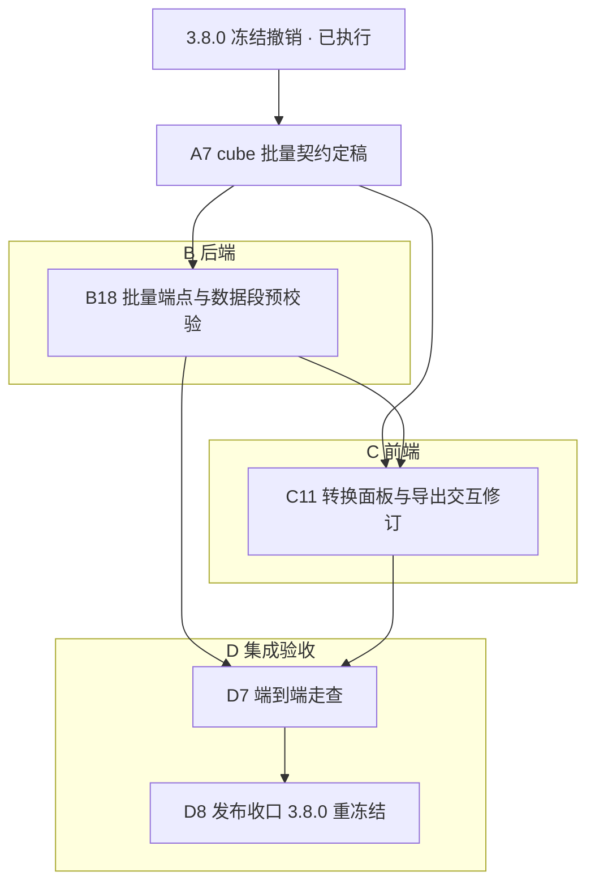
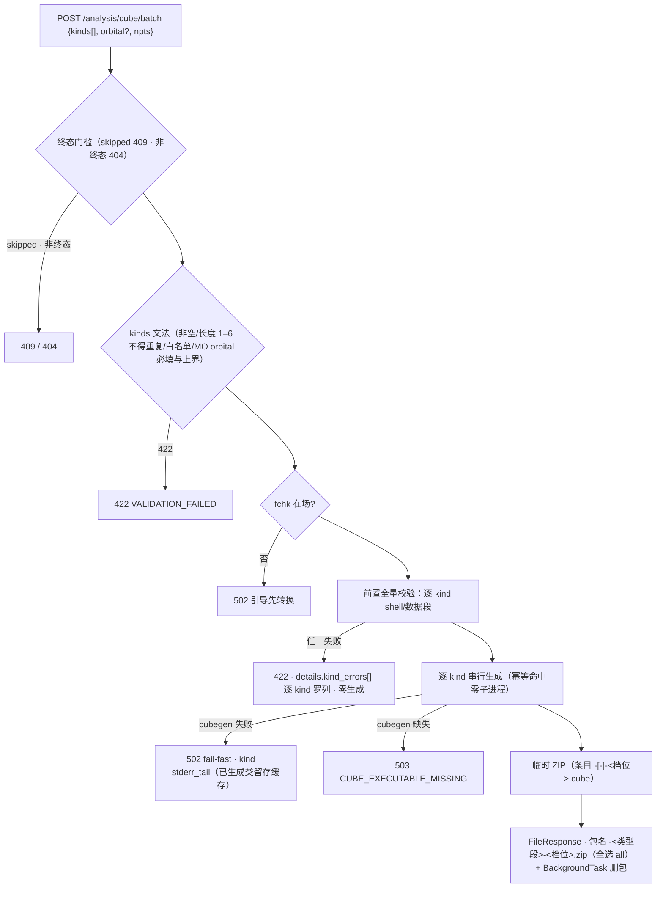

# G16 工具箱走查修订 · 执行计划

> 状态：**待执行**（需求输入 = 用户 2026-11-18 走查反馈六条（R1–R6，§0.2
> 原文定位））。
> 目标版本 **3.8.0**（修订批并入已恢复的 unreleased 行，与源计划工具箱批
> 同版本冻结）；**开工闸门 = 3.8.0 冻结撤销完成**（2026-11-18 已执行——
> tag v3.8.0 删除、发布提交 3eb396b0 回退、发布簿记回滚，§0.4 实录）。
> §0–§9 结构同 [toolbox-plan.md](toolbox-plan.md) 范式；任务编号沿工具箱
> 波顺延（A7/B18/C11/D7/D8），编号作用域 = 本文档，跨计划引用一律带
> 文档名前缀。契约基线 = 开工时 HEAD 的 docs/api/（3.8.0 工具箱批契约
> 已在库），本波新增一律走契约文档 diff（roadmap §4），不得漂移既有语义。

## 0. 目标、范围与依据

### 0.1 目标（= 用户 2026-11-18 走查反馈逐条定位）

修复工具箱批走查发现的六项体验与正确性问题，使历史详情工具域与 cube
导出域达到可交付形态：

1. 历史抽屉的 chk 工具区与导出 cube 区块不再常驻，改为与「分析」同级
   的「转换」按钮开合（互斥三态），相关提示文案同步修正；
2. chk 工具区按钮主次修正——正常结束（succeeded）条目 fchk 已自动
   生成，「下载 fchk」升为主按钮（第一顺位、primary 样式），「转换为
   fchk 并下载」降为次按钮；
3. cube 导出「类型」支持多选与全选——后端工具单次单类型生成，按选中
   项多次执行，多类型产出打包为单个 ZIP 下载；
4. cube 导出前置数据校验——异常终止任务的 chk 缺电子结构数据段时，
   生成前明示「不能生成」及原因，不再以「cubegen 非零退出或超时」
   裸报错抛给用户；
5. cube 导出文件命名全英文——网格档位中文单字（粗/中/细）改为原义
   英文（coarse/medium/fine）；多类型打包命名包含全部选中类型，全选
   用 `all`；
6. 批量导出按钮「全部导出」按实际语义改名——其 scope=all 仅含 out+chk
   （不含 fchk），更名为「导出 .out 和 .chk」。

### 0.2 工作项编号（反馈条目 → 工作项映射）

| 编号 | 工作项（反馈原文摘要） | 承载任务 |
|---|---|---|
| R1 | 抽屉 chk 工具/cube 区块改「转换」按钮开合（与「分析」同级），修正「见上方工具区」类文案 | C11 |
| R2 | 「转换为fchk并下载」与「下载fchk」主次——已证实 succeeded 自动物化，按用户给定分支调换位置与样式 | C11 |
| R3 | cube 类型多选/全选——后端单类型多次执行，多类型打包 ZIP | A7/B18/C11 |
| R4 | cube 导出前置校验——缺数据段时明示原因（038 案例），不可生成即提示 | B18/C11 |
| R5 | cube 命名档位英文（coarse/medium/fine），多类型打包含全选类型段（全选 = `all`） | B18/C11 |
| R6 | 「全部导出」更名为「导出 .out 和 .chk」（scope=all 实为 out+chk 旧语义） | C11 |

### 0.3 不做（非目标）

- `POST /history/{id}/analysis/cube` 单 kind 端点语义零变更（参数、
  幂等、40–120 自由整数、错误码全部保留——批量端点叠加，不改既有）。
- cube 异步作业表（沿 B17 形态）：批量 cubegen 走同步请求——单 kind
  既有链路即同步、批量 ≤6 类、典型体系秒级，等待以按钮 busy 文案呈现；
  异步作业机制属过度设计，不引入。
- `scope=all` API 语义变更（仅前端按钮文案更名，三 scope 契约与测试
  零改动）。
- cube 导出前置置灰（库内无 fchk 数据段在场查询端点——前端无从预判，
  沿 toolbox-plan §2.1「不做前置置灰、点击后按契约报错」口径；预校验
  以提交后 422 明示承载）。
- OrbitalsPanel 预览面板改动（预览与导出分工不变）。
- fdensity kind（沿 toolbox-plan §0.3 维持排除）。
- 新增 SSE 事件（批量同步请求-响应，sse.md 零变更）。
- 前端页面单测（沿 m3/m4/工具箱批决策：手动冒烟 + D 走查清单）。

### 0.4 前置条件（已执行实录 + 开工检测项）

1. **3.8.0 冻结撤销（2026-11-18 已执行实录）**：
   - `git tag -d v3.8.0`（原指 3eb396b0）；
   - `git reset --hard HEAD~1` 回退发布提交 3eb396b0（该提交未被推送，
     分支 ahead 43 全部为未推本地提交，无远端影响；提交对象经 reflog
     可恢复）——CHANGELOG.jsonl unreleased 14 条恢复、progress.json
     latest_released 回 3.7.0、README/link1/m3-plan/roadmap/评估文档的
     D6 回填随提交回退一并撤销（重冻结时按 §6 D8 清单重做）；
   - **打包产物核验：v3.8.0 从未打包**（`target/deploy/` 最新为
     v3.7.0，`VERSION=v3.7.0`），无需删除；
   - `scripts/validate_progress.py` 复跑通过；
   - 源计划 toolbox-plan.md 状态行已回填「已实施并验收 + 冻结撤销注记」
     （未提交，随本计划立项提交一并落库）。
2. `target/release/hq` 在位（全量 pytest 硬前提，AGENTS.md §6.1 第 4 条
   ——本波不触派发链路，凡声称「全量 pytest 通过」时 hq 一律须在位）。
3. 真机资产在位：`~/g16/cubegen`、`~/g16/formchk`、`~/g16/chkchk`
   （§2.8 核验项依赖）；金标准 fchk 与 038 反例在案（§0.5）。
4. **批次闸门（B18 启动前核对）**：A7 契约 diff 经用户评审通过
   （文档先行，roadmap §4）。

### 0.5 依据（2026-11-18 实测与代码回读）

- **038 反例实测（`~/g16web/run/38/input.fchk`，anion_BC1 失败态）**：
  头锚点齐全（`Number of atoms I 15`、`Multiplicity I 1`、
  `Number of basis functions I 160`）、`Alpha Orbital Energies R N=160`
  与 `Alpha MO coefficients R N=25600` 在场，**`Total SCF Density` 段
  缺失**（无 Beta/Spin 段）——异常终止于 SCF 收敛前的 chk 不含密度
  数据。chkchk 体检只验结构可读性（verdict=ok），不验电子结构数据段
  在场性，故「体检健康但 cubegen 非零退出」；该 chk 经 formchk 转换
  的 fchk 继承同形态。**MO kind 对 038 实为可生成**（MO 系数在场），
  Density/Potential/α/β/Spin 不可生成——预校验须按 kind 分列数据段
  映射，不能一刀切。
- **金标准 fchk 数据段实测**：闭壳层水
  （`~/g16/tests/h2o_optfreq_popreg.fchk`）含 `Alpha MO coefficients`
  + `Total SCF Density`，无 Beta/Spin 段；开壳层 OH
  （`oh_doublet_popreg.fchk`）含 Alpha+Beta MO coefficients +
  `Total SCF Density` + `Spin SCF Density`——开壳层 α/β 密度按
  （总密度+自旋密度）/2 合成的段依赖成立，段映射表（§2.4）以实测锚定。
- **自动物化时机（代码回读）**：`web/src/engine/dispatcher.py:573`
  ——仅 `state == "succeeded"` 分支调用 `finalize.make_fchk`（formchk
  自动物化）；failed 分支仅保全 chk 入 protected/。即 R2 的用户分支
  判定 = 「任务完成会自动转换」，按钮调换（§2.2）。
- **cube 服务现状（`web/src/services/cube.py` 回读）**：generate()
  判定链 = 终态门槛（404/409）→ 参数校验（422）→ α/β 开壳层
  fail-closed（422）→ fchk 在场闸（502）→ 幂等命中 → cubegen 子进程
  （120s 超时）；502 details 已携带 `stderr_tail`（尾部 400 字符）但
  前端未透出（CubeExportPanel 仅呈现通用文案「cubegen 非零退出或
  超时」）；fchk 头锚点解析限 `_FCHK_HEAD_SPAN = 65536` 头窗——**数据
  段预校验不能复用该头窗**（038 实测 MO 系数大块 N=25600 之后才轮到
  密度段，超 64KB），须全文行扫描。
- **前端现状（组件回读）**：`ChkToolPanel.vue` 按钮区顺序 = 体检
  （secondary）/ 转换为 fchk 并下载（secondary）/ 下载 fchk（ghost，
  404 以「fchk 不存在 — 请先执行转换」提示）；`CubeExportPanel.vue`
  kind 为单选下拉、档位 `GRADE_CN`（粗/中/细）入名
  （`<stem>-<kind>[-<n>]-<粗|中|细>.cube`）、fchk_missing 文案含
  「请先在上方工具区」；`HistoryView.vue` 抽屉 = ChkToolPanel +
  CubeExportPanel 常驻渲染于操作按钮区之前、按钮区含「分析」开关按钮
  （ana-toggle，与文本预览互斥）、展示区 `anaOpen`/`textView` 二态
  互斥；导出菜单 = 导出 .out（主按钮）/ 导出 .chk / 全部导出 /
  导出 .fchk；`AnalysisPanel.vue:290` 异常态文案含「chk 转换与 cube
  导出见上方工具区」。
- **scope=all 语义（toolbox-plan §2.1/§0.3 定案回读）**：「全部导出」
  维持 out+chk 语义、不含 fchk——R6 更名的语义依据。
- 本波实测（§2.8 核验项随批补充留痕）：批量端点真机全选基线（基线
  体系 = 开壳层 OH——闭壳层无 Spin 段、全选必 422，见 §2.8 核验项
  3；体积/耗时）、OH α/β 段依赖复核。

### 0.6 实施输入：现状核查结论（本波视角）

| 事实 | 对计划的影响 |
|---|---|
| dispatcher 仅 succeeded 自动物化 fchk（finalize.make_fchk），failed 仅保全 chk | R2 按用户分支「自动转换成立」执行：下载 fchk 升主按钮（§2.2） |
| 038 fchk 缺 `Total SCF Density`、有 MO 系数；chkchk verdict=ok 不验数据段 | R4 预校验按 kind 数据段映射（§2.4），fail-closed 422 明示；体检报告语义不扩（数据段判定属 cube 域职责） |
| cube.py 502 details.stderr_tail 已在、前端未透出 | R4 前端补 stderr 尾部摘录呈现（残余失败模式可见根因） |
| `_FCHK_HEAD_SPAN=65536` 头窗不含密度段位置 | 数据段预校验全文行扫描（行首锚点，§2.4），不复用头窗 |
| CubeExportPanel kind 单选下拉 + GRADE_CN 中文入名 | R3/R5：复选按钮组 + GRADE_EN；恰选 1 类走既有单端点直下，≥2 类走批量端点收 ZIP |
| 抽屉 ChkToolPanel/CubeExportPanel 常驻 + 分析/文本预览二态互斥 | R1：三态互斥（转换/分析/文本预览），面板迁入转换区（§2.1） |
| 导出菜单「全部导出」= scope all（out+chk） | R6 前端文案更名「导出 .out 和 .chk」，scope 枚举与后端零改动 |
| 错误码全集 40、mapping openapi 67 操作（工具箱批终态基线） | A7：新端点 +1（mapping 68）、错误码零新增（40 不变）、生成物随批再生 |
| 批量 fchk 作业（B17）为异步作业表 | 批量 cube 不同构——cubegen 单次秒级~数十秒、≤6 类，同步请求 + busy 文案承载（§0.3），不复制作业机制 |

## 1. 任务分解与追踪（WBS）

单波：**A7、B18、C11、D7–D8，目标版本 3.8.0**。阶段语义沿
toolbox-plan：**A** 契约定稿（契约 diff，文档先行）→ **B** 后端 →
**C** 前端 → **D** 集成验收与发布。规模：S ≈ 半天内，M ≈ 1 天。

| 编号 | 任务 | 产出物 | 验收标准（可验证） | 依赖 | 规模 | 对应项 |
|---|---|---|---|---|---|---|
| A7 | cube 批量导出契约定稿 | §2.7 契约 diff（新端点一枚 `POST /history/{id}/analysis/cube/batch` + 请求/响应契约 + 422 details 双词形词域（errors[]/kind_errors[] 分键）+ mapping.md 增行（67→68）+ sse.md 零变更确认 + contract.ts/models.py 再生零 diff；错误码全集 40 不变） | 每个复用码在批量语境的触发场景有承载；details 双词形结构与键名分流规则定稿；生成物再生成零 diff；用户评审通过 | §0.4 条件 1–2 | S | R3/R5（契约面） |
| B18 | cube 批量端点与数据段预校验（后端） | `services/cube.py`：`generate_batch()`（前置全量校验 + 逐 kind 串行生成 + ZIP 打包）+ fchk 数据段预校验单点（per-kind 段映射，全文行扫描）+ 单端点插入段预校验 + 路由声明（routers/analysis.py，置于既有 cube 两路由之后）+ RFC 5987 包名 | kinds 文法校验（非空、长度 1–6 不得重复/未知/orbital 随 MO 必填与上界）；前置全量校验任一 kind 失败 422 且零生成（details.kind_errors[] 逐 kind）；038 形态反例（有 MO 系数无密度段）Density 422 `data_missing`、MO 生成成功；单端点同段校验（幂等命中先于段校验）；幂等命中零子进程；ZIP 条目/包名/全选 `all` 命名正确；502 fail-fast 携带 failing kind 与 stderr_tail；skipped 409、非终态 404；既有单端点用例零回归（fixture 补数据段） | A7 | M | R3/R4/R5（后端） |
| C11 | 抽屉转换面板与导出交互修订（前端） | `HistoryView.vue`（转换按钮 + 三态互斥 + 面板迁挂 + 导出菜单更名）+ `ChkToolPanel.vue`（按钮调换与 title）+ `CubeExportPanel.vue`（类型复选 + 全选 + 批量收包 + GRADE_EN 命名 + kind_errors[]/errors[] 分流呈现 + stderr_tail 摘录 + 文案修正）+ `AnalysisPanel.vue`（异常态文案） | 转换/分析/文本预览三态互斥开合正确；面板仅终态条目渲染（skipped 仅 cube 域 409 明示入口）；按钮主次与 title 符合 §2.2；多选 ≥2 类出 ZIP、恰选 1 类直下 .cube、全选包名 `all`；422 逐 kind 原因与 502 工具输出摘录可见；「全部导出」更名为「导出 .out 和 .chk」；新增/改动样式仅引用既有令牌（§2.8） | A7, B18 | M | R1/R2/R3/R5/R6（前端）+ R4 文案面 |
| D7 | 端到端验收走查（真机） | 走查记录 `docs/plans/toolbox-revision-acceptance.md`（§7.2 路径逐条留痕，截图存本地不入库） | §7.2 走查路径逐条通过（含 038 案例预校验明示、批量全选 ZIP、三态互斥） | B18, C11 | S | R1–R6 |
| D8 | 发布收口（3.8.0 重冻结） | CHANGELOG.jsonl 冻结（原 14 条 + 修订批条目）+ tag v3.8.0 重打 + progress.json/README 同步 + D6 回填重做（§6 清单） | AGENTS.md §5.2 五步顺序执行；check_plan_status 定点校验通过；本计划与源计划状态行回填 | D7 | S | AGENTS.md §5.2 |

**依赖关系总览**：`冻结撤销完成（已达成）→ A7 → B18 → C11 → D7 → D8`。
C11 含不依赖 B18 的纯前端项（R1/R2/R6），与 B18 并行可做、随批同提交；
R3/R5/R4 的前端面依赖 B18 端点与 details 词域落定。A7 是本波契约总闸。

**总工量与关键路径**：≈ **4 人天**（A7 0.5 + B18 1 + C11 1 + D7/D8
1）；逻辑关键路径 `A7 → B18 → C11 → D7 → D8`。里程碑以版本号为锚、
无日历承诺——人天估算仅作规模参照。

## 2. 关键设计定稿（A7 契约规格输入）

> 以下全部为定案（§8 决策记录），无「建议/待定」项。契约 diff 以本节
> 为唯一来源，评审仅核对与本文一致性。

### 2.1 R1 · 历史抽屉「转换」面板（C11）

- **入口形态**：与「分析」按钮并列（ana-toggle 同款）新增「转换」按钮，
  同款（展开态 accent 描边，沿既有 `.ana-toggle--on` 语义与令牌）；
  点击开合「转换」展示区，与「分析」「输入/输出文本预览」**三态互斥**
  （现 `anaOpen`/`textView` 二态互斥机制扩为三态——开任一边关其余，
  展示区同占操作按钮区以下剩余高度，拉伸贴抽屉下缘的既有布局不变）。
- **面板构成**：ChkToolPanel + CubeExportPanel 自常驻位置（操作按钮区之前）
  迁入转换展示区，纵向排列（chk 工具区在上、导出 cube 在下）；组件
  内部实现零改动（R2/R5 的组件内修订另节）。
- **可见性口径**：「转换」按钮与面板渲染口径一致——`selected.state ∈
  {succeeded, failed, skipped}` 可见（skipped 条目 chk 工具区组件内
  自隐藏、cube 域 409 明示入口保留——3.8.0 批 ba9867a6 形态不变）；
  其余状态不渲染按钮。
- **文案修正**（逐处定稿）：
  - `AnalysisPanel.vue` 异常态：「异常结束的执行不进入解析管道 —
    分析不可用，仅可查看 / 导出原文；chk 转换与 cube 导出见「转换」
    面板（终态条目可用）」；
  - `CubeExportPanel.vue` fchk_missing 提示（errText 文案字符串）：
    「fchk 缺失 — 请先执行 chk 转换后再生成 cube」（原「请先在上方
    工具区」随常驻布局移除而失义；转换面板内 chk 工具区与 cube 导出
    区上下相邻，无需方位指引）；
  - 注释面同步：`ChkToolPanel.vue` docblock「「下载 fchk」入口常显
    （缺失以 404 提示）」表述随 §2.2 主次调换改写。

### 2.2 R2 · chk 工具按钮主次调换（C11）

**事实前提**（§0.5）：succeeded 任务完成时 `finalize.make_fchk`
自动物化 fchk；failed 任务不自动转换；crest 条目虽 succeeded 但不经
formchk（无 fchk，下载行为与「缺失」分支相同）。按用户给定分支
「会自动转换 → 调换位置和样式」执行：

- **顺序与样式**：按钮区变为「chk 体检」（btn--secondary，位置不变）
  →「下载 fchk」（**btn--primary、升第一主操作**）→「转换为 fchk 并
  下载」（btn--secondary，次操作）。
- **title 定稿**（用户可见，禁内部词——状态映射中文「正常结束/
  异常结束」，不出现枚举值与「幂等」「自动物化」等实现概念）：
  下载 fchk——「fchk 已生成时可直接下载；缺失时请先执行转换」
  （crest 条目 succeeded 而无 fchk，title 不作「已自动生成」的普适
  断言）；转换按钮——「fchk 缺失或需重转时使用；此前已生成过则直接
  下载」（替换既有含「幂等」的 title）。
- **错误提示保留**：下载 404 →「fchk 不存在 — 请先执行转换」（既有
  errText 分支零改动）；体检损坏拒转换 409 明示形态不变。
- docblock 首注释「「下载 fchk」入口常显（缺失以 404 提示）」同步改写
  为主次调换后的表述。

### 2.3 R3 · cube 类型多选与批量导出（A7/B18/C11）

- **前端选择形态**：kind 单选下拉改**复选按钮组**（六项，形态沿档位
  按钮组 `ce-grade` 同款）+「全选」切换按钮（六项全勾/全清）；
  MO 轨道号行随 MO 勾选显隐（多选含 MO 时单一轨道号作用于该类）。
- **执行模型**：后端 cubegen 单次单类型（`KINDS` 白名单不变）——批量
  即按选中项多次执行既有生成链：服务端逐 kind 串行调内部生成单点
  （幂等命中零子进程），前端单请求收包，不复制前端循环。
- **交付形态**：恰选 1 类 → 走既有单 kind 端点直下 `.cube`（现行为
  零变更）；选中 ≥2 类 → `POST /history/{id}/analysis/cube/batch`
  收单个 ZIP（`parseAs: "blob"` 落盘）。1 类不打包（单文件直下更直接，
  也不产生「ZIP 套一层」的解包负担）。
- **判定链（批量端点，B18）**：
  1. 终态门槛 `terminal_for_download`（skipped 409、非终态 404——
     与 GET 同口径）；
  2. kinds 文法校验 422：非空数组、元素 ∈ KINDS、长度 1–6 且不得
     重复（重复/未知 422）；orbital 仅选中含 MO 时接受——含 MO 时
     必填且 1≤n≤上界（越界 422），不含 MO 而携带 422 `unexpected`
     （沿单端点既有码型）；上界解析三级源不可得的 `mo_upper_unknown`
     与 succeeded 条目无 MO 表的 `ANALYSIS_PARSE_FAILED` 均属本步，
     沿单端点既有码与 details 形态透传（零新增码）；npts 域同单端点
     （{-2,-3,-4} ∪ [40,120]）；
  3. fchk 在场闸 `terminal_with_fchk`（502 引导先转换——文案沿 §2.1
     修正后的中性表述）；
  4. **前置全量校验**：逐 kind 依次执行 α/β 开壳层 fail-closed、
     fchk 数据段预校验（§2.4）——任一 kind 失败即 422
     `VALIDATION_FAILED`，`details.kind_errors[]` 逐 kind 罗列（kind
     + reason + section?），**零生成、零子进程**（先全量校验后生成，
     避免「生成一半才报另一类不可用」；与步骤 2 文法 422 分键承载，
     判别规则见 §2.7）；
  5. 全部通过 → 逐 kind 串行生成（幂等命中直接复用）→ 任一 kind
     生成失败（cubegen 非零退出/超时）即 fail-fast 502
     `CUBE_GENERATION_FAILED`（details 携带 failing kind、kind_arg、
     npts、stderr_tail——与单端点同码同形；已生成的 cube 留存幂等
     缓存，重试只补缺失类）；cubegen 可执行缺失 → 503
     `CUBE_EXECUTABLE_MISSING`（生成阶段首类子进程调用即失败、
     零产物，fail-fast 同口径）。
- **打包**：临时目录写 ZIP（条目逐 kind：`<stem>-<Kind>[-<n>]-<档位>
  .cube`）→ `FileResponse` 流式发送 + `BackgroundTask` 删临时包
  （沿 history.py 导出先例）；包名 `Content-Disposition` 恒附带
  RFC 5987 `filename*`（中文 stem 原样保留）与白名单清洗的 ASCII
  fallback（清洗为空回落 `execution-<id>`，沿 fchk 下载先例）。
- **路由落位**：`POST /history/{id}/analysis/cube/batch` 挂
  `routers/analysis.py`，声明置于既有 cube 两路由之后的独立字面段
  ——`batch` 字面段与 `GET .../cube/{cube_id}` 动态段方法不重合、
  无实际吞并（analysis.py 既有路由与新端点路径/方法均不相交，无
  history.py `/history/{id}` 形态的字面/动态竞争位，两种落位功能
  等价；后置与既有 cube 路由相邻）。
- **进度与失败呈现（C11）**：busy 文案「生成中 …」（批量
  「生成中（N 类）…」）；422 按 details 键名分流——`kind_errors[]`
  逐 kind 罗列（mono 多行，「kind — 原因」逐行，分隔用「—」）、
  `errors[]` 沿既有字段错误呈现（两键同响应不并存，判别见 §2.7）；
  502 呈现 failing kind 与 stderr 尾部摘录（§2.4）。
- **体积提示**：勾选 ≥2 类且细档时提示「多类型 × 细档 — 体积叠加
  （每类数十 MB 量级）」（单类细档提示保留）。

### 2.4 R4 · fchk 数据段预校验（B18，单端点同步插入）

- **判定单点**：`_ensure_cube_sections(execution_id, kind, shell)`——
  读 `input.fchk` 全文（`errors="replace"`）行扫描段名（行首锚点正则，
  沿既有 `_F_*` 形态扩）；**不复用 64KB 头窗**（038 实测密度段位于
  MO 系数大块之后；fchk 文本量级 MB，单遍扫描可接受）。shell 判定
  复用既有三级源判定（抽 helper 返回 open/closed/unknown，供 α/β
  校验与段映射共用，不重复实现）；unknown 分支定稿——α/β 沿既有闸
  422 `shell_unknown`，MO 段校验不判 shell、仅要求
  `Alpha MO coefficients` 在场即放行（不因 shell 不可判定拒绝，与
  「038 MO 可生成」口径自洽，不为 MO 引入既有链路之外的失败形态；
  shell 可判定为开壳层时仍按映射表另验 Beta 段）。
- **per-kind 必需段映射**（fail-closed，锚点以金标准实测为准）：

  | kind | 必需段（行首锚点） | 缺失时 details.reason / 用户提示（定稿） |
  |---|---|---|
  | MO | `Alpha MO coefficients`（开壳层另需 `Beta MO coefficients`；shell 不可判定时仅验 Alpha 段） | `data_missing` — 「fchk 缺少 MO 系数数据 — 无法生成轨道 cube」 |
  | Potential | `Total SCF Density` | `data_missing` — 「fchk 缺少密度数据 — 异常结束任务的 chk 通常不含密度数据，无法生成」 |
  | Density | `Total SCF Density` | 同上 |
  | Spin | `Spin SCF Density` | `data_missing` — 「fchk 缺少自旋密度数据 — 无法生成」 |
  | Alpha / Beta | `Total SCF Density` + `Spin SCF Density` | `data_missing` — 「fchk 缺少总密度或自旋密度数据 — 已拒绝生成，避免产出错误密度」 |

- **落位与顺序**：单端点插在幂等命中之后、cubegen 之前（幂等命中
  即曾成功，不重查）；批量端点在 fchk 闸后的前置全量校验阶段（§2.3
  判定链第 4 步）。422 码复用 `VALIDATION_FAILED`，
  `details.reason="data_missing"` + `details.section`（缺失段名）+
  `details.kind`——message 以中文要义呈现（映射表右列）。
- **fail-closed 依据**：闭壳层 α/β 在 cubegen 侧不报错、静默产出
  半密度（toolbox-plan §0.5 实测 ElSum 恰为一半）——缺 Spin 段的
  开壳层 α/β 同理可能以零自旋兜底产出错误 cube，不能依赖 cubegen
  报错兜底；038 实测证实缺密度段时 cubegen 才非零退出，但报错裸文案
  不可排查——预校验把「不可生成」前置为结构化 422。
- **502 残余失败透出（C11）**：校验通过后 cubegen 仍非零退出/超时的
  残余失败模式，前端 errText 对 `CUBE_GENERATION_FAILED`（非
  fchk_missing）呈现「cube 生成失败（cubegen 非零退出或超时）—
  工具输出摘录：<尾部 ~200 字符>」（mono 呈现；界面用「工具输出
  摘录」表述，不出现 stderr 等实现词）——服务端 details 已携带，
  纯前端呈现补齐。
- **既有用户可见文案内部词清洗（C11 同批，仅限本波触及组件）**：
  - `CubeExportPanel.vue` mo_upper_unknown 文案「无法确定轨道上界
    （分析数据与 fchk 头锚点均不可得）」→「无法确定轨道上界 —
    条目数据不完整，无法生成 MO cube」（「头锚点」为实现概念）；
  - 工具缺失文案「请检查 g16_root 设置」→「请检查设置中的 G16
    安装目录」（内部设置键不上界面）——`ChkToolPanel.vue` 与
    `CubeExportPanel.vue` 两处同改（均属本波触及组件）；
  - 既有转换按钮 title「input.fchk 已存在时直接下载（幂等）」→
    由 §2.2 新 title 替换。
- **体检报告语义不扩**：chkchk 报告的「MO 系数」在场项（has_mo）
  维持现状；数据段判定属 cube 域职责，不在体检报告加注（避免跨域
  耦合——体检对「转 fchk/供外部软件读」仍有效，仅 cube 生成受限）。

### 2.5 R5 · cube 导出命名英文化（B18/C11）

- **档位英文**（原义）：`-2 = coarse`、`-3 = medium`、`-4 = fine`。
- **单文件（恰选 1 类，前端命名）**：`<stem>-<Kind>[-<n>]-<coarse|
  medium|fine>.cube`（如 `anion_BC1-MO-5-medium.cube`）——
  `GRADE_CN` 替换为 `GRADE_EN`，其余命名结构不变。
- **批量 ZIP（≥2 类）**：
  - 包名：`<stem>-<Kind1>-<Kind2>-…-<档位>.zip`，类型段按 KINDS
    规范序（MO、Potential、Density、Spin、Alpha、Beta）排列；
    **六类全选 → 类型段 `all`**（`<stem>-all-<medium>.zip`）；类型段
    不含 MO 轨道号——同 stem 同档位下不同轨道号的批量包落同名
    （后导出覆盖先导出），属低频场景的已知限制，不为此扩公式；
  - ZIP 内条目：逐 kind `<stem>-<Kind>[-<n>]-<档位>.cube`（与单文件
    同构）；包内平铺、无目录层级；
  - 前端落盘名与服务端 Content-Disposition 同公式（客户端已知选中
    集，两端一致，避免双命名漂移）；
  - 40–120 自由整数（契约兼容保留、工具箱 UI 不发起）：命名段用
    无符号数值本身（如 `80`——40–120 为正整数域，命名段不含负号，
    负号仅属 -2/-3/-4 presets 且 presets 映射英文词）。
- **stem 取数**：服务端与 fchk 下载端点同源（执行记录 filename stem）；
  前端沿用现有 `stem()` 逻辑。

### 2.6 R6 ·「全部导出」更名（C11）

- 菜单项「全部导出」→「导出 .out 和 .chk」（用户定名）；title 同步
  「导出 .out 和 .chk — 同包导出（ZIP）」。菜单顺序不变（导出 .out
  主按钮 / 导出 .chk / 导出 .out 和 .chk / 导出 .fchk）。
- `scope=all` 枚举、`exportSelected('all')` 调用、后端三 scope 契约
  与测试**零改动**——纯文案更名，消除「全部（含 fchk）」误读。

### 2.7 契约 diff 全集（A7 交付物明细）

- **新端点一枚**：`POST /history/{id}/analysis/cube/batch`——请求
  `{kinds: Kind[]（长度 1–6、不得重复）, orbital?: int（仅 kinds
  含 MO 时接受，不含 MO 而携带沿单端点 422 `unexpected`）, npts?:
  -2|-3|-4 ∪ 40–120}`，响应 200 `application/zip` 二进制流
  （FileResponse）；错误响应复用 `ErrorBody`（404 `NOT_FOUND` / 409
  `ANALYSIS_UNAVAILABLE` / 422 `VALIDATION_FAILED` / 502
  `CUBE_GENERATION_FAILED` / 503 `CUBE_EXECUTABLE_MISSING`）。
- **details 词域扩展（批量 422 双词形分键定稿）**：`VALIDATION_FAILED`
  的批量 422 按失败阶段分键承载——文法 422（判定链步骤 2）复用既有
  `errors[]`（元素 `{field, reason, value, …}` 字段词形，与单端点
  参数校验同形；MO 上界三级源不可得的 `mo_upper_unknown` 属本步、
  details 沿单端点既有形态）；前置校验 422（判定链步骤 4）用独立键
  `kind_errors[]`（元素 `{kind, reason, section?}`，reason 词域 =
  既有 `closed_shell`/`shell_unknown` ∪ 新增 `data_missing`）。两键
  同响应互斥（步骤 2 先于步骤 4 fail-fast），前端按 details 键名
  分流呈现；两键皆无的透传码——批量含 MO 请求撞上既有
  `ANALYSIS_PARSE_FAILED`（succeeded 条目无 MO 表，文法步抛出，
  details `{"block": "orbitals"}`）沿单端点形态透传，零新增码，前端
  message 兜底。单端点新增 `data_missing`（含 `section`，details 沿
  单端点既有形态）；`CUBE_GENERATION_FAILED` details 批量形态补
  `kind`（failing kind 归属）。文件头 reason 词表核对：`data_missing`
  属 cube 域校验 reason（与导入 per-file/设置域/组合流模板三张词表
  无涉），随 diff 在 cube 契约节登记即可。
- **码型分歧声明（α/β + fchk 缺失组合）**：单端点 α/β 的 shell 判定
  先于 fchk 在场闸（既有判定链顺序不变）——同组合 shell 判定可得时
  422 `closed_shell`、不可得时 422 `shell_unknown`；批量端点 fchk 闸
  （判定链步骤 3）先于 shell/段校验（步骤 4）——同组合 502 引导先
  转换。批量预期按 502 钉死（测试矩阵覆盖），单端点既有语义零变更、
  不以批量口径回改。
- **错误码全集 40 不变**（零新增码）；`test_error_codes.py` 计数注释
  不动；`FRONTEND_CODE_BRANCHES` 允许集零变更（按码分支均为既有码）。
- **mapping.md**：06 工具箱节增一行（openapi 操作 67→68）；
  **sse.md 零变更**（请求-响应型，确认注记随 diff 留痕）。
- **生成物随批再生**：`npm run gen:types`（contract.ts）与
  `uv run python web/scripts/gen_models.py`（models.py）零 diff
  为契约批次闸门（`test_openapi_ssot.py` 全量校验）。
- **存储迁移：零**（批量 ZIP 为临时文件即发即删；cube 幂等留存与
  cube_id 公式沿用既有——批量不新增维度，同参数同 id）。

### 2.8 真机实测核验项（随批实现后完成、留痕入交付物）

1. **038 反例预校验落点复核**（2026-11-18 实测已锚定根因，本项为
   实现后真机回归）：`run/38` 条目 Density/Potential/Spin 预期
   422 `data_missing`（逐 kind 罗列）、α/β 预期 422 `closed_shell`
   （α/β 先经 shell 判定，038 闭壳层形态被既有闸拦截、不进入段
   校验）、MO 预期生成成功——D7 走查逐条留痕（含 422 提示文案
   可见性）。
2. **OH α/β 段依赖复核**：`oh_doublet_popreg.fchk` 含
   `Total SCF Density` + `Spin SCF Density`（已实测在案）——B18
   段映射不误伤真机开壳层；若真机出现开壳层缺 Spin 段形态，按
   fail-closed 422 留痕（属异常终止形态，非误伤）。
3. **批量全选基线**（B18 实现后，D7 走查路径 4 一并留痕）：基线
   体系 = 开壳层 OH（`oh_doublet_popreg.fchk` 形态条目，六类必需段
   齐备；闭壳层水无 `Spin SCF Density` 段、全选六类必 422，不作
   成功基线）全选六类 × medium 真机端到端——逐类耗时、ZIP 体积与
   条目命名核对，供细档叠加提示的量级表述校准；闭壳层健全条目全选
   六类的 422 逐 kind 罗列（Spin `data_missing`、α/β `closed_shell`）
   随同路径留痕。

### 2.9 前端视觉与令牌纪律（C11，承 toolbox-plan §2.8 同口径）

- 继承既有风格：不引入 UI 组件库；复选按钮组沿档位按钮组形态、
  「转换」按钮沿 ana-toggle 形态、进度/失败注记沿既有 note 形态；
- 令牌集中管理不可违反：新增/改动样式一律 `var(--…)` 引用既有令牌，
  禁字面值、禁组件内私设 `--*` 令牌、禁主题分支；确需新令牌先成对
  登记 tokens.css 并跑 `check_tokens`/`check_contrast`；
- 动效只改 transform/opacity，时长缓动引用既有 `--dur-*`/`--ease-*`；
- 新增 UI 文案简体中文、分隔用「—」或「/」、禁「·」；**用户可见
  文案禁一切内部语义**（2026-11-18 用户强调，硬性纪律）：布局词
  （动作行/动作区等）、状态枚举值（succeeded/failed/skipped 等——
  映射「正常结束/异常结束/未运行」）、实现概念（幂等/物化/锚点/
  stderr/资产/闸门等）、内部字段名与设置键（g16_root 等）一律不上
  界面；G16 领域词汇（chk/fchk/cube/cubegen/MO/SCF/%chk 等）与既有
  可见面板标题可引用；kind 展示名沿用现有中文标签、`data_missing`
  等 reason 值不出现在界面；本计划被引用为 UI 字符串的文本已逐句
  按此清洗（§2.1/§2.2/§2.4/§2.5），实现阶段不得引入新违规；
- 闸门：`npm run build`（vue-tsc 零错误）、`scripts/check_tokens.py`、
  `scripts/check_contrast.py`、组件样式 diff 复核（仅令牌引用）、
  `scripts/audit_frontend_offline.sh`——C11 提交前逐项过闸，D7 双主题
  目检新增面。

## 3. 任务流程图

### 3.1 阶段与任务依赖

### 3.2 批量 cube 判定链（R3/R4/R5）

## 4. 逐任务执行方案

> 每任务四要素：**步骤**、**技术要求**、**质量标准**、**交付物**。
> 公共纪律不重复写：文档先行、全量 `uv run pytest` + 闸门清单（§6）
> 过闸、契约生成物随 diff 再生零 diff。

### 4.1 A7 · cube 批量导出契约定稿

- 步骤：① 按 §2.7 起草契约 diff（新端点请求/响应 + details 双词形
  词域与键名分流 + `data_missing` reason 登记 + mapping 增行 67→68 +
  sse.md 零变更确认注记）；② 与 §2.3/§2.4 逐条走查契约形状一致性；
  ③ 生成物同批再生零 diff；④ 用户评审。
- 技术要求：契约基线 = 开工时 HEAD docs/api/；错误码 40 不变（零新增）；
  批量 details 双词形判别规则与单端点复用码触发场景（含 α/β + fchk
  缺失组合的批量 502 分歧声明）写清；`data_missing` 的
  section 字段为段名原文（供前端与日志定位）。
- 质量标准：评审通过；`test_openapi_ssot.py` / `test_error_codes.py`
  通过；contract.ts 与 models.py 再生成零 diff。
- 交付物：契约 diff（openapi.yaml + mapping.md + sse.md 确认注记 +
  contract.ts / models.py 再生产物）。

### 4.2 B18 · cube 批量端点与数据段预校验

- 步骤：① `services/cube.py`：shell 判定抽 helper（三级源复用、返回
  open/closed/unknown）→ `_ensure_cube_sections` 数据段预校验单点（§2.4 映射
  表，全文行扫描）→ 单端点插入段校验（幂等命中后、cubegen 前）→
  `generate_batch()`（§2.3 判定链五步 + ZIP 打包与包名公式）；
  ② 路由声明（routers/analysis.py，`batch` 字面段）；③ 测试 fixture
  补数据段（既有成功用例的合成 fchk 补 `Total SCF Density` 等段——
  预校验插入后缺段即 422，不补则既有用例自红）；④ 038 形态反例
  fixture（有 MO 系数无密度段）入库；⑤ §2.8 核验项真机留痕（038
  回归、OH 开壳层不误伤、批量全选基线——核验项 3 端到端依赖本任务
  端点，随实现完成）。
- 技术要求：段扫描 `errors="replace"` 全文行读、行首锚点正则（沿
  `_F_*` 形态）；批量校验先全量后生成（任一 422 零子进程）；ZIP 临时
  文件 + BackgroundTask 删包（沿 history 导出先例），包内平铺；
  RFC 5987 + ASCII fallback 包名；幂等命中逐 kind 复用（同参数同
  cube_id，批量不新增维度）；fail-fast 502 携带 failing kind；单端点
  既有语义零漂移（校验顺序仅在幂等命中后追加一闸；唯一有意例外——
  缺段 kind 由 502 裸错改 422 `data_missing`，§6 fixed 条目承载）。
- 质量标准：批量判定链全支路用例（文法 422 各形态 / fchk 闸 502 /
  kind_errors[] 逐 kind 422 / 038 反例 Density 422 + MO 成功 / 幂等零子
  进程 / ZIP 条目与包名含全选 all / RFC 5987 中文 stem / fail-fast
  502 / skipped 409 / 非终态 404 / 无 cubegen 503）；单端点段校验用例（缺段 422、
  幂等命中不重查、既有用例补 fixture 后零回归）；ZIP testzip 完整性
  与临时包删除断言。
- 交付物：cube.py 扩展 + 路由 + fixtures + 测试 + §2.8 核验项
  真机留痕。

### 4.3 C11 · 抽屉转换面板与导出交互修订

- 步骤：① `HistoryView.vue`：三态互斥（convOpen/anaOpen/textView）
  + 「转换」按钮（ana-toggle 同款）+ 面板迁挂转换区 + 导出菜单更名；
  ② `ChkToolPanel.vue`：按钮调换（§2.2）与 title/docblock；③
  `CubeExportPanel.vue`：类型复选按钮组 + 全选 + 批量收包（client
  batch 方法 parseAs blob）+ `GRADE_EN` 命名 + kind_errors[]/errors[] 分流呈现
  + stderr_tail 摘录 + fchk_missing 文案修正；④ `AnalysisPanel.vue`
  异常态文案；⑤ `client.ts` 增批量方法；⑥ 组件样式 diff 复核 +
  明暗双主题目检。
- 技术要求：复选按钮组沿 `ce-grade` 形态（多选语义 +「全选」切换）；
  恰选 1 类走单端点、≥2 类走批量端点（前端路由逻辑）；kind 展示
  沿用现有中文标签，reason 值不上界面——前端按 §2.4 映射表右列
  登记 kind+reason(+section)→中文文案映射（含单端点 `data_missing`
  分支与批量 `kind_errors[]` 三 reason 组装，`closed_shell`/
  `shell_unknown` 亦入映射）；错误呈现沿既有 note 形态
  （mono，逐行「kind — 原因」；errors[]/kind_errors[] 按 details
  键名分流，两键皆缺沿 `error.message` 兜底透显——既有行为）；
  互斥逻辑与既有 toggleAna 同构扩展。
- 质量标准：三态互斥开合正确且展示区占位不回跳；skipped 条目转换
  面板内 cube 域 409 明示入口可用；按钮主次与 title 符合 §2.2；
  多选 ≥2 类出 ZIP、全选包名 all、单类直下 .cube；422 逐 kind 与
  502 工具输出摘录可见；「导出 .out 和 .chk」更名后三 scope 导出零
  回归；既有与新增用户可见文案零内部词（§2.9 禁用清单逐条核对）；
  新增/改动样式仅引用既有令牌。
- 交付物：四组件修订 + client 方法 + 走查（D7 留痕）。

### 4.4 D7/D8 · 走查与发布

- D7：按 §7.2 清单真机走查（GUI 经 Playwright 黑盒驱动），走查记录落
  `docs/plans/toolbox-revision-acceptance.md`（体例同
  toolbox-acceptance.md；截图存本地不入库）。
- D8：AGENTS.md §5.2 五步执行（3.8.0 重冻结；不推送远端、打包上传
  属用户授权动作另请；冻结时按 changelog-spec §1.7 复核——修订批含
  added 新端点判 minor，与源批同版本合并冻结）；**发布前回填本计划
  状态行**与源计划状态行版本标注；`scripts/check_plan_status.py`
  定点校验通过。

## 5. 测试矩阵（先测试后实现）

| 测试文件（拟） | 覆盖 | 关键用例 | 类型 |
|---|---|---|---|
| test_cube_api.py（扩） | B18 | 批量判定链全支路（文法 422：空/重复/未知/超 6/kinds 非数组/元素类型错/orbital 缺失/非 MO 带 orbital `unexpected`/succeeded 无 MO 表 `ANALYSIS_PARSE_FAILED` 透传、长度 1 合法 200；fchk 闸 502 先于前置段校验——闭壳且缺 fchk 为 502 非 422；kind_errors[] 逐 kind 422 零生成；038 形态反例逐 kind 矩阵：MO 200 / Density、Potential、Spin 422 `data_missing` / α/β 422 `closed_shell`；批量幂等序相反形态——曾生成后 fchk 缺段 422；幂等命中零子进程；ZIP 条目命名含 40–120 自由整数档/包名全选 `all`/testzip/临时包删除/RFC 5987；fail-fast 502 带 kind 与 stderr_tail；skipped 409/非终态 404/无 cubegen 503）；单端点段校验（缺段 422 带 section、幂等命中不重查、闭壳 Spin 422、开壳 α/β 缺 Spin 段 422）；既有用例 fixture 补段后零回归 | 单元+契约+真机段 |
| 既有回归 | 全程 | 单 kind 端点语义零漂移（六 kind × 档位/幂等/502/503/404/409 既有用例）；history 三 scope（all 不含 fchk）零回归；错误码 40 与 mapping 68 计数一致；`test_openapi_ssot.py`/gen 产物零 diff；`test_e2e_fake_g16.py` 不回归（hq 在位） | 闸门 |

**缺漏场景逐条落位**（全部进上表，不以人工走查替代）：

1. 038 形态反例（有 MO 系数、无密度段）逐 kind 预期矩阵
   （test_cube_api——MO 200 / Density、Potential、Spin 422
   `data_missing` / α/β 422 `closed_shell`；α/β 先经既有 shell
   判定，038 闭壳层形态被既有闸拦截、不进入段校验）。
2. 开壳层（OH fixture）α/β 全段在场通过、缺 Spin 段 422
   （test_cube_api）。
3. 全选六类包名 `all`、五类包名逐类罗列、规范序排列
   （test_cube_api）。
4. 中文 stem 包名 RFC 5987 与 ASCII fallback（test_cube_api）。
5. 批量中途 cubegen 失败 fail-fast、已生成类留存缓存可重试
   （test_cube_api——mock 假 cubegen 第 N 类失败）。
6. 单端点幂等命中先于段校验（已生成 cube 后 fchk 缺段不 422）
   （test_cube_api）。
7. 既有成功用例 fixture 补段后全绿（回归——预校验插入不误伤）。
8. 闭壳层且缺 fchk 条目批量请求 → 502（fchk 闸先于前置段校验——
   段扫描依赖 fchk 在场，非 422）；α/β + fchk 缺失同组合批量 502、
   单端点 422（shell 判定先行的既有码型，分歧按 §2.7 声明钉死）
   （test_cube_api）。
9. 批量端点 kinds 长度 1 合法（200）——恰选 1 类前端路由到单端点，
   批量端点自身对 1 类的接受性由契约测试钉死（test_cube_api）。
10. 批量幂等序相反形态：曾成功生成后 fchk 被替换为缺段形态，批量
    请求在前置全量校验即 422（与单端点幂等命中不重查相反，系批量
    先全量后生成的有意设计）（test_cube_api）。
11. ZIP 条目命名覆盖 40–120 自由整数档位形态（数值段无符号原样
    入名，如 `80`，沿 §2.5 公式；presets 映射英文词不落数值段）
    （test_cube_api）。
12. shell 不可判定条目（无三级源样例）MO 请求——`Alpha MO
    coefficients` 在场即放行（200），不因 shell 不可判定 422
    `shell_unknown`（§2.4 MO 支路定稿）（test_cube_api）。
13. 批量请求 + g16_root 无 cubegen → 503 `CUBE_EXECUTABLE_MISSING`
    （生成阶段首类子进程调用即失败、零产物；契约五码在批量语境的
    承载用例）（test_cube_api）。
14. 批量请求 kinds 不含 MO 而携带 orbital → 422 `unexpected`
    （errors[] 词形，沿单端点既有码型）（test_cube_api）。
15. 批量含 MO 请求 + succeeded 条目无 MO 表（blocks.orbitals=false）
    → 422 `ANALYSIS_PARSE_FAILED` 文法步透传（details
    `{"block": "orbitals"}`，两键皆无——前端 message 兜底形态钉死）
    （test_cube_api）。

fixtures 落位 `web/tests/fixtures/g16tools/`（沿工具箱批体例）：
038 形态反例 fchk 头部样例（头锚点 + Alpha MO coefficients、无密度
段，按 `run/38` 实测形态截存）、闭壳层水与开壳层 OH 全段 fchk 样例
（金标准已在案，补入 fixture 集）、shell 不可判定样例（无 shell 判定
源锚点、Alpha MO coefficients 在场——配 §2.4 MO 放行支路用例）、
假 cubegen 可执行脚本（成功/延迟/第 N 次调用失败三形态，供批量
fail-fast 用例）。

## 6. 提交序列与进度同步

遵守 conventional_commits（单类变更/提交，文档 → 实现（测试随实现
同提交） → 进度同步）。**定稿提交表**（6 项，含 3.8.0 重冻结；
每项随行一笔 chore(progress) 登记、不另占编号）：

| # | 提交（type: 摘要） | 内容 |
|---|---|---|
| 1 | docs(plans): 立项工具箱走查修订计划 | 本文档 + 源计划状态行「已实施并验收 + 冻结撤销注记」随批落库 |
| 2 | docs(api): 增补 cube 批量导出契约 diff | 新端点一枚/details 双词形词域（errors[]/kind_errors[] 分键）与 data_missing 登记/mapping 67→68/sse.md 零变更确认/生成物随批再生零 diff |
| 3 | feat(web): 实现 cube 批量导出与数据段预校验 | generate_batch 判定链 + 段预校验单点（单端点同步插入）+ ZIP 打包与命名 + 路由 + fixtures + 测试 |
| 4 | feat(frontend): 修订抽屉转换面板与导出交互 | 三态互斥转换面板/按钮主次调换/类型复选与批量收包/命名英文化/导出菜单更名/文案修正与既有文案内部词清洗（§2.9） |
| 5 | docs(plans): 登记 D7 修订走查记录 | `docs/plans/toolbox-revision-acceptance.md`（+ 随查随修 fix 一缺陷一提交另计） |
| 6 | chore(release): 冻结发布 3.8.0 | 五步重冻结 + D6 回填重做 + 本计划与源计划状态行回填 |

**进度同步**：每完成一项提交即向 CHANGELOG.jsonl unreleased 行
（2026-11-18 撤销后恢复的 14 条所在行）与 progress.json unreleased
追加摘要；修订批变更条目（拟）：

- added：新增 cube 批量导出端点——历史详情多类型（含全选）一次打包
  下载，逐类串行生成、幂等命中复用；
- changed：历史抽屉新增「转换」面板入口，chk 工具与 cube 导出移入
  面板（与「分析」同级三态互斥）；将 chk 工具「下载 fchk」升为
  主按钮（succeeded 自动物化直下）；将批量导出「全部导出」更名为
  「导出 .out 和 .chk」（scope=all 实为 out+chk）；将 cube 导出
  文件名档位英文化（coarse/medium/fine），多类型打包命名含全选
  类型段（全选 `all`）；
- fixed：修复 cube 生成裸报错——前置 fchk 数据段预校验在异常终止
  任务缺密度/MO 数据段时按 kind 明示不可生成原因（422
  data_missing），不再裸报「cubegen 非零退出」；补充 502 提示透出
  工具输出尾部摘录。

**闸门清单**（提交前逐项）：`uv run pytest`（全量，hq 在位）、
`scripts/validate_progress.py`、`scripts/check_tokens.py`、
`scripts/check_contrast.py`（前端批次）、组件样式 diff 复核（前端
批次）、`scripts/gen_changelog_md.py --check`、`npm run build`
（vue-tsc 零错误）、`scripts/audit_frontend_offline.sh`（前端批次
与 D7 收口）、`npm run gen:types` 与 `gen_models.py` 再生零 diff
（契约批次）、`scripts/check_plan_status.py`（发布前定点）。

**D8 重冻结回填清单**（原 D6 回填随撤销回退，重做项）：

1. CHANGELOG.jsonl unreleased 行冻结为 3.8.0（原 14 条 + 修订批条目
   一并冻结）、追加新空 unreleased 行；CHANGELOG.md 经
   `scripts/gen_changelog_md.py` 再生；
2. progress.json 清空 unreleased、latest_released_version=3.8.0；
3. `git tag v3.8.0` 本地落位（HEAD = 届时冻结提交；打包
   `scripts/package_release.sh v3.8.0` 由用户届时指示——打包/上传均
   属授权动作）；
4. README 版本同步；
5. roadmap：§4 正则禁令豁免登记（四处锚点提取）、M3 段失败条目规则
   修订与化学层注记、§6 backlog 增 opt 内存公式（原 D6 三项重做）；
6. m3-plan §2.2 失败条目规则同口径修订（重做）；
7. link1-multistep-plan B1 基线起点数字随工具箱批终态同步——错误码
   「35→37」改「40→42」、kind「12→15」改「14→17」（本修订批零新增、
   起点数字不变，仅随重冻结重做登记）；
8. 源计划状态行补「（3.8.0）」版本标注、本计划状态行回填
   「已实施并验收（3.8.0）」+ 验收留痕位置。
9. 评估文档（docs/specs/g16-native-tools-assessment.md）状态行回填
   重做——「已实施并验收」+ 验收留痕 + 「（3.8.0）」版本标注（该
   文档在 docs/specs/、不在 check_plan_status 扫描域内，随本清单
   逐项人工核对）。

## 7. 验收标准（DoD）

### 7.1 本波 DoD

1. 历史抽屉与「分析」并列的「转换」按钮同级同款，三态互斥开合正确；
   chk 工具区与 cube 导出块仅于转换面板内渲染，常驻形态移除；
   skipped 条目 cube 域 409 明示入口保留；异常态文案不再指向
   「上方工具区」。
2. chk 工具区按钮主次：下载 fchk 为 primary 第一主操作、转换为
   fchk 并下载为 secondary；常规 G16 任务 succeeded 条目直接下载
   可用，crest 条目（succeeded 而无 fchk）与 failed 条目下载 404
   提示引导先转换。
3. cube 类型多选：复选按钮组 + 全选；恰选 1 类直下 .cube（命名英文
   档位），≥2 类单 ZIP（包名类型段规范序、全选 `all`）；逐类串行
   生成、幂等命中零子进程；busy 与失败提示按 §2.3 呈现。
4. cube 预校验：038 形态条目 Density/Potential/Spin 生成前 422
   逐 kind 明示（`data_missing` + 缺失段）、α/β 422 `closed_shell`
   （先经既有 shell 判定、闭壳层形态被既有闸拦截），MO 可生成；
   闭壳层 Spin、开壳层缺 Spin 段的 α/β 均 422 明示；残余 502 呈现
   failing kind 与 stderr 摘录。
5. 导出菜单「导出 .out 和 .chk」更名生效，out/chk/all 三 scope 与
   批量 fchk 导出零回归。
6. 全量测试与全部闸门脚本通过（hq 在位、offline 审计、npm build、
   gen 产物零 diff）；C11 改动样式经 diff 复核仅引用既有令牌，明暗
   双主题一致（§2.9）。
7. 用户可见文案零内部语义：本波新增与触及组件的既有文案按 §2.9
   禁用清单逐条清洗核对（枚举值/布局词/实现概念/字段名不上界面）。
8. 3.8.0 重冻结五步完成、tag v3.8.0 本地落位；本计划与源计划状态行
   回填；D8 回填清单（§6）九项重做落位。

### 7.2 本波 D7 走查路径清单（记录落 `docs/plans/toolbox-revision-acceptance.md`）

1. **转换面板三态互斥**：终态条目抽屉 → 点「转换」展开 →
   chk 工具区 + cube 导出块在面板内；开「分析」转换区收起、开文本
   预览两区均收起；再点「转换」收起；非终态/恰当时机按钮不渲染。
2. **按钮主次**：常规 G16 任务 succeeded 条目 → 「下载 fchk」
   （primary）直接落盘 `.fchk`；failed 条目 → 下载 404 提示「请先
   执行转换」→ 「转换为 fchk 并下载」（secondary）转换后自动下载；
   crest 条目（succeeded 而无 fchk）→ 下载 404 同「请先执行转换」
   提示。
3. **038 预校验案例**：anion_BC1（38）条目 → 转换面板 → 体检
   （verdict=ok 徽标照常）→ cube 类型勾选 Density → 生成 → 422
   明示「fchk 缺少密度数据 — 异常结束任务的 chk 通常不含密度数据，
   无法生成」（§2.4 映射表定稿文案）；
   勾选 Density+Spin+Alpha+Beta 多选 → 422 逐 kind 罗列零生成；
   仅勾选 MO → 生成成功落盘 `<stem>-MO-<n>-<档位>.cube`。
4. **批量多选与全选**：succeeded 开壳层条目（OH 全段形态——§2.8
   核验项 2 同源）→ 勾选 Density+MO → 生成 → ZIP 落盘，条目命名
   逐 kind、包名类型段规范序；全选六类 → 包名 `all` 段；闭壳层健全
   条目全选六类 → 422 逐 kind 罗列（Spin `data_missing`、α/β
   `closed_shell`）；细档 + 多类 → 叠加体积提示可见。
5. **命名英文**：三档位产物落盘名分别含 coarse/medium/fine，无中文
   单字残留；单类 MO 含轨道号段。
6. **导出菜单更名**：「导出 .out 和 .chk」点击 → ZIP 含 out+chk 不含
   fchk；导出 .out / 导出 .chk / 导出 .fchk 三项零回归。
7. **残余失败透出**：受控 mock cubegen 失败（或受控异常条目）→ 502
   提示含 failing kind 与 stderr 尾部摘录。
8. **skipped 边界**：skipped 条目 → 转换面板仅 cube 域入口 → 409
   「未运行条目无执行产物」明示。
9. **视觉、令牌与文案纪律**：明暗双主题目检转换面板、复选按钮组、
   批量注记；组件样式 diff 复核无硬编码、无私设令牌；用户可见文案
   目检零内部词（枚举值/布局词/实现概念/字段名——§2.9 清单）。
10. **闸门**：全量测试与全部闸门脚本通过（口径同 §6 闸门清单）。

## 8. 风险评估与应对预案

| # | 风险 | 影响 | 应对预案 |
|---|---|---|---|
| 1 | 批量全选 × 细档体积叠加（每类数十 MB，大体系更大） | ZIP 巨大、生成与下载耗时 | 细档提示扩「多类型 × 细档 — 体积叠加」；幂等命中使重试零重算；真机基线核验项 3 留痕；不做硬上限（沿单类口径） |
| 2 | 数据段预校验误伤（段锚点随 G16 版本漂移或特例形态） | 可生成条目被 422 拒 | 锚点锁本机实测（金标准水/OH 在案）+ fixtures 回归；`details.section` 携带缺失段名，误伤可快速定位；核验项 2 显式验证开壳层全段形态不误伤 |
| 3 | 预校验插入使既有成功用例自红（fixture fchk 无数据段） | 全量测试红 | B18 步骤 ③ 显式补 fixture 数据段（水/OH 样例为模板），回归用例锁「补段后零回归」 |
| 4 | 批量同步请求长耗时（大体系细档 × 6 类） | 请求占用、前端等待无进度颗粒 | busy 文案承载（「生成中（N 类）…」）；幂等缓存使中断重试只补缺失类；细档叠加提示前置劝导；不做异步（§0.3） |
| 5 | 中文 stem ZIP 包名/条目名兼容性 | 客户端解包乱码 | RFC 5987 `filename*` + ASCII fallback（沿 fchk 下载先例）；ZIP 条目 UTF-8 名沿 history 打包先例（既有中文 stem 条目已验证） |
| 6 | 撤销发布后 D6 回填项遗漏（roadmap/m3-plan/link1/README/评估文档） | 重冻结时簿记不全 | §6 D8 回填清单九项逐项登记（评估文档在 check_plan_status 扫描域外，随清单人工核对），发布前 check_plan_status 定点 + 本 DoD 第 8 条销号 |
| 7 | 三态互斥改动波及既有分析/预览交互 | M3 分析面板回归 | 互斥机制同构扩展（开一边关其余），D7 走查路径 1 专项覆盖；AnalysisPanel 载荷与置灰语义零改动 |
| 8 | 前端命名公式与服务端不一致（双端各自计算） | 落盘名与包名漂移 | 公式单源登记（§2.5），前端落盘名与后端 Content-Disposition 同公式同序；走查路径 4/5 落盘名逐字核对 |
